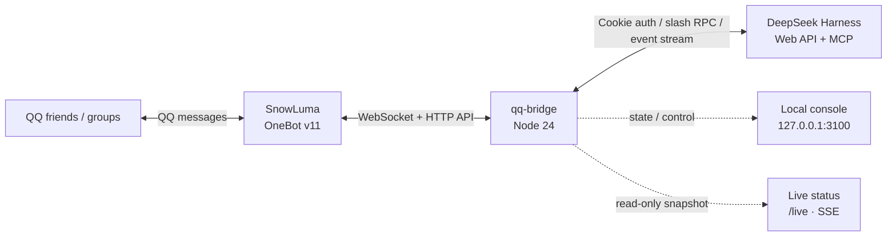
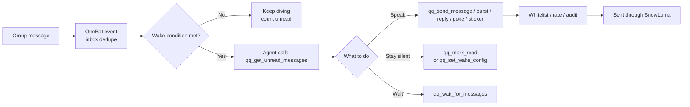

<p align="center">
  
</p>

<h1 align="center">xiaojingyu · qq-bridge</h1>

<p align="center"><b>Turn QQ into a chat entrance for DeepSeek Harness.</b><br>
Your group chats stay exactly as they are — behind them is an agent that reads,
waits, and decides for itself whether it is worth speaking up.</p>

<p align="center">
  
  
  
  
  
</p>

<p align="center">
  <a href="README.md">中文</a> ·
  <a href="docs/README.md">Docs</a> ·
  <a href="RULES.md">Rules</a> ·
  <a href="SECURITY.md">Security</a> ·
  <a href="UPSTREAM.md">Upstream</a>
</p>

> Connect QQ messages to DeepSeek Harness (DSH) agents: QQ friends/groups become DSH conversations, and agent replies (including questions and tool approvals) are sent back to QQ.

> ⚠️ **Development build (`0.0.0`, not released), targets DSH 0.2.0-rc.2** (verified item by item on that version; run `npm run verify:adaptation`). It uses the persistent local signing key to **mint the session Cookie offline**, slash RPC endpoints and the `/api/remote.mux` event stream — a protocol generation introduced in DSH `0.1.2-alpha.1`, incompatible with the older dot-endpoint protocol. Reading the launch token out of the old guard logs has not worked since DSH 0.1.7 (the token is generated per process and never written to disk). Agent presets are `@deepseek-ai/dsh-agent-preset` Cordis rows since DSH 0.1.7 (the `~/.dsh/.agent-presets/` directory mechanism is gone). On **DSH `0.1.1-rc.2` or earlier**, use tag [`v0.1.0`](https://github.com/Derpyu520/qq-bridge/releases/tag/v0.1.0); for **DSH 0.1.5-rc.1** use [`v0.1.5`](https://github.com/Derpyu520/qq-bridge/releases/tag/v0.1.5); for **DSH 0.1.7-rc.2** use [`v0.1.7`](https://github.com/Derpyu520/qq-bridge/releases/tag/v0.1.7).
>
> The tags above are **upstream releases** ([Derpyu520/qq-bridge](https://github.com/Derpyu520/qq-bridge)); this repository has no tags or releases yet and ships a `0.0.0` development snapshot.
>
> The default branch `main` **is** this version — a plain `git clone` gets it, no branch switching needed.

For the detailed documentation (all Chinese), start from **[docs/README.md](docs/README.md)**;
the repository/folder and script-naming conventions are in **[docs/FOLDER_MAP.md](docs/FOLDER_MAP.md)**.

## Architecture



- **QQ side**: `@snowluma/sdk` provides the OneBot v11 WebSocket client.
- **DSH side**: adapted for DSH 0.1.2+ and **re-verified on 0.2.0-rc.2** — session Cookie minted from the persistent local signing key, `/api/<namespace>/<method>` slash RPC, and `/api/remote.mux` + `session/follow` event stream (the pending queue is read from `value.projections[<id>].values.inbox`, with the unary `session/projections` RPC as the primary path). The per-session model is pinned by the bridge via `session.selectModel` from `config.json`'s `dsh.model` (default `deepseek-flash` = DeepSeek-V41-Flash, multimodal).
- **Agent tools**: three bundled MCP servers expose a restricted QQ toolset (`qq_status`, `qq_list_groups`, `qq_get_group_history`, `qq_send_group_message`, `qq_reply`, etc.), a read-only host probe (`snowluma_status` only), and a read-only `web_search` / `web_fetch` pair with SSRF protection.
  ⚠️ **`start_snowluma` / `stop_snowluma` (and `snowluma.allowProcessControl`) were removed in v0.1.5**: SnowLuma EULA §5.4 requires prior written permission to deploy its proprietary native components through automated scripts. This program only probes, never deploys — installing, starting and scanning SnowLuma is always up to you. See [NOTICE](NOTICE) and [RULES.md](RULES.md).
- **Console and live view**: a local web console at `http://127.0.0.1:3100` (13 task pages, cross-page search and a light / dark theme) plus the read-only `/live` SSE page.

## What it does

| Area | Concrete behaviour |
| --- | --- |
| **Group-chat simulation** | The agent reads unread messages, decides whether to speak, waits for the next wave, or keeps diving. 35 per-tool switches; wake triggers on @ / name / keyword / question / poke / probability; hard limits for sleep, rate, night silence and clingy follow-ups; per-group initial prompt and group profile. |
| **Live status page** | `/live` is a single-page SSE view: pixel whale and mood bubble, bonds, mood / energy with a 7-day curve, interests and growth, inner life, current activity, sessions, recent events, service health, cumulative tokens, long-term memory and libraries. Read-only; suited to a second monitor. |
| **Local console** | 13 task pages for mode switching, sessions and approvals, persona editing, tool switches, slang, libraries, cost, security, operations, reliability and tool reference; light / dark themes, responsive layout, cross-page search. |
| **Two prompt layers** | The **simulation prompt** owns the tool protocol and behaviour boundaries; the **persona prompt** owns character and voice. Role cards can be created, edited, renamed, duplicated and deleted, with per-mode filtering and an injection character cap. |
| **Memory and relationships** | Active topics, pending thoughts, member impressions and cross-session personal memory; relationship axes per member, daily-report preview, mood / energy / interest and inner-life timelines. |
| **Slang learning** | Candidates are extracted from group history; a human confirms meaning, usage, examples, risk and source before an entry enters the vocabulary. Confirmed entries are injected into the prompt and exposed through query / submit tools; thresholds and injection size are configurable. |
| **Multimodal expression** | Images, emoji and animated images enter the context; sticker notes, tags and image understanding; quote replies, pokes and burst sends; voice library with TTS emotion; inbound voice ASR transcription (off by default). |
| **Group insight** | Member relationship table with editable values, daily-report preview, active members and group profile; the daily report stays off until enabled. |
| **Reliability core** | SQLite/WAL; idempotent outbox with replay, inbox dedupe, job queue; messages queue per conversation while DSH is down and are replayed on recovery; `npm run doctor` health check. |
| **Cost dashboard** | Priced with DeepSeek's official peak / off-peak table; drill-down per group, friend and turn; cache-hit vs miss split; 24-hour / 3-day / 7-day / 30-day trend. |
| **Secure defaults** | An empty whitelist means no responses; simulation sessions have no local execution tools; sends require a whitelist hit plus sensitive-text audit; cross-session instructions require a confirmation code; internal errors never reach the group; `state/` can be ACL-hardened. |
| **DSH adaptation** | Session Cookie minted offline from the persistent `~/.dsh` signing key; slash RPC plus `/api/remote.mux` event stream; preset bundle patch; three restricted MCP servers; one-command `install-dsh.mjs` install. |

## Group-chat simulation

In `simulation` mode an incoming message **does not** trigger one automatic reply per message. The
bridge only delivers QQ events into DSH reliably; the agent then decides whether to look, whether to
speak, how many messages to send, or whether to keep diving.



### Tools the agent holds

- **Read**: unread queue, recent messages, one message in detail, message images, merged forwards,
  active members and its own recent sends (to avoid repeating itself);
- **Speak**: unified send, burst send, quote reply, poke, collect sticker, voice clip — intervals are
  spread out to feel human;
- **Wait**: `qq_wait_for_messages` waits briefly for new messages, returns immediately when one arrives,
  and returns on timeout so the agent can decide again;
- **Pacing**: `qq_set_wake_config` sets the next wake trigger (indefinite / at a time / @ / name / keyword /
  question / poke / probability), `qq_mark_read` means "seen but staying silent", and `qq_social_state`
  shows unread and wake state;
- **Memory**: `qq_memory_append` / `qq_memory_query` record topics, pending thoughts, member impressions
  and cross-session personal memory;
- **Slang**: `qq_slang_query` reads confirmed entries; `qq_slang_submit` hands unfamiliar expressions to
  the operator;
- **Life skills**: weather, rock-paper-scissors / dice / daily whale fortune, scheduled reminders
  (owner DM and family group).

The console's **Simulation** page turns every tool into an independent switch. Turning one off removes
it from the DSH tool list; voice, sticker, collection and send tools can each be disabled separately.

<p align="center">
  
  <br>
  <sub>Simulation page: tool switches, wake suggestions and hard limits, send limits (offline demo data)</sub>
</p>

### Pacing and boundaries

- **Wake hard limits**: minimum / maximum dive time, wakes per minute / hour, merge window, no-action
  fallback count, wake wrap-up reminders, forced wait before sleeping;
- **Night silence**: a configurable window in which no proactive message is sent;
- **Clingy follow-up**: when the owner does not answer a DM, a configured number of follow-ups are sent
  at configured intervals, never an unbounded loop;
- **Proactive checks**: after a long idle period a probability decides whether to start a topic, instead
  of a fixed-frequency push;
- **Per-group configuration**: initial prompt, group profile, style notes and whether proactive speech
  is allowed;
- **Send boundary**: every send hits the whitelist; sensitive paths, tokens and cookies are blocked by
  the audit layer; QQ / SnowLuma / DSH internal errors go to logs, never to the group.

## Live status page `/live`

<p align="center">
  
  <br>
  <sub>Read-only live status page (offline demo data); no real account is shown</sub>
</p>

`/live` is for people who want to keep an eye on what she is doing. It refreshes over SSE, needs no
manual reload, and offers no action that changes state:

- **The whale**: the pixel sprite changes with mood (wave / idle / excited / tired / pout), next to the
  current mood bubble;
- **Bonds**: relationship warmth with the owner and individual members, plus the latest interaction;
- **Mood / energy**: a two-axis mood compass, 7-day mood curve, energy bar and the cause of the current mood;
- **Interests / growth**: long-term interest weights, recent learnings, quirks and small habits;
- **Inner life**: what she plans to do next, pending thoughts and today's counts;
- **Activity**: whether she is diving, active, waiting or woken, and why;
- **Sessions and events**: phase, unread count and recent event stream for every group / DM;
- **Service health**: live state of the bridge, DSH and the SnowLuma upstream;
- **Usage**: token and cost summary;
- **Memory and libraries**: memory counts and sticker / image / voice library sizes.

The page has its own access token, listens on `127.0.0.1` by default, and reconnects automatically when
the SSE stream drops. It works well on a second monitor, a streaming overlay, or another device on the
same LAN.

## Local console

<p align="center">
  
  <br>
  <sub>Overview · light theme (offline demo data; the dark theme is in <a href="assets/screenshots/console-dark.png">console-dark.png</a>)</sub>
</p>

The console runs at `http://127.0.0.1:3100` and needs a token (generated into `state/console-token`
when none is configured). Its 13 pages each cover one kind of task:

| Page | What you can do |
| --- | --- |
| **Overview** | DSH / SnowLuma health cards, current mode and persona, pending questions and approvals, silence switch, DSH reasoning effort, recent 100 activity lines. |
| **Features** | Current capabilities grouped by persona, media, inner life, life skills and runtime; active groups, session count and boundaries. |
| **Sessions & approvals** | QQ ↔ DSH session mapping, phase and unread per session, questions and tool approvals waiting for the owner. |
| **Persona & roles** | Create / edit / rename / delete role cards, inspect and edit both prompt layers, injection cap, simulation-prompt sync state. |
| **Simulation** | 35 tool switches, wake recommendations and hard limits, initial prompt, group profile, memory and state viewers, tool-call log, feedback, voice and sticker settings. |
| **Group insights** | Member relationship table with editable values, daily-report preview, active members and group profiles. |
| **Library** | Names, descriptions, notes and tags for QQ favourite stickers and the image library; filter and inspect. |
| **Slang** | Candidate / confirmed / rejected columns; a confirmation dialog for meaning, usage, examples, risk and source; extraction thresholds and injection size. |
| **Usage & cost** | Total cost, cumulative tokens, cache hit rate, average per turn; drill-down by conversation and turn; 24-hour / 3-day / 7-day / 30-day trend. |
| **Access & security** | Allow / deny lists, owner QQ, console token, `state/` ACL warning and one-click re-check. |
| **Debug & operations** | Test message, notify the agent, maintain the bridge process, session workspace, cleanup and diagnostics. |
| **Reliability & config** | outbox / jobs / inbox queue state, retry failed items, edit configuration directly against the schema. |
| **Tool reference** | MCP tool list exposed to DSH, with parameters and purpose, grouped by namespace. |

Interface details:

- **Light / dark themes**: follows the OS preference first, remembers a manual choice afterwards;
- **Responsive**: desktop sidebar, tablet and phone switch to a top horizontal nav; tables scroll
  horizontally without page-level overflow;
- **Draft protection**: changing pages or a 3-second polling refresh does not discard unsaved form input;
- **Cross-page search**: type a feature or parameter name and jump to the page and control;
- **Accessibility**: keyboard focus rings, skip-to-content, decorative animation disabled under
  `prefers-reduced-motion`;
- **Fully offline**: no external fonts, CDN or analytics; `npm run preview:console` browses every page
  with synthetic data without DSH or QQ.

## Limitations

- Agent replies are sent once at the end of a turn, not streamed token by token; long replies are split
  at sentence / URL boundaries;
- Images, stickers and merged forwards enter the multimodal context; inbound voice is transcribed only
  when `simulation.speech.asr.enabled` is on (off by default, otherwise a placeholder is shown); video
  messages currently show a placeholder;
- **AI voice is off by default** (`simulation.voice.enabled` and `tools.sendVoice` are both `false`):
  put audio into `audio/`, then enable it in the console. Sample clips live in
  [`assets/voice/`](assets/voice/);
- Agent Markdown replies are converted to plain text before sending (links keep the `text (url)` form);
- Windows 10 / 11 only: both QQ and SnowLuma are Windows programs;
- Only `simulation` / `closed-agent` are first-class modes; earlier `chat` / `reserved` need a
  `qq-chat-legacy` preset that is not shipped.

## Requirements

- Node.js >= 22.13
- Running DeepSeek Harness Web (default `http://127.0.0.1:3080`)
- Running SnowLuma with OneBot v11 WebSocket and HTTP API enabled

## Quick Start

```bash
npm install        # postinstall automatically patches the @snowluma/sdk ESM packaging bug
```

Copy `config.example.json` to `config.json`, then edit:

```bash
cp config.example.json config.json
```

Key settings:

| Field | Description |
| --- | --- |
| `dsh.baseUrl` | DSH Web API URL, default `http://127.0.0.1:3080` |
| `dsh.authToken` | DSH launch token (a process-launch credential). **Normally leave this empty**: with no token the bridge mints the session cookie offline from the persistent signing key in `~/.dsh/.credentials.yaml`, which depends on no per-process state (since DSH 0.1.7 the launch token lives only in memory — the one in the old logs belongs to a previous process and only yields a 401). A value here is honoured first if you set one |
| `dsh.authHeader` / `dsh.authPrefix` | Legacy fields kept for compatibility; the current path uses Cookie auth and does not send this header |
| `snowluma.wsUrl` | SnowLuma OneBot **WebSocket** URL (e.g. `ws://127.0.0.1:3001`) |
| `snowluma.accessToken` | OneBot access token, leave empty if not configured |
| `snowluma.httpUrl` | OneBot **HTTP API** URL (e.g. `http://127.0.0.1:3000`); do not point this at the WebSocket port or you will get HTTP 426 |
| `ownerQQ` | Administrator QQ (highest privilege) |
| `allow.private` / `allow.groups` | Whitelist of QQ/group IDs |
| `consolePort` | Local console port, default `3100` |

Start:

```bash
npm start
```

Or double-click `bin/boot.cmd` on Windows (guard mode with auto-restart).

## DSH Setup on Another Device

The bridge and console can run without extra DSH setup, but the DSH chat preset (`qq-chat`) and the MCP servers must be installed into DSH once per machine:

```bash
node tools/install-dsh.mjs
```

This installs:

- the `agent-presets` bundle, which generates the `@deepseek-ai/dsh-agent-preset` row (`qq-chat`) plus the shared `qq-tool-restrict` safety guard
- MCP entries in `~/.dsh/profiles/web/cordis.patch.yml`
- `mode-console` and `agent-presets` in the profile `package.json` (`bundles` + `link:` dependencies)
- Default DSH mode set to `simulation`, with a local `state/mode.json` fallback

Then restart DSH. See [docs/guides/DSH_SETUP.md](docs/guides/DSH_SETUP.md) for details.

## Security Notes

- `config.json` and `state/` are **never committed**; the repository only ships `config.example.json`. Both are ACL-hardened to the owner / SYSTEM / Administrators (`npm run harden-acl`).
- MCP send tools enforce whitelist checks and reject CQ-code injection.
- Local paths, credentials, tokens and other sensitive patterns are filtered by the audit layer.
- Simulation sessions get **no local execution tools at all**: the preset's `qq-tool-restrict` row hides them from the tool schema at registration time and a runtime allowlist rejects anything outside the QQ MCP namespaces (`npm run scan:tool-names` re-checks that list against the installed DSH).
- The console uses a generated token when none is configured.
- Found a security issue? Report it privately per [SECURITY.md](SECURITY.md) — please do not open a public issue.

## Repository Layout

```
xiaojingyu/
  config.example.json   # sanitized config template (real config.json is not in repo)
  app/                  # process entry points (whale.js, self-check.js)
  runtime/              # kernel / persona / sharing / control / orchestration
  services/             # persona, media and social capabilities
  channels/             # QQ (SnowLuma OneBot) and DSH adapters
  mcp/                  # the three MCP servers
  console/              # console server side (auth, /live, policy)
  features/             # pluggable features (daily report, rich cards)
  web/                  # deck.html console, live.html status page, assets/
  personas/             # persona cards
  integrations/dsh/     # preset source, agent-presets bundle, mode-console plugin
  docs/
    README.md           # documentation index (published docs only)
    FOLDER_MAP.md       # folder layout and tools/tests naming conventions
    guides/             # user/operator facing: DSH_SETUP, DSH_ADAPTATION, SECURITY_BASELINE,
                        # RELIABILITY, TOKEN_USAGE_CONSOLE, CONSOLE-UI-TESTING, PRIVACY
  tools/                # operations, build and test helper scripts
  tests/                # automated tests and baseline fixtures
  bin/                  # Windows launchers (boot.cmd / reboot.cmd)
  assets/               # README banner, screenshots (offline demo data) and voice/ (two sample clips)
  state/                # runtime data (not in repo)
```

Design/audit/research/legacy documents, the full project guide and the voice-tool notes are **not published** with this
repository (they were written on a real machine and contain local paths and account identifiers); see
[docs/README.md](docs/README.md) for what is included.

The standalone **voice sender tool** (`voice-cli.mjs`, `voice-gui.mjs`, `public/voice.html`) is **not part of this
repository**; it reuses this repo's `services/media/voice-core.js` / `channels/qq/gateway.js` as the shared implementation.

## Testing

`npm run test:audit` runs isolated regression tests without production credentials, DSH, or QQ messages. Security
boundaries and the current threat model are documented in [docs/guides/SECURITY_BASELINE.md](docs/guides/SECURITY_BASELINE.md);
reliability mechanics (SQLite/WAL, outbox, inbox, jobs, doctor) are in [docs/guides/RELIABILITY.md](docs/guides/RELIABILITY.md).

After upgrading, legacy QQ session mappings without permission metadata are recreated once. Mode or preset changes also retire the old mapping and recreate the session on the next message; DSH history is retained.

```bash
npm run test:audit      # offline regression suite (CI main job)
npm run test:console-ui # offline browser regression for the console
npm run self-test       # DSH-side link test (creates an isolated test session)
npm run verify          # schema + console contracts + all core / stage / audit tests
npm run test-md
npm run test-wait
npm run test-vision
npm run test-forward
npm run test-slang
npm run test-stickers
```

## Upstream and License

This project started from the MIT-licensed [Derpyu520/qq-bridge](https://github.com/Derpyu520/qq-bridge)
(baseline `v0.2.0-r4`); thanks to its authors and contributors for the bridge skeleton. On top of that,
this repository has been substantially rewritten and extended with:

- a **group-chat simulation engine**: unread queue, wake triggers (@ / name / keyword / question / poke /
  probability), a short `qq_wait_for_messages` wait, burst sends, night silence, clingy follow-ups,
  per-group initial prompts and group profiles, and 35 MCP tool switches;
- a **read-only live page** (`/live`, SSE) showing mood, energy, bonds, interests, inner life, sessions,
  events, health, tokens and memory;
- a **local web console** with 13 task pages, light / dark themes, responsive layout, draft protection
  and cross-page search;
- a **reliability kernel**: SQLite/WAL, idempotent outbox with replay, inbox dedupe, job queue and
  doctor diagnostics;
- a **cost dashboard** priced with DeepSeek's peak / off-peak table, with per-group / friend / turn
  drill-down and 24-hour to 30-day trends;
- **DSH 0.2.0 adaptation**: slash RPC, the `/api/remote.mux` event stream, preset bundle patch and
  offline Cookie minting;
- **safety boundaries**: preset tool guards, send allowlists, reply auditing and voice-library limits.

The upstream name, copyright lines and MIT license are preserved in [LICENSE](LICENSE); see
[UPSTREAM.md](UPSTREAM.md) for the fork point and sync rules, and [NOTICE](NOTICE) for third-party
components. This repository has no tags or releases yet and ships a `0.0.0` development snapshot.

## Compliance

SnowLuma is an independent third-party project and is not affiliated with Tencent/QQ. This project is for learning and technical research only; please follow the relevant terms and the QQ User Agreement.
