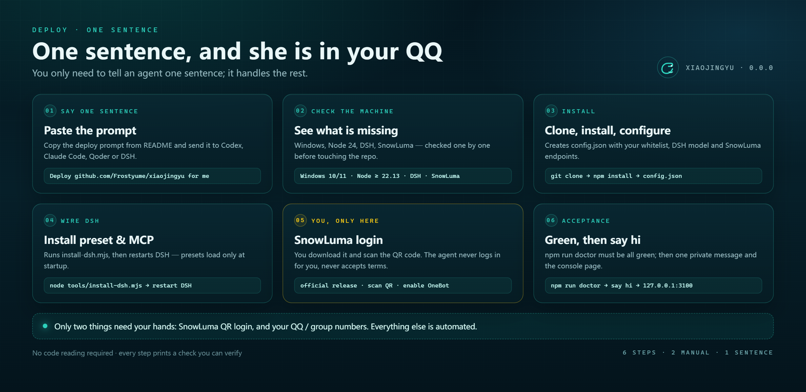
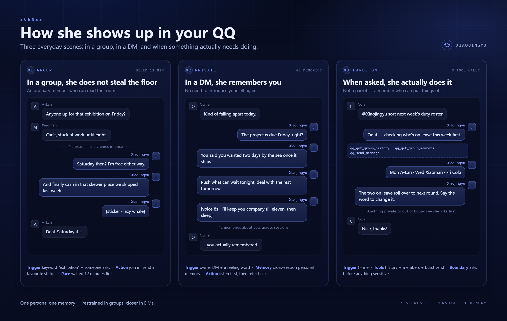
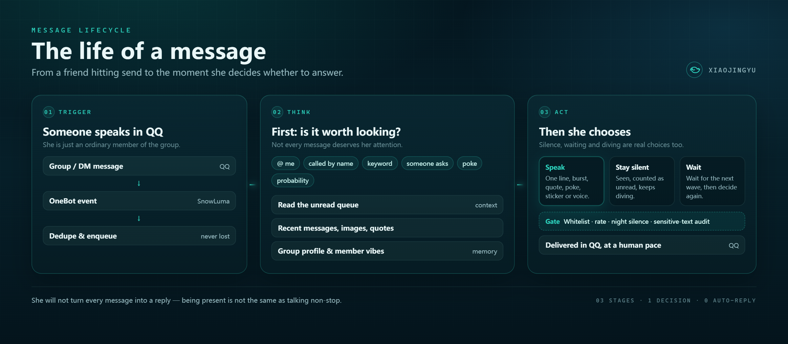
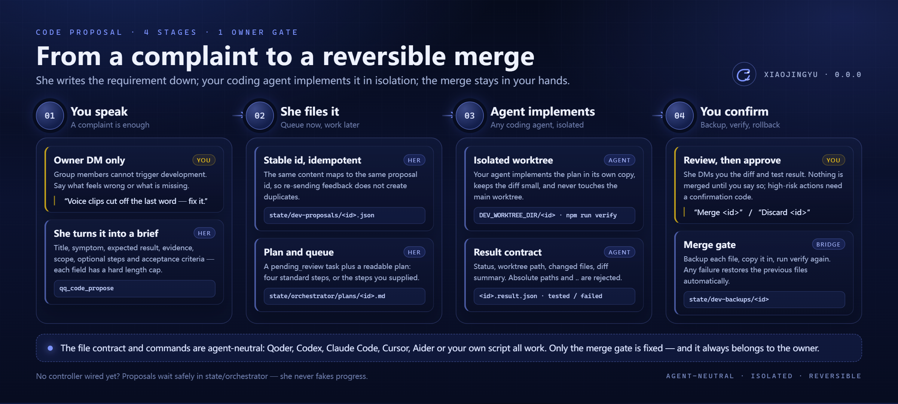
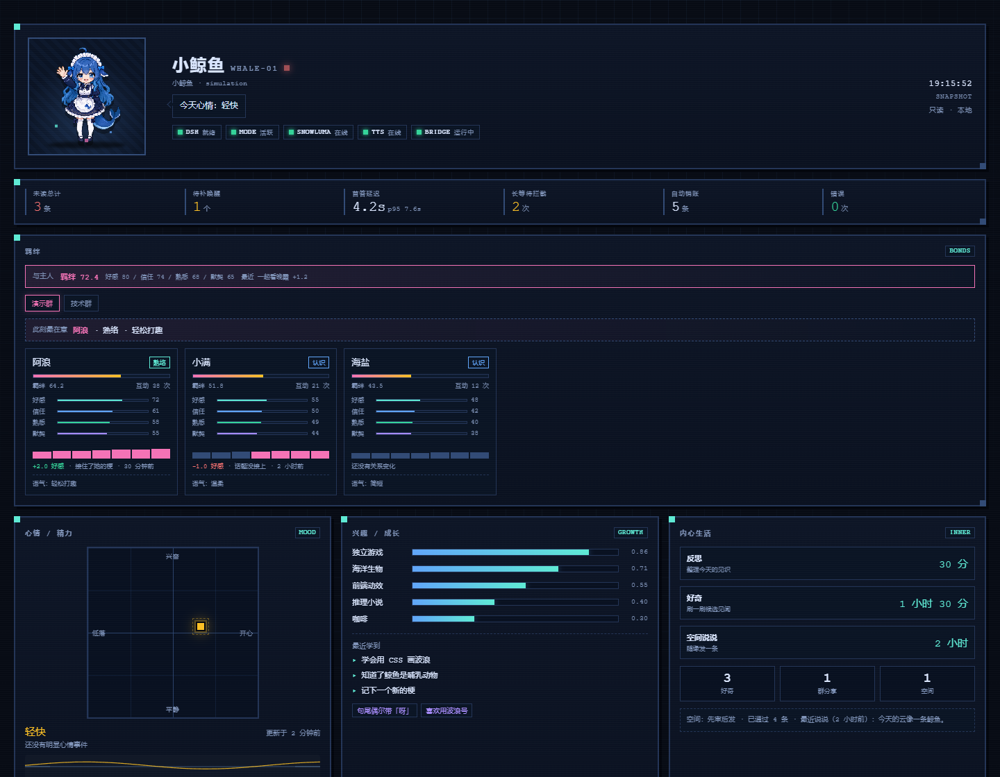
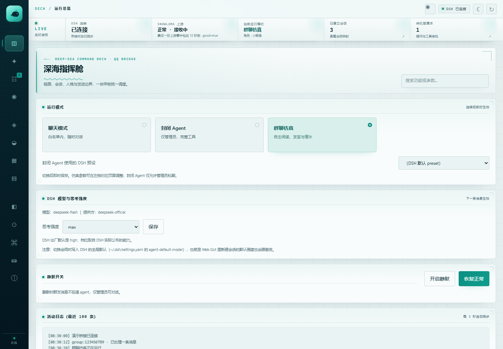
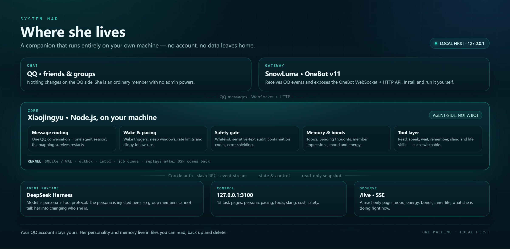

  

<h1 align="center">Xiaojingyu</h1>

<b>A companion AI that lives in your QQ.</b> 
She is present the way a friend is: she reads the room, picks her moment, remembers what you told her,
and actually does things when you ask.

  
  
  
  
  

  <a href="https://github.com/Frostyume/xiaojingyu">GitHub</a> ·
  <a href="https://gitee.com/frostyume/xiaojingyu">Gitee mirror</a> ·
  <a href="README.md">中文</a> ·
  <a href="docs/README.md">Docs</a> ·
  <a href="RULES.md">Rules</a> ·
  <a href="SECURITY.md">Security</a> ·
  <a href="UPSTREAM.md">Upstream</a>

> [!NOTE]
> Current version **v1.0.0**, verified item by item against **DSH 0.2.0-rc.2**
> (`npm run verify:adaptation`). This is the first stable release of this repository; the
> `v0.1.x` / `v0.2.x` tags belong to upstream
> [Derpyu520/qq-bridge](https://github.com/Derpyu520/qq-bridge) and are unrelated to this project.

**Contents**

- **Meet her**: [Who she is](#who-she-is) · [Why she is not just a chat window](#why-she-is-not-just-a-chat-window) · [Scenes](#scenes) · [Life of a message](#life-of-a-message) · [A life of her own](#a-life-of-her-own)
- **Install her**: [Quick deploy](#quick-deploy-no-coding-required) · [Manual deployment](docs/guides/MANUAL_DEPLOY.md) · [Run modes](docs/guides/MANUAL_DEPLOY.md#run-modes) · [Make her yours](#make-her-yours)
- **Watch her**: [Live status page /live](#live-status-page-live) · [Local console](#local-console) · [Architecture](#architecture)
- **Capabilities and boundaries**: [Code proposals](#code-proposals-ask-her-to-fix-or-build-something-in-a-dm) · [Capability map](#capability-map) · [Full capability list](docs/guides/CAPABILITIES.md) · [Security notes](#security-notes) · [Limitations](#limitations)
- **Going deeper**: [Troubleshooting](docs/guides/TROUBLESHOOTING.md) · [Compatibility and extending](docs/guides/EXTENDING.md) · [Documentation](#documentation) · [Repository layout](docs/FOLDER_MAP.md) · [Upstream and license](#upstream-and-license)

## Who she is

Xiaojingyu lives in a QQ account. You can find her in group chats and in DMs.

She does not answer every message. Most of the time she is just watching: who is talking, what the
mood is, whether she has anything worth adding. When she does speak, she remembers what you mentioned
last week, and when you say "kind of falling apart today" she asks whether the project is still due
Friday.

There is no new app to install and no habit to change. Your friends keep chatting as usual; she is the
member who occasionally surfaces and sounds like a person.

| She has | She does not |
| --- | --- |
| A persona: two prompt layers, one for behaviour boundaries and one for character and tone, both editable in the console | Take over the account: she is an ordinary member with no admin powers |
| Memory: topics, pending thoughts, member impressions, cross-session memory, all viewable and deletable | Flood the chat: wake rate, night silence and clingy follow-ups all have hard caps |
| Pacing: she decides whether to look, wait, speak or keep diving | Reach your machine: no amount of prompting gives group members local tools |
| A toolbox: read, speak, stickers, search, reminders, each switchable | Run its own cloud: local components stay on `127.0.0.1`; messages still go through DSH to the model you choose (see the data-egress list in [NOTICE](NOTICE)) |

A few things she does not do:

- QQ injection and SnowLuma deployment are SnowLuma's own business; she only talks to its OneBot
  endpoints;
- messages only go to people on the allowlist, and there are no mute, kick, upload or download actions;
- when something breaks the group gets one plain sentence; the raw error stays in the logs;
- voice is off by default; turn it on in the console.

## Why she is not just a chat window

Most AI chats are disposable: one message in, one reply out, and everything resets when you close the tab.
Xiaojingyu lives inside QQ, closer to a member who has been in the group for a long time.

A thread you started in a group today can continue in a DM tomorrow, with no recap. She also does not
pop up for every message: rules first discard what is not worth waking her for, then she decides whether
to look up. What you see is "she happened to be there"; what you do not see is that most of the time she
stays quiet.

She keeps a schedule of her own, too. She reflects, browses out of curiosity, settles down late at night
and sets her own next wake-up. With the supervisor window open she stays online: crashes restart her,
drops reconnect, and undelivered messages replay in order. All of it runs on your machine.

| What you face | What is underneath |
| --- | --- |
| One her, in one group | One isolated context per group and per DM, so nothing bleeds across |
| A sentence in plain language | Deterministic rules first, semantic judgement second |
| She remembers you | Cross-chat memory, topics and summaries fetched by relevance |
| She is always there | Process supervision, reconnects, queued replay |

## Quick deploy (no coding required)

  
   
  Three phases: prepare the environment → hand it to an agent → sign in and accept

You do not need to understand Node, DSH or OneBot. Deployment has just three phases:
**prepare an agent, hand it one sentence, then scan the QR code and accept.** Follow the order below;
every step has a clear success marker.

### Phase 1: prepare three things

| What | How | Success marker |
| --- | --- | --- |
| **A Windows PC + a QQ account** | Windows 10 / 11; QQ can log in normally | — |
| **DeepSeek Harness (DSH)** | Install it from the official channel and start it. DSH is her actual "brain" | `http://127.0.0.1:3080` opens in a browser |
| **An agent that can run commands** | Codex, Claude Code, Qoder or DSH — anything that can read/write files and run commands | You can create a project in it and have it run a command |

> Only DSH needs to be installed by you; Node.js, Git, dependencies, config and presets are the agent's job.
> If DSH is not running yet, finish that first — every later step depends on it.

### Phase 2: send this sentence to the agent

> Deploy <https://github.com/Frostyume/xiaojingyu> for me on Windows (use the Gitee mirror
> <https://gitee.com/frostyume/xiaojingyu> if GitHub is slow). Read
> `docs/guides/AGENT_DEPLOY.md` in the repository first and follow it exactly: check the environment,
> install dependencies, write the config, run `install-dsh` and `doctor` until everything passes.
> Except for signing in to SnowLuma by QR code and providing my QQ number / group numbers, do
> everything yourself. Do not print or upload anything from `config.json` or `state/` — no tokens,
> cookies or account numbers.

It will check the environment, clone the repository and install dependencies, then **ask you four
questions in order**:

| # | Question | What to answer | Example |
| --- | --- | --- | --- |
| 1 | What is the owner QQ number? | The single owner the bot recognises | `12345678` |
| 2 | Which QQ accounts and groups are allowed? | At least one of each; an empty whitelist means she **answers nobody** | DM `12345678`, group `87654321` |
| 3 | SnowLuma ports and token? | Defaults are WS `3001`, HTTP `3000`; leave the token empty if unset | `ws://127.0.0.1:3001` |
| 4 | Which model? | A model name that actually exists in your DSH | Check your DSH model list |

The only part it will hand back to you is SnowLuma — that is phase 3.

### Phase 3: sign in yourself, then accept

**Only two things require your own hands**, because SnowLuma's licence does not allow scripts to
install, sign in or start it:

1. **Install SnowLuma and sign in by QR code.** Download
   `SnowLuma-v<version>-win-x64.zip` from [SnowLuma Releases](https://github.com/SnowLuma/SnowLuma/releases/latest),
   unzip it, run `launcher.bat`, open the WebUI address from the launch log, accept the terms, set a
   password, scan the QQ QR code, then enable **WebSocket server** and **HTTP API** in the WebUI.
2. **Tell the agent your QQ number / group numbers / ports / token** so it can write `config.json`.

The agent then installs the DSH preset and MCP servers, **fully restarts DSH** (not a page refresh),
starts the bridge and runs the health check. When you see `SnowLuma 已连接` in the log, send a private
message to the bot from a whitelisted QQ account.

**Acceptance checklist (all boxes must be ticked):**

- [ ] `npm run doctor` has no `[FAIL]`; DSH / SnowLuma / preset / ports are all OK;
- [ ] the log says `SnowLuma 已连接`;
- [ ] a whitelisted private chat gets a reply;
- [ ] `http://127.0.0.1:3100` opens and the overview shows both services healthy;
- [ ] `http://127.0.0.1:3100/live` shows her status page;
- [ ] no test message was sent to any group (a private chat is enough).

### The first hour after deployment

1. Open **Persona & roles** in the console, confirm the card is Xiaojingyu, and read both prompt layers;
2. Open **Group Theatre** and tune wake rate, night silence and tool switches;
3. **Allow only one group and one friend first**, observe for a day, then widen the whitelist;
4. Try `内心状态` and `跑一次分享` in a private chat to sample her inner-life features;
5. Back up `config.json`, `state/` and `personas/` — take them with you when changing machines.

### If it gets stuck

Paste the agent's full "where it stopped / the raw error / what it already tried" back to it and let
it continue from the troubleshooting table in [AGENT_DEPLOY.md](docs/guides/AGENT_DEPLOY.md).
**Do not** let it delete `state/`, disable the whitelist or turn off authentication to get past a
problem — that is not a fix, it is just opening the door.

> Prefer to do it yourself? [Manual deployment](docs/guides/MANUAL_DEPLOY.md) runs the same flow step by step.

## Make her yours

Xiaojingyu is just the default card that ships with the repository. Her name, temperament, way of
speaking and how she carries herself in each group are yours to change.

1. **Know the two layers first.** The *persona prompt* defines who she is — identity, character,
   tone, sore spots. The *simulation prompt* defines how she works — tools, message splitting,
   diving and waking. When changing the character, edit only the former.
2. **Change the character.** Copy `personas/小鲸鱼.md` to `personas/<new-name>.md` and rewrite it,
   or create a card in the console under **Persona & roles**. Then select it in the console, or say
   `进入角色扮演：<name>` in a group to switch.
3. **Give each group its own manners.** In **Group Theatre**, write a per-group initial prompt,
   group profile and style note, so she does not sound the same everywhere.
4. **Verify in small steps.** Talk to her in a DM first, then put her in one group for a day. Edit
   the file or save in the console and the next message picks it up — no DSH restart needed.

Keep the persona card about character only, not tool usage; and keep the behaviour boundaries
(no overreach, no flooding, no impersonation). Templates, per-mode injection and character limits
are in [personas/README.md](personas/README.md); the mechanics are in the
[full capability list](docs/guides/CAPABILITIES.md).

## Scenes

  
   
  Three everyday scenes (illustrative dialogue): picking her moment, remembering you, getting things done

**① In a group, she does not steal the floor.**
Out of a few hundred messages a day she only looks up when she is called, asked, or when the topic
lands somewhere she knows. Seven unread, one line back is enough; if she has nothing to add she keeps
diving. She knows who jokes around in this group and who is busy this week, so her reply does not read
like a weather report.

**② In a DM, she remembers you.**
"Kind of falling apart today" needs no recap. She knows the project is due Friday and that you wanted
two days by the sea afterwards. That is not re-asked every time; it is memory kept across sessions,
and you can browse, edit or delete any of it in the console.

**③ When asked, she actually does it.**
Duty rosters, research, reminders, tidying up chat logs: she reads group history, checks members,
searches when needed, then sends the result as a few short messages. Anything private or out of bounds
gets a question first, not an action.

**④ If something is off, just tell her in a DM.**
"Voice clips cut off the last word, fix it." "Can you add a Monday-morning group digest?" She turns
the request into a code proposal and queues it for the development side; your own coding agent
implements and tests it, reports the diff back to you, and only merges after your explicit
confirmation. Full flow and how to connect any agent:
[Code proposals](#code-proposals-ask-her-to-fix-or-build-something-in-a-dm).

More everyday jobs:

| Everyday need | What she does |
| --- | --- |
| A wake-up call | A scheduled reminder in her own voice, not a system notification |
| The group goes quiet | After a long idle period a probability decides whether to start a topic, not a fixed push |
| Someone posts an image or sticker | Images enter the multimodal context; the sticker library has notes and tags |
| You want to hear her | Voice library + TTS emotion; she can only speak clips in `audio/` (off by default) |
| New slang appears | Candidates are extracted; she only uses an entry after you confirm meaning, usage and risk |
| You want to see what she is up to | `/live` on a second monitor: mood, energy, bonds, inner life, current activity |
| You want her to remember something | Say it once — it goes into cross-session memory, and you can delete it any time |

## Life of a message

In `simulation` mode (the default), an incoming message does not immediately become a model call. It
passes two very different gates.

**The first gate is deterministic and costs no tokens.** The allowlist decides whether it may be seen at
all; wake conditions decide whether it is worth waking her — @, name, keyword, question, poke,
probability. Explicit commands such as `/reset` or a pending approval take a fast path and never reach
the model. Most group chatter simply lands in the unread queue.

**The second gate is semantic.** Only a matching message wakes her, and even then she does not process
messages one by one: messages within an 8-second window merge into a single wake, and a busy session
carries at most one batch of 12 unread messages / 6,000 characters. She reads a snapshot, then decides
to reply, wait, mark as read, or keep diving.

**Only then comes speech.** Her reply does not go straight out. It returns to the shared exit, passes the
allowlist and audit again, is split, rate-limited and paced like a person, and only then appears in QQ.

  
   
  Trigger → think → act: before deciding what to say, she decides whether to speak at all

So a message goes through five steps here: receive, two gates, merge, act, one exit. Whether she speaks
at all, and how much, is still her call.

Her 35 tools, wake rules and send limits are listed in the
[full capability list](docs/guides/CAPABILITIES.md).

## A life of her own

She is there when the room is quiet, too. She reflects, gets curious, finds something worth sharing,
and settles down late at night.

- **Scheduled reflection**: looks back over recent chats and relationships, then updates mood, energy,
  interests and verbal tics;
- **Curious browsing**: forms candidate findings from the sources you configure; whether to share them
  is a separate decision;
- **Mood has inertia**: mood decays against real time and energy follows Beijing time, so one sentence
  cannot flip her from happy to broken;
- **Sharing has caps**: group shares, Qzone posts and share modules all obey daily counts, intervals
  and night silence.

You can steer all of it from a DM: `内心状态`, `跑一次分享`, `反思一下`, `发` / `不发`,
`验证通过 <id>`. The full command table, example frequencies and probation rules are in
[Inner life and proactive sharing](docs/guides/INNER_LIFE.md).

## Code proposals: ask her to fix or build something in a DM

She does not write code herself. What she can do is turn a complaint into an actionable development
task, hand it to **your own coding agent**, and follow the whole chain — implement → test → your
confirmation → merge → rollback on failure.

Four steps: you state the need → she files a proposal → an agent implements in an isolated copy → you confirm the merge

She first breaks the request into a proposal with symptom, expected result, evidence and acceptance
criteria, derives a stable id from a content hash, and writes it into `state/dev-proposals/` and
`state/orchestrator/`. Your agent implements it in an isolated copy and runs `npm run verify`. When you
reply "merge `<id>`", the bridge backs up each file, copies, runs `verify` again, and rolls back
automatically on failure. She only records, queues and reports: she does not create development
sessions, write application code or merge, and nobody in a group chat can trigger it.

The repository ships a Qoder wake-up adapter, but Codex, Claude Code, Cursor, Aider or your own script
can run the same loop. Full flow, three sample DM receipts, the agent contract and common traps are in
[the code proposal guide](docs/guides/CODE_PROPOSAL.md).

## Capability map

### Say it once, she files the improvement

She does not edit code directly. She turns your sentence into a **proposal with symptom, expected
result, evidence and acceptance criteria** and queues it for development; your own coding agent does
the implementation, and the merge stays in your hands.

### She decides whether to speak

There is no "message in, reply out" loop. Every message enters an unread queue, and she weighs wake
triggers, night silence, rate caps and current energy to decide: look now or not, speak or not, how
many lines, or keep diving. All 35 tools can be switched off one by one; a disabled tool disappears
from her tool list instead of being rejected at call time.

### Memory, and a schedule of her own

She keeps topics, pending thoughts, member impressions and cross-session personal memory — all
viewable, editable and deletable in the console. When the room is quiet she does not stop existing:
scheduled reflection, curious browsing, and mood / energy that evolve in real time, with daily caps,
intervals and quiet hours governing what she shares.

The tool list, pacing boundaries, capability tables and secure defaults are in the
[full capability list](docs/guides/CAPABILITIES.md).

## Live status page `/live`

  
   
  Read-only live status page (offline demo data); no real account is shown

Put it on a second monitor to watch her mood, energy, bonds, interests, inner life and current
activity, plus unread counts and activity for every session. Read-only, refreshed over SSE, its own
token, listening on `127.0.0.1` by default. Panel-by-panel details are in
[the console guide](docs/guides/CONSOLE.md).

## Local console

  
   
  Overview · light theme (offline demo data; the dark theme is in <a href="assets/screenshots/console-dark.png">console-dark.png</a>)

It runs at `http://127.0.0.1:3100` and has 13 task pages: overview, features, sessions and approvals,
persona and roles, Group Theatre, group insights, library, slang, usage and cost, access and security,
debug and operations, reliability and config, and tool reference. Light / dark themes, responsive
layout and draft protection, with no external fonts or analytics. Page-by-page details are in
[the console guide](docs/guides/CONSOLE.md).

## Architecture

  
   
  Where she lives: every hop stays on your own machine

The whole path has just two roles. **The wiring layer** receives QQ events, applies the allowlist and
wake admission, merges messages that arrive close together, keeps the session map and memory, and owns
every outgoing message. **The thinking layer** (the DSH agent) wakes inside an isolated context, reads
messages, queries memory and decides what to say; its result returns to the wiring layer and leaves
through the same exit.

So sessions are an implementation detail: you deal with "her, in this group". Why it is split this way
and how context is spent as a budget are covered in
[architecture and design trade-offs](docs/ARCHITECTURE.md).

## Security notes

- **Group members have no local power**: the `qq-chat` preset mounts no bash / file access /
  sub-agents / workflows, so no amount of prompting reaches the machine;
- **QQ actions are a safe subset**: only three MCP namespaces plus `ask_user_question` /
  `todo_write`; every send must match the allowlist, and voice can only use files in the library;
- **Risky actions need confirmation**: cross-session sends and sensitive operations require
  `/确认 <6-digit code>` in the owner DM;
- **Persona is injected bridge-side**: the card comes from `personas/` and the console, so a group
  member asking her to change persona has no effect;
- **Internal errors never reach the group**: raw DSH / SnowLuma / QQ errors stay in logs and
  `GET /api/status`;
- **No secrets in the repository**: real `config.json`, `state/` and `audio/` are never committed;
  only a sanitised template ships.

The data-egress list and privacy switches (for example, slang learning sends candidates to a search
backend and can be turned off) are in [docs/guides/PRIVACY.md](docs/guides/PRIVACY.md); permission
boundaries are in [RULES.md](RULES.md). Found a security issue? Report it privately per
[SECURITY.md](SECURITY.md) — please do not open a public issue.

## Limitations

- Windows 10 / 11 only; single-machine deployment with no cross-device sync;
- agent replies are sent once at the end of a turn, not streamed token by token;
- there are no topic-level execution sessions, so several topics in one group share a single context;
- there is no task-level progress supervision — only process / port / lease probes and a "no action"
  counter.

The full list (inbound voice, video messages, voice defaults, Markdown to plain text and more) is in
[troubleshooting and limitations](docs/guides/TROUBLESHOOTING.md#limitations).

## Documentation

| Doc | What it covers |
| --- | --- |
| [docs/README.md](docs/README.md) | Documentation index (one line per page) |
| [docs/guides/AGENT_DEPLOY.md](docs/guides/AGENT_DEPLOY.md) | Quick deploy: the agent's steps, boundaries, acceptance and rollback |
| [docs/guides/MANUAL_DEPLOY.md](docs/guides/MANUAL_DEPLOY.md) | Manual deployment in six steps, and run modes |
| [docs/guides/TROUBLESHOOTING.md](docs/guides/TROUBLESHOOTING.md) | Troubleshooting and limitations |
| [docs/guides/CAPABILITIES.md](docs/guides/CAPABILITIES.md) | Full capability list, tools and pacing boundaries |
| [docs/guides/CODE_PROPOSAL.md](docs/guides/CODE_PROPOSAL.md) | Code proposal loop and connecting any agent |
| [docs/guides/INNER_LIFE.md](docs/guides/INNER_LIFE.md) | Inner life, proactive sharing and DM commands |
| [docs/guides/CONSOLE.md](docs/guides/CONSOLE.md) | `/live` and the console, page by page |
| [docs/ARCHITECTURE.md](docs/ARCHITECTURE.md) | Architecture, design trade-offs and context budget |
| [docs/guides/EXTENDING.md](docs/guides/EXTENDING.md) | Compatibility matrix, extension points and development loop |
| [docs/guides/DSH_SETUP.md](docs/guides/DSH_SETUP.md) | DSH-side install: preset, MCP, restart |
| [docs/guides/DSH_ADAPTATION.md](docs/guides/DSH_ADAPTATION.md) | DSH 0.2.0-rc.2 adaptation notes |
| [docs/guides/SECURITY_BASELINE.md](docs/guides/SECURITY_BASELINE.md) | Security baseline and Windows ACL |
| [docs/guides/RELIABILITY.md](docs/guides/RELIABILITY.md) | outbox / queue / retry mechanics |
| [docs/guides/TOKEN_USAGE_CONSOLE.md](docs/guides/TOKEN_USAGE_CONSOLE.md) | Cost dashboard pricing and method |
| [docs/guides/CONSOLE-UI-TESTING.md](docs/guides/CONSOLE-UI-TESTING.md) | Console offline regression and preview |
| [docs/guides/PRIVACY.md](docs/guides/PRIVACY.md) | What leaves the machine, privacy switches |
| [docs/FOLDER_MAP.md](docs/FOLDER_MAP.md) | Folder layout and script naming conventions |
| [RULES.md](RULES.md) | Permission boundaries for QQ sessions |
| [SECURITY.md](SECURITY.md) | Vulnerability reporting |
| [UPSTREAM.md](UPSTREAM.md) | Fork point and sync rules |
| [NOTICE](NOTICE) | Third-party components and licenses |

## Upstream and license

This project started from the MIT-licensed [Derpyu520/qq-bridge](https://github.com/Derpyu520/qq-bridge)
(baseline `v0.2.0-r4`). The upstream name, copyright lines and MIT license are preserved; see
[UPSTREAM.md](UPSTREAM.md) for the fork point and sync rules.

Both this repository and upstream are released under MIT. Thanks to Derpyu520/qq-bridge,
[SnowLuma](https://github.com/SnowLuma/SnowLuma) and DeepSeek Harness; third-party components and
licenses are listed in [NOTICE](NOTICE).

SnowLuma is an independent third-party project and is not affiliated with Tencent/QQ. This project is
for learning and technical research only; please read SnowLuma's EULA and the QQ User Agreement before
use.
