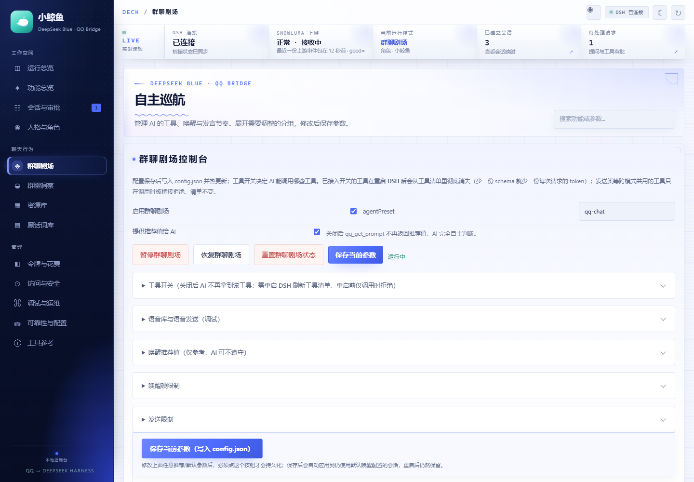
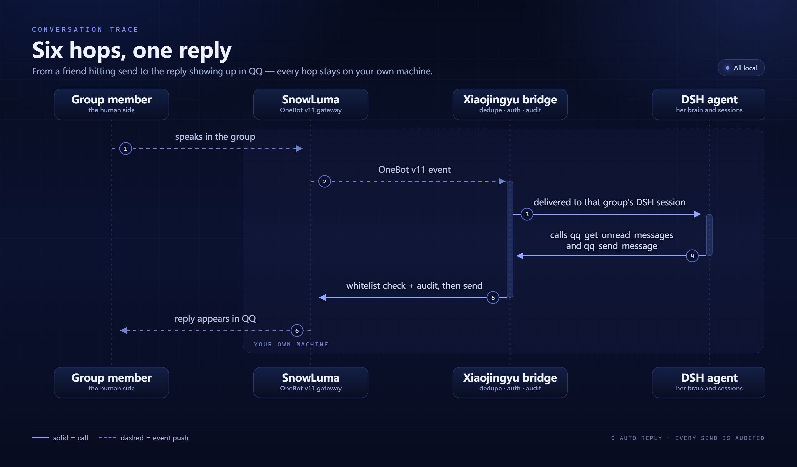

<p align="center">
  
</p>

<h1 align="center">Xiaojingyu</h1>

<p align="center"><b>A companion AI that lives in your QQ.</b><br>
She is present the way a friend is: she reads the room, picks her moment, remembers what you told her,
and actually does things when you ask.</p>

<p align="center">
  
  
  
  
  
</p>

<p align="center">
  <a href="README.md">中文</a> ·
  <a href="docs/README.md">Docs</a> ·
  <a href="RULES.md">Rules</a> ·
  <a href="SECURITY.md">Security</a> ·
  <a href="UPSTREAM.md">Upstream</a>
</p>

> ⚠️ **Development build (`0.0.0`, not released), targets DSH 0.2.0-rc.2** (verified item by item on that version; run `npm run verify:adaptation`). It uses the persistent local signing key to **mint the session Cookie offline**, slash RPC endpoints and the `/api/remote.mux` event stream — a protocol generation introduced in DSH `0.1.2-alpha.1`, incompatible with the older dot-endpoint protocol. Reading the launch token out of the old guard logs has not worked since DSH 0.1.7 (the token is generated per process and never written to disk). Agent presets are `@deepseek-ai/dsh-agent-preset` Cordis rows since DSH 0.1.7 (the `~/.dsh/.agent-presets/` directory mechanism is gone). On **DSH `0.1.1-rc.2` or earlier**, use tag [`v0.1.0`](https://github.com/Derpyu520/qq-bridge/releases/tag/v0.1.0); for **DSH 0.1.5-rc.1** use [`v0.1.5`](https://github.com/Derpyu520/qq-bridge/releases/tag/v0.1.5); for **DSH 0.1.7-rc.2** use [`v0.1.7`](https://github.com/Derpyu520/qq-bridge/releases/tag/v0.1.7).
>
> The tags above are **upstream releases** ([Derpyu520/qq-bridge](https://github.com/Derpyu520/qq-bridge)); this repository has no tags or releases yet and ships a `0.0.0` development snapshot.
>
> The default branch `main` **is** this version — a plain `git clone` gets it, no branch switching needed.

**Contents**

- **Meet her**: [Who she is](#who-she-is) · [Scenes](#scenes) · [Life of a message](#life-of-a-message) · [A life of her own](#a-life-of-her-own)
- **Install her**: [Quick deploy (no coding)](#quick-deploy-no-coding-required) · [Manual deployment](#manual-deployment)
- **Watch her**: [Live status page /live](#live-status-page-live) · [Local console](#local-console) · [Architecture](#architecture)
- **Capabilities and boundaries**: [Code proposal loop](#code-proposals-ask-her-to-fix-or-build-something-in-a-dm) · [Capability map](#capability-map) · [Security notes](#security-notes) · [Limitations](#limitations)
- **Going deeper**: [Compatibility and extending](#compatibility-and-extending) · [Documentation](#documentation) · [Testing](#testing) · [Repository layout](#repository-layout) · [Upstream and license](#upstream-and-license)

## Who she is

Xiaojingyu is not a support bot and not a "message in, reply out" script. She is an AI companion
that stays in your QQ with her own name, voice, mood and memory. She dives, she picks up jokes, and
when you say "kind of falling apart today" she asks whether the project is still due Friday.

She lives where you already are — group chats and DMs. No new app, no new habit: your friends keep
chatting as usual, and she is simply the member who occasionally says something that sounds human.

| She has | She does not |
| --- | --- |
| **A persona**: two prompt layers, one for behaviour boundaries and one for character and tone, both editable in the console | **Take over the account**: she is an ordinary member with no admin powers |
| **Memory**: topics, pending thoughts, member impressions, cross-session personal memory — all viewable and deletable | **Flood the chat**: wake rate, night silence and clingy follow-ups all have hard caps |
| **Pacing**: she decides whether to look, wait, speak or keep diving | **Reach your machine**: no amount of prompting gives group members local tools |
| **A toolbox**: read, speak, stickers, search, reminders — each switchable | **Ship data out**: the whole link runs on `127.0.0.1` |

**What she deliberately does not do:**

- she does not inject into QQ or deploy SnowLuma — native hooks are SnowLuma's job, she only talks to
  its OneBot endpoints;
- she never messages outside the whitelist, and has no mute / kick / upload / download group actions;
- she never drops raw DSH / SnowLuma errors into a group, only one plain sentence;
- she does not send voice by default (AI voice has to be enabled by hand).

## Quick deploy (no coding required)

<p align="center">
  
  <br>
  <sub>Three phases: prepare the environment → hand it to an agent → sign in and accept</sub>
</p>

You do not need to understand Node, DSH or OneBot. Deployment has just three phases:
**prepare an agent, hand it one sentence, then scan the QR code and accept.** Follow the order below;
every step has a clear success marker.

### Phase 1: prepare three things

| What | How | Success marker |
| --- | --- | --- |
| **A Windows PC + a QQ account** | Windows 10 / 11; QQ can log in normally | — |
| **DeepSeek Harness (DSH)** | Install it from the official channel and start it. DSH is her actual "brain" | `http://127.0.0.1:3080` opens in a browser |
| **An agent that can run commands** | Codex, Claude Code, Qoder or DSH — anything that can read/write files and run commands | You can create a project in it and have it run a command |

> Only DSH needs to be installed by you; Node.js, Git, dependencies, config and presets are the agent's job.
> If DSH is not running yet, finish that first — every later step depends on it.

### Phase 2: send this sentence to the agent

> Deploy <https://github.com/Frostyume/xiaojingyu> for me on Windows. Read
> `docs/guides/AGENT_DEPLOY.md` in the repository first and follow it exactly: check the environment,
> install dependencies, write the config, run `install-dsh` and `doctor` until everything passes.
> Except for signing in to SnowLuma by QR code and providing my QQ number / group numbers, do
> everything yourself. Do not print or upload anything from `config.json` or `state/` — no tokens,
> cookies or account numbers.

It will check the environment, clone the repository and install dependencies, then **ask you four
questions in order**:

| # | Question | What to answer | Example |
| --- | --- | --- | --- |
| 1 | What is the owner QQ number? | The single owner the bot recognises | `12345678` |
| 2 | Which QQ accounts and groups are allowed? | At least one of each; an empty whitelist means she **answers nobody** | DM `12345678`, group `87654321` |
| 3 | SnowLuma ports and token? | Defaults are WS `3001`, HTTP `3000`; leave the token empty if unset | `ws://127.0.0.1:3001` |
| 4 | Which model? | A model name that actually exists in your DSH | Check your DSH model list |

The only part it will hand back to you is SnowLuma — that is phase 3.

### Phase 3: sign in yourself, then accept

**Only two things require your own hands**, because SnowLuma's licence does not allow scripts to
install, sign in or start it:

1. **Install SnowLuma and sign in by QR code.** Download
   `SnowLuma-v<version>-win-x64.zip` from [SnowLuma Releases](https://github.com/SnowLuma/SnowLuma/releases/latest),
   unzip it, run `launcher.bat`, open the WebUI address from the launch log, accept the terms, set a
   password, scan the QQ QR code, then enable **WebSocket server** and **HTTP API** in the WebUI.
2. **Tell the agent your QQ number / group numbers / ports / token** so it can write `config.json`.

The agent then installs the DSH preset and MCP servers, **fully restarts DSH** (not a page refresh),
starts the bridge and runs the health check. When you see `SnowLuma 已连接` in the log, send a private
message to the bot from a whitelisted QQ account.

**Acceptance checklist (all boxes must be ticked):**

- [ ] `npm run doctor` has no `[FAIL]`; DSH / SnowLuma / preset / ports are all OK;
- [ ] the log says `SnowLuma 已连接`;
- [ ] a whitelisted private chat gets a reply;
- [ ] `http://127.0.0.1:3100` opens and the overview shows both services healthy;
- [ ] `http://127.0.0.1:3100/live` shows her status page;
- [ ] no test message was sent to any group (a private chat is enough).

### The first hour after deployment

1. Open **Persona & roles** in the console, confirm the card is Xiaojingyu, and read both prompt layers;
2. Open **Group Theatre** and tune wake rate, night silence and tool switches;
3. **Allow only one group and one friend first**, observe for a day, then widen the whitelist;
4. Try `内心状态` and `跑一次分享` in a private chat to sample her inner-life features;
5. Back up `config.json`, `state/` and `personas/` — take them with you when changing machines.

### If it gets stuck

Paste the agent's full "where it stopped / the raw error / what it already tried" back to it and let
it continue from the troubleshooting table in [AGENT_DEPLOY.md](docs/guides/AGENT_DEPLOY.md).
**Do not** let it delete `state/`, disable the whitelist or turn off authentication to get past a
problem — that is not a fix, it is just opening the door.

> Prefer to do it yourself? [Manual deployment](#manual-deployment) runs the same flow step by step.

## Scenes

<p align="center">
  
  <br>
  <sub>Three everyday scenes (illustrative dialogue): picking her moment, remembering you, getting things done</sub>
</p>

**① In a group, she does not steal the floor.**
Out of a few hundred messages a day she only looks up when she is called, asked, or when the topic
lands somewhere she knows. Seven unread, one line back is enough; if she has nothing to add she keeps
diving — silence is also a way of being present. She knows who jokes around in this group and who is
busy this week, so her reply does not read like a weather report.

**② In a DM, she remembers you.**
"Kind of falling apart today" needs no recap. She knows the project is due Friday and that you wanted
two days by the sea afterwards. That is not re-asked every time — it is memory kept across sessions,
and you can browse, edit or delete any of it in the console.

**③ When asked, she actually does it.**
Duty rosters, research, reminders, tidying up chat logs — she reads group history, checks members,
searches when needed, then sends the result as a few short messages. Anything private or out of bounds
gets a question first, not an action.

**④ If something is off, just tell her in a DM.**
"Voice clips cut off the last word — fix it." "Can you add a Monday-morning group digest?" She turns
the request into a code proposal and queues it for the development side; your own coding agent
implements and tests it, reports the diff back to you, and only merges after your explicit
confirmation. Full flow, outcomes and how to connect any agent:
[Code proposals](#code-proposals-ask-her-to-fix-or-build-something-in-a-dm).

More everyday jobs:

| Everyday need | What she does |
| --- | --- |
| A wake-up call | A scheduled reminder in her own voice, not a system notification |
| The group goes quiet | After a long idle period a probability decides whether to start a topic, not a fixed push |
| Someone posts an image or sticker | Images enter the multimodal context; the sticker library has notes and tags |
| You want to hear her | Voice library + TTS emotion; she can only speak clips in `audio/` (off by default) |
| New slang appears | Candidates are extracted; she only uses an entry after you confirm meaning, usage and risk |
| You want to see what she is up to | `/live` on a second monitor: mood, energy, bonds, inner life, current activity |
| You want her to remember something | Say it once — it goes into cross-session memory, and you can delete it any time |

## Life of a message

In `simulation` mode (the default) a message **does not** trigger one automatic reply. She only stores
the QQ event reliably, then decides for herself whether to look, whether to speak, how many messages to
send, or whether to keep diving.

<p align="center">
  
  <br>
  <sub>Trigger → think → act: before deciding what to say, she decides whether to speak at all</sub>
</p>

### Tools the agent holds

- **Read**: unread queue, recent messages, one message in detail, message images, merged forwards,
  active members and her own recent sends (to avoid repeating herself);
- **Speak**: unified send, burst send, quote reply, poke, collect sticker, voice clip — intervals are
  spread out to feel human;
- **Wait**: `qq_wait_for_messages` waits briefly for new messages, returns immediately when one arrives,
  and returns on timeout so she can decide again;
- **Pacing**: `qq_set_wake_config` sets the next wake trigger (indefinite / at a time / @ / name / keyword /
  question / poke / probability), `qq_mark_read` means "seen but staying silent", and `qq_social_state`
  shows unread and wake state;
- **Memory**: `qq_memory_append` / `qq_memory_query` record topics, pending thoughts, member impressions
  and cross-session personal memory;
- **Slang**: `qq_slang_query` reads confirmed entries; `qq_slang_submit` hands unfamiliar expressions to
  the operator;
- **Life skills**: weather, rock-paper-scissors / dice / daily whale fortune, scheduled reminders
  (owner DM and family group).

The console's **Group Theatre** page turns every tool into an independent switch. Turning one off
removes it from the DSH tool list; voice, sticker, collection and send tools can each be disabled
separately.

<p align="center">
  
  <br>
  <sub>Group Theatre: tool switches, wake suggestions and hard limits, send limits (offline demo data)</sub>
</p>

### Pacing and boundaries

- **Wake hard limits**: minimum / maximum dive time, wakes per minute / hour, merge window, no-action
  fallback count, wake wrap-up reminders, forced wait before sleeping;
- **Night silence**: a configurable window in which no proactive message is sent;
- **Clingy follow-up**: when the owner does not answer a DM, a configured number of follow-ups are sent
  at configured intervals, never an unbounded loop;
- **Proactive checks**: after a long idle period a probability decides whether to start a topic, instead
  of a fixed-frequency push;
- **Per-group configuration**: initial prompt, group profile, style notes and whether proactive speech
  is allowed;
- **Send boundary**: every send hits the whitelist; sensitive paths, tokens and cookies are blocked by
  the audit layer; QQ / SnowLuma / DSH internal errors go to logs, never to the group.

## A life of her own

<p align="center">
  
  <br>
  <sub>Her mood, interests and "what she wants to do next" all live on the status page (offline demo data)</sub>
</p>

Not every message deserves a reply, and she does not stop existing when the room goes quiet. Xiaojingyu
keeps her own schedule: she reflects, gets curious, finds something worth sharing, and settles down late
at night.

### Inner life: moods are not random numbers

What follows are **default mechanisms and example settings**, not requirements every deployment must
copy. Reflection intervals, browsing sources, frequencies and caps all come from your `config.json`.

- **Scheduled reflection**: wakes on a configured interval (the example is every 1–8 hours at random),
  looks back over recent chats, relationships and her own state, then updates mood, energy, interests,
  things learned and verbal tics;
- **Curious browsing**: browses the sources and frequency you configure (the example is 5–12 times a
  day; Bilibili trending, a sports subscription and RSS are just built-in sample sources). Replace
  them with your own feeds, remove some, or switch browsing off entirely;
- **Mood has inertia**: mood decays against real time with a half-life and energy follows Beijing
  time; hourly and daily change budgets have defaults, so one sentence cannot flip her from happy to
  broken;
- **Reflection never speaks**: it only updates state — whether to share is a separate decision;
- **Observable**: the console shows mood curves and inner state, `/live` has an **inner life** panel,
  and a DM with `内心状态` prints it too.

### Proactive sharing: sometimes she wants to show you something

These capabilities can be switched on or off individually, and the numbers below are only defaults.
Targets, sources, frequency and enablement all come from configuration.

- **Group share**: pick one candidate and post it to a chosen group; by default at most 20 a day,
  15 minutes between shares per group, the group must have been quiet for 2 minutes, and never during
  night silence. Caps and windows are configurable; configure a target group first — with no target
  or no candidate, nothing is forced;
- **Qzone posts**: friends-visible by default, at most 2 a day, optionally review-before-publish;
- **Share modules**: 9 built-in templates (knowledge, news, fun, practical tips, custom…); a new
  module starts on **probation** — the first few go to your DM as drafts, and it only auto-posts
  after you reply `验证通过 <id>`;
- **AI tips (sample module)**: an optional share module, off by default; when enabled it posts 2–5
  tips a day between 09:00 and 22:00. If your deployment does not need it, leave it off or delete it;
- **No spam**: every proactive message is bounded by daily caps, intervals and quiet hours; when the
  budget is gone she simply keeps diving.

### DM as console: manage her without opening a browser

Owner QQ only, private chat only. You can just say:

| You say | She does |
| --- | --- |
| `内心状态` | Report current mood, energy, interests and what she plans to do next |
| `发` / `不发` | Approve or reject the latest Qzone draft |
| `跑一次说说` / `跑一次分享` / `反思一下` | Run that task once, right now |
| `发分享 <id>` / `不发分享 <id>` / `暂停分享 <id>` / `恢复分享 <id>` | Manage candidate stories |
| `验证通过 <id>` | Promote a share module out of probation |
| `关说说` / `开说说` / `关AI分享` / `开AI分享` | Toggle the matching capability |
| `预览三个AI知识` / `用第N种` | Pick a wording for the AI tip; only meaningful when the AI tips module is enabled |
| `删说说` / `改签名` / `收藏表情` | Everyday maintenance |
| `修一下` / `加个功能` | File a code proposal into the controller queue; she never develops or merges it herself |
| `你能做什么` | List current configurable / buildable abilities, status and examples |
| `规则/频率是多少` | Read the real config value; an explicit "change it" uses `qq_config_set` after your confirmation |
| Anything else | Treated as a revision note for the draft waiting for review |

Risky actions (cross-session sends, sensitive operations) ask you to reply `/确认 <6-digit code>` in the
same DM. This DM surface is **not a full admin panel**: editing config, restarting the process and
running commands still happen only in the console or on the machine itself.

## Code proposals: ask her to fix or build something in a DM

She does not write code herself. But she can turn "this feels off" into an executable development
task for **your own coding agent**, and follow the whole chain: implement → test → you approve →
merge → roll back on failure. The repository ships a Qoder wake-up adapter, but that is not a hard
dependency: Codex, Claude Code, Cursor, Aider, or your own script can take over as long as it can
read and write files and run commands.


<p align="center"><sub>Four stages: you ask → she files a proposal → an agent implements in isolation → you approve the merge</sub></p>

### How one sentence becomes a reversible merge

1. **You ask.** This only works in the owner's private chat. Group members and other friends cannot
   trigger a proposal. "Voice clips cut off the last word — fix it" or "add a Monday group digest"
   is enough; you do not need to write a spec first.
2. **She turns it into a structured proposal.** She calls `qq_code_propose` and splits the request
   into title, symptom, expected result, evidence, scope, optional steps and acceptance criteria.
   Every field has a hard cap (title 60 chars, symptom / expected 800 each, evidence 1200, scope 300,
   up to 8 steps of 120 chars), so one frustrated sentence cannot silently become an unbounded task.
3. **Proposal and plan land together.** The bridge derives a stable id from the content hash, so
   re-sending the same description updates idempotently. The proposal goes to
   `state/dev-proposals/<id>.json`, the task to `state/orchestrator/tasks/<id>.json`, and a readable
   plan to `state/orchestrator/plans/<id>.md`. The default plan is four steps — locate the change,
   implement minimally, run verify, report back — or your own steps if you supplied them.
4. **The queue is handed to a development agent.** The task starts as `pending_review`; it never
   flips to "in progress" by itself. The built-in wake-up entry is
   `state/orchestrator/controller.json`, where `controller-cli.js` drives the Qoder CLI. Swapping in
   another agent leaves the queue, plan and merge gate untouched; you only replace who picks up work.
5. **The agent works in an isolated copy.** `DEV_WORKTREE_DIR/<id>` names the copy (set it
   explicitly; otherwise the code's built-in default path is used). Clone from the main workspace
   while excluding `node_modules/`, `state/`, `audio/` and secret config. Changes stay there; the
   main worktree is not touched.
6. **The result comes back.** The agent runs `npm run verify` inside the copy, then writes status,
   worktree path, changed files and diff summary to `state/dev-proposals/<id>.result.json`. The
   bridge accepts repository-relative paths only; absolute paths, drive letters and `..` are
   rejected, and `tested` must list at least one changed file.
7. **Nothing merges until you approve.** She DMs you the diff and test result; you reply
   "merge `<id>`", and high-risk actions also require `/confirm <6-digit code>` in the DM. The bridge
   backs up each file to `state/dev-backups/<id>`, copies the changes in, runs `npm run verify`
   again, and restores the previous files automatically on failure. Reply "discard `<id>`" to drop
   the isolated copy — the main worktree was never touched.

She only **records, queues and relays results**: she does not create development sessions, write
business code or merge. Without a connected agent, proposals wait safely under `state/orchestrator/`
and she will not pretend work has started.

### What you can actually get

| You say | What usually comes back |
| --- | --- |
| "Voice clips cut off the last word — fix it." | The truncation point is located, the implementation fixed, a regression test added; you see the diff and verify result before merging |
| "Add a Monday-morning group digest." | A scheduled job, summary generation and send boundaries; the existing whitelist, rate caps and quiet hours still apply |
| "Reminders are awkward — let me change the time." | Parsing and storage are adjusted, edge cases added; other enabled features keep working |
| "That console page feels cramped." | Layout and styling in `web/deck.html`, with console UI tests before the diff is reported |
| "Tidy up this duplicated logic." | A small refactor that preserves behaviour; the bigger the change, the more it should be split |

A successful proposal usually produces three private messages:

```text
[Code proposal] Voice clip truncation
Symptom: the last half-sentence is swallowed
Expected: the whole sentence plays
Plan created (code_20261031_ab12cd34, 4 steps), handed to the controller…
Plan: state/orchestrator/plans/code_20261031_ab12cd34.md
If you do not hear back, say "process code_20261031_ab12cd34" in the controller session;
the diff and test result will come back to you, and the merge still needs your confirmation.
```

```text
[Code proposal done] code_20261031_ab12cd34
Tests passed, 3 files changed.
3 files changed, 42 insertions(+), 7 deletions(-)
Reply "merge code_20261031_ab12cd34" to merge after confirmation, or "discard …" to drop it.
```

```text
Code feature "code_20261031_ab12cd34" merged and passed verify.
```

**What it is not:**

- It is not instant code editing. Proposal-to-merge depends on your agent and is a full development
  task, not a chat reply;
- It does not deploy or restart anything. A merge only changes files; DSH / bridge restarts still
  follow [Manual deployment](#manual-deployment);
- It is not a good fit for a giant cross-module rewrite. Larger proposals make isolation and verify
  less reliable — split them;
- Green `verify` means the existing tests pass, not that the feature matches your intent. Precise
  symptom, expected result and acceptance criteria are what make the result usable;
- Merge is a **file-by-file copy**, not a git merge. An agent that reformats unrelated files will
  produce a dirty diff, and the copy can overwrite uncommitted changes in the same files — check
  your worktree before approving.

### Connect your own coding agent (not necessarily Qoder)

**The only contract is "files + commands", not a vendor SDK.** The bundled `controller-cli.js`
currently adapts the Qoder CLI (`--resume --fork-session` to wake a short-lived turn), but it only
decides *who gets woken*. Proposals, plans, results and the merge gate do not depend on Qoder.
Codex, Claude Code, Cursor, Aider or your own polling script can run the same loop.

| Contract | Purpose |
| --- | --- |
| `state/orchestrator/tasks/<id>.json` | Queue task; `pending_review` means it is waiting for dispatch |
| `state/orchestrator/plans/<id>.md` | Human-readable plan, acceptance criteria and boundaries |
| `state/dev-proposals/<id>.json` | Original proposal (title, symptom, expected, evidence, scope) |
| `state/dev-proposals/<id>.result.json` | Agent report: `tested` / `failed`, worktree, changed files, diff summary |
| `DEV_WORKTREE_DIR/<id>` | Isolated copy, normally outside the repo; exclude dependencies, state, audio and secrets |
| `npm run verify` | The single test gate; the agent runs it in the copy, the bridge runs it again during merge |

**Your agent needs to do four things:**

1. Read `plans/<id>.md` and `tasks/<id>.json`, including requirements, steps, acceptance and boundaries;
2. Edit code only in the isolated copy; do not commit, push or deploy;
3. Run `npm run verify` in the copy and keep the failure log if it fails;
4. Write `result.json` in the agreed shape, then stop and wait for the owner.

**Three ways to connect it:**

| Mode | How | Best for |
| --- | --- | --- |
| **Built-in wake-up** | Configure `state/orchestrator/controller.json` (session / workspace / CLI path); `controller-cli.js` wakes the Qoder CLI to review the queue, and with `allowExecute: true` it implements in the copy during the same turn | People already using Qoder Desktop / CLI |
| **Your agent watches the queue** | Have Codex, Claude Code, Cursor, Aider or a script poll `tasks/` for `pending_review`, or watch for new `plans/`; implement and write `result.json` | Teams with an existing coding agent they want to wire into QQ |
| **Semi-automatic** | No controller: hand `plans/<id>.md` to any agent yourself; the agent writes `result.json`; the bridge still notifies, validates and enforces the merge gate | Occasional changes without a resident development process |

> The built-in wake-up reads `sessionId` / `configDir` / `cwd` / `cliScript` / `permissionMode` /
> `allowExecute` from `controller.json`, and requires an existing resumable Qoder session.
> `allowExecute` defaults to false, so it only reviews the plan; set it to true to implement during
> the same turn (still inside the copy, still no merge). Without a Qoder session, do not force it:
> use the second or third mode — the merge gate and result notifications are identical.

Minimal result file (use your real worktree path):

```json
{
  "status": "tested",
  "worktree": "D:/dev-worktrees/code_20261031_ab12cd34",
  "changed": ["runtime/voice/tts.js", "tests/tts.test.mjs"],
  "diffStat": "2 files changed, 18 insertions(+), 4 deletions(-)",
  "logPath": "state/dev-logs/code_20261031_ab12cd34.log",
  "error": ""
}
```

**Boundaries and common traps:**

- `changed` must contain repository-relative paths; absolute paths, drive letters and `..` are rejected;
- The isolated copy is created by your agent: the bridge only validates the relative paths in
  `result.json`, not whether the copy was truly isolated. Keep the agent inside the copy;
- `status` accepts only `tested` / `failed`; `tested` requires at least one changed file;
- The merge gate always runs `npm run verify`. If your project changes the test command, change the
  merge side too, or "tests passed" from the agent will not be trusted;
- Merging requires `simulation` mode, the owner's private chat and `confirm=true`; groups and ordinary
  friends have no entry point;
- When wake-ups are blocked by `login` / `quota` / SDK environment issues, events keep queuing instead
  of retrying every proposal; trigger a wake-up manually once the problem is fixed;
- `state/dev-backups/<id>` exists for rollback — do not delete it before or after merging.

## Capability map

Three signature abilities first, then the full grouped list.

### Signature 1: say it once in a DM, she files the improvement

She does not write code directly. She turns your sentence into a proposal with **symptom, expected
result, evidence and acceptance criteria**, and queues it for development. Your own coding agent
does the implementation, and the merge stays in your hands. Full flow, outcomes and how to connect
Codex / Claude Code / Cursor / Aider:
[Code proposals](#code-proposals-ask-her-to-fix-or-build-something-in-a-dm).

**What she deliberately does not do:** create development sessions herself, merge by herself, touch
the main worktree, or bypass the controller with an external CLI. Nobody in a group chat can trigger
it. Without a controller, proposals wait safely in `state/orchestrator/` and she will not pretend
work has started.

### Signature 2: she decides whether to speak, not just what to say

There is no "message in, reply out" loop. Every message enters an unread queue, and she weighs wake
triggers, night silence, rate caps and current energy to decide: look now or not, speak or not, how
many lines, or keep diving. All 35 tools can be switched off one by one; a disabled tool disappears
from her tool list instead of being rejected at call time.

### Signature 3: she remembers, and has a life of her own

She keeps topics, pending thoughts, member impressions and cross-session personal memory — all
viewable, editable and deletable in the console. When the room is quiet she does not stop existing:
scheduled reflection, curious browsing, and mood / energy that evolve in real time, with daily caps,
intervals and quiet hours governing what she shares.

### Full capability list

#### Chat and presence

| Capability | What she can do | Default / boundary |
| --- | --- | --- |
| **Group presence** | Read unread, decide whether to speak, wait for the next wave, keep diving; wake on @ / name / keyword / question / poke / probability; per-group initial prompt and profile | Never messages outside the whitelist |
| **Human pacing** | Hard caps for sleep, rate, night silence and clingy follow-ups; sends spread at a human rhythm; probability decides idle topic starts | Caps configurable |
| **Multimodal expression** | Images, stickers and GIFs enter context; sticker notes and tags; quote replies, pokes, burst sends; voice library + TTS emotion; inbound ASR | ASR and AI voice off by default |
| **Group insight** | Member relationship values, active members, group profile, daily-report preview | Daily report off by default |
| **Life skills** | Weather, rock-paper-scissors / dice / daily fortune, scheduled reminders | Reminders only in owner DM and family group |

#### Persona, memory and language

| Capability | What she can do | Default / boundary |
| --- | --- | --- |
| **Two prompt layers** | Simulation prompt owns tool protocol and boundaries; persona prompt owns character and voice; create / edit / rename / duplicate / delete cards, per-mode filtering, injection cap | Injection cap 10,000 characters |
| **Memory and relationships** | Topics, pending thoughts, member impressions, cross-session personal memory; view, edit, delete | Memory stays on this machine |
| **Slang learning** | Extract candidates from group history; a human confirms meaning, usage and risk before it enters the vocabulary; confirmed entries are injected into the prompt | Thresholds and injection size configurable |
| **Mood evolution** | Mood decays with a half-life and change budgets; energy follows Beijing time; one sentence cannot flip her from happy to broken | Reflection updates state only, never speaks |

#### Life and proactive sharing

| Capability | What she can do | Default / boundary |
| --- | --- | --- |
| **Inner life** | Reflection interval and browsing sources are configurable (example: every 1–8 hours, 5–12 times a day, Bilibili / matches / RSS) | Updates state only |
| **Group sharing** | Pick one candidate story and post it to a chosen group | ≤20/day, 15 min per group, 2 min quiet, never during night silence |
| **Qzone posts** | Post to Qzone, optionally review-before-publish | Friends-visible, ≤2/day |
| **Share modules** | 9 templates; the owner can create / update / pause / delete modules from a DM (`qq_share_module_*`) | New modules start on probation: each draft goes to your DM, auto-post only after `验证通过 <id>` |
| **AI tips** | Optional sample share module; generates 2–5 tips a day when enabled | Off by default; only 09:00–22:00 |

#### Improvement, extension and development

| Capability | What she can do | Default / boundary |
| --- | --- | --- |
| **Defect / feature proposals** | Say "fix this" or "add a feature" in a DM; she files a code proposal into the controller queue | Never develops, merges or touches the main worktree herself |
| **Owner feature centre** | `qq_capabilities_list` shows abilities; `qq_feature_preview` previews schedule and wording; `qq_feature_apply` applies scheduled messages / auto-replies / Qzone posts / voice messages | Applies only after preview and confirmation |
| **Persona cards and plugins** | Drop a card in `personas/`, a plugin in `features/<id>/`, extend `mcp/`, edit a preset | Loaded in-process; only load code you trust |
| **Console pages** | Single-page `web/deck.html` plus `console/` routes | No plugin registration point yet; a new page means changing the main program |

#### Observability, operations and cost

| Capability | What she can do | Default / boundary |
| --- | --- | --- |
| **Live status page** | `/live` with SSE: pixel whale, bonds, mood / energy curves, interests, inner life, activity, sessions, health, tokens, memory, libraries | Read-only; suited to a second monitor |
| **Local console** | 13 task pages: mode, sessions and approvals, persona, tool switches, slang, libraries, cost, security, operations, reliability, tool reference | Token auth; listens on `127.0.0.1` |
| **Reliability core** | SQLite/WAL; idempotent outbox with replay, inbox dedupe, job queue; messages queue per conversation while DSH is down and replay on recovery | Queue caps apply; process exit loses the in-memory queue |
| **Cost dashboard** | Priced with DeepSeek's peak / off-peak table; drill-down per group / friend / turn; cache-hit split; 24-hour to 30-day trend | Based on actual usage |
| **DSH adaptation** | Offline Cookie minting from the persistent `~/.dsh` key; slash RPC + `/api/remote.mux`; preset bundle patch; three restricted MCP servers; one-command `install-dsh.mjs` | Adapted to 0.2.0-rc.2 |

#### Secure defaults

| Default | What it means |
| --- | --- |
| **Empty whitelist means silence** | `allow.allowAllWhenEmpty` is `false`; with no IDs filled in she answers nobody |
| **No local tools in the chat preset** | No bash / file access / sub-agents; no amount of prompting gives group members machine access |
| **Whitelist + audit on every send** | Sensitive paths, tokens and cookies are blocked; internal errors only reach logs |
| **Confirmation code for risky actions** | Cross-session sends and sensitive operations need `/确认 <6-digit code>` in the owner DM |
| **AI voice off by default** | Put audio in `audio/`, then enable it in the console |

## Live status page `/live`

<p align="center">
  
  <br>
  <sub>Read-only live status page (offline demo data); no real account is shown</sub>
</p>

`/live` is for people who want to keep an eye on what she is doing. It refreshes over SSE, needs no
manual reload, and offers no action that changes state:

- **The whale**: the pixel sprite changes with mood (wave / idle / excited / tired / pout), next to the
  current mood bubble;
- **Bonds**: relationship warmth with the owner and individual members, plus the latest interaction;
- **Mood / energy**: a two-axis mood compass, 7-day mood curve, energy bar and the cause of the current mood;
- **Interests / growth**: long-term interest weights, recent learnings, quirks and small habits;
- **Inner life**: what she plans to do next, pending thoughts and today's counts;
- **Activity**: whether she is diving, active, waiting or woken, and why;
- **Sessions and events**: phase, unread count and recent event stream for every group / DM;
- **Service health**: live state of the bridge, DSH and the SnowLuma upstream;
- **Usage**: token and cost summary;
- **Memory and libraries**: memory counts and sticker / image / voice library sizes.

The page has its own access token, listens on `127.0.0.1` by default, and reconnects automatically when
the SSE stream drops. It works well on a second monitor, a streaming overlay, or another device on the
same LAN.

## Local console

<p align="center">
  
  <br>
  <sub>Overview · light theme (offline demo data; the dark theme is in <a href="assets/screenshots/console-dark.png">console-dark.png</a>)</sub>
</p>

The console runs at `http://127.0.0.1:3100` and needs a token (generated into `state/console-token`
when none is configured). Its 13 pages each cover one kind of task:

| Page | What you can do |
| --- | --- |
| **Overview** | DSH / SnowLuma health cards, current mode and persona, pending questions and approvals, silence switch, DSH reasoning effort, recent 100 activity lines. |
| **Features** | Current capabilities grouped by persona, media, inner life, life skills and runtime; active groups, session count and boundaries. |
| **Sessions & approvals** | QQ ↔ DSH session mapping, phase and unread per session, questions and tool approvals waiting for the owner. |
| **Persona & roles** | Create / edit / rename / delete role cards, inspect and edit both prompt layers, injection cap, simulation-prompt sync state. |
| **Group Theatre** | 35 tool switches, wake recommendations and hard limits, initial prompt, group profile, memory and state viewers, tool-call log, feedback, voice and sticker settings. |
| **Group insights** | Member relationship table with editable values, daily-report preview, active members and group profiles. |
| **Library** | Names, descriptions, notes and tags for QQ favourite stickers and the image library; filter and inspect. |
| **Slang** | Candidate / confirmed / rejected columns; a confirmation dialog for meaning, usage, examples, risk and source; extraction thresholds and injection size. |
| **Usage & cost** | Total cost, cumulative tokens, cache hit rate, average per turn; drill-down by conversation and turn; 24-hour / 3-day / 7-day / 30-day trend. |
| **Access & security** | Allow / deny lists, owner QQ, console token, `state/` ACL warning and one-click re-check. |
| **Debug & operations** | Test message, notify the agent, maintain the bridge process, session workspace, cleanup and diagnostics. |
| **Reliability & config** | outbox / jobs / inbox queue state, retry failed items, edit configuration directly against the schema. |
| **Tool reference** | MCP tool list exposed to DSH, with parameters and purpose, grouped by namespace. |

Interface details:

- **Light / dark themes**: follows the OS preference first, remembers a manual choice afterwards;
- **Responsive**: desktop sidebar, tablet and phone switch to a top horizontal nav; tables scroll
  horizontally without page-level overflow;
- **Draft protection**: changing pages or a 3-second polling refresh does not discard unsaved form input;
- **Cross-page search**: type a feature or parameter name and jump to the page and control;
- **Accessibility**: keyboard focus rings, skip-to-content, decorative animation disabled under
  `prefers-reduced-motion`;
- **Fully offline**: no external fonts, CDN or analytics; `npm run preview:console` browses every page
  with synthetic data without DSH or QQ.

## Architecture

<p align="center">
  
  <br>
  <sub>Where she lives: every hop stays on your own machine</sub>
</p>

A conversation runs roughly like this:

<p align="center">
  
  <br>
  <sub>Six hops, one reply: solid lines are calls, dashed lines are event pushes, and every send passes the allowlist and the audit</sub>
</p>

- **One QQ conversation = one DSH session**, grouped into a "QQ 聊天" workspace, with the mapping
  persisted in `state/sessions.json`;
- **All three MCP servers expose only a safe subset**: `snowluma` (QQ actions), `snowluma-host`
  (read-only probe) and `web-search-safe` (search / fetch with SSRF protection);
- **Auth never touches process memory**: the session cookie is minted offline from the persistent
  signing key in `~/.dsh`, so no DSH launch token is needed (it has lived only in memory since DSH 0.1.7);
- **Persona and memory are local files**: who she is lives in `personas/`, what she remembers lives in
  `state/` — both can be backed up, moved or deleted.

### DSH-side details (DSH 0.2.0-rc.2)

- **QQ side**: `@snowluma/sdk` provides the OneBot v11 WebSocket client.
- **DSH side**: session Cookie minted from the persistent local signing key, `/api/<namespace>/<method>`
  slash RPC, and `/api/remote.mux` + `session/follow` event stream (the pending queue is read from
  `value.projections[<id>].values.inbox`, with the unary `session/projections` RPC as the primary path).
  The per-session model is pinned by the bridge via `session.selectModel` from `config.json`'s `dsh.model`
  (default `deepseek-flash` = DeepSeek-V41-Flash, multimodal).
- **Agent tools**: three bundled MCP servers expose a restricted QQ toolset (`qq_status`, `qq_list_groups`,
  `qq_get_group_history`, `qq_send_group_message`, `qq_reply`, etc.), a read-only host probe
  (`snowluma_status` only), and a read-only `web_search` / `web_fetch` pair with SSRF protection.
  ⚠️ **`start_snowluma` / `stop_snowluma` (and `snowluma.allowProcessControl`) were removed in v0.1.5**:
  SnowLuma EULA §5.4 requires prior written permission to deploy its proprietary native components
  through automated scripts. This program only probes, never deploys — installing, starting and scanning
  SnowLuma is always up to you. See [NOTICE](NOTICE) and [RULES.md](RULES.md).
- **Console and live view**: a local web console at `http://127.0.0.1:3100` (13 task pages, a live status
  ribbon for DSH / SnowLuma / mode / sessions / pending approvals, an icon rail, cross-page search and a
  light / dark theme) plus the read-only `/live` SSE page.

## Manual deployment

Six steps, the same flow the agent runs, for people who want to control every step.
Steps 3 and 4 are the easiest to miss — missing them does not crash anything, but QQ will simply
appear unresponsive. To hand it all to an agent, go back to [Quick deploy](#quick-deploy-no-coding-required).

### 0. Requirements

| Component | Requirement |
| --- | --- |
| **DeepSeek Harness** | Installed and running, default `http://127.0.0.1:3080` |
| **SnowLuma** | Windows x64 build; can log in to QQ and expose OneBot WebSocket + HTTP API |
| **Node.js** | ≥ 22.13 (CI runs Node 24) |
| **OS** | Windows 10 / 11 (QQ and SnowLuma are both Windows programs) |

### 1. Get the code and install dependencies

```bash
git clone https://github.com/Frostyume/xiaojingyu.git
cd xiaojingyu
npm install        # postinstall automatically patches the @snowluma/sdk ESM packaging bug
```

### 2. Write the config

```bash
cp config.example.json config.json
```

Key settings:

| Field | Description |
| --- | --- |
| `dsh.baseUrl` | DSH Web API URL, default `http://127.0.0.1:3080` |
| `dsh.model` | A model name that actually exists in your DSH |
| `dsh.authToken` | DSH launch token. **Normally leave this empty**: with no token the bridge mints the session cookie offline from the persistent signing key in `~/.dsh`, which depends on no per-process state |
| `snowluma.wsUrl` | OneBot **WebSocket** URL (e.g. `ws://127.0.0.1:3001`) |
| `snowluma.httpUrl` | OneBot **HTTP API** URL (e.g. `http://127.0.0.1:3000`); do not point this at the WebSocket port or you will get HTTP 426 |
| `snowluma.accessToken` | OneBot access token; leave empty if not configured |
| `ownerQQ` | Administrator QQ (highest privilege) |
| `allow.private` / `allow.groups` | Whitelist of QQ / group IDs |
| `allow.allowAllWhenEmpty` | Keep `false` (fail-closed) |
| `role.maxInjectChars` | Role-card injection cap (1000–20000), default 10000; cards are filtered by mode before truncation |
| `consolePort` / `consoleToken` | Console port (default `3100`) and token (generated into `state/console-token` when empty) |

An empty whitelist with `allowAllWhenEmpty: false` means she **answers nothing** — a deliberate
fail-closed default.

### 3. Install the DSH side (preset + MCP), then restart DSH

```bash
node tools/install-dsh.mjs
```

This installs the `agent-presets` bundle with the `qq-chat` preset and shared `qq-tool-restrict`
guard, writes MCP entries into `~/.dsh/profiles/web/cordis.patch.yml`, registers `mode-console` and
`agent-presets` in the profile, and sets the default DSH mode to `simulation` with a local
`state/mode.json` fallback.

**A full DSH restart is required** — presets and MCP servers only load at startup. Skipping this step
does not crash anything, but sessions cannot get the preset and the bridge fails closed instead of
falling back to a default preset with bash / file tools. See
[docs/guides/DSH_SETUP.md](docs/guides/DSH_SETUP.md) for details.

### 4. Prepare SnowLuma

1. Download `SnowLuma-v<version>-win-x64.zip` from
   <https://github.com/SnowLuma/SnowLuma/releases/latest>;
2. Unzip it anywhere and run `launcher.bat`;
3. Open the WebUI address from the launch log, accept the terms, set a password and scan the QQ QR code;
4. Enable **WebSocket server** and **HTTP API** in the WebUI and note the ports (default WS `3001`,
   HTTP `3000`) and the access token, if set.

### 5. Fill the `snowluma` block and whitelist

```json
"snowluma": {
  "wsUrl": "ws://127.0.0.1:3001",
  "httpUrl": "http://127.0.0.1:3000",
  "accessToken": "the token you configured in the WebUI (leave empty if none)"
},
"allow": {
  "private": [12345678],
  "groups": [87654321]
}
```

### 6. Start

```bash
npm start          # foreground, no auto-restart on crash
```

On Windows, use `bin/boot.cmd` for a guard window with auto-restart (closing the window stops it).
When the log says `SnowLuma 已连接`, send a private message to the bot from a whitelisted account.

```bash
npm run doctor     # config, SQLite, DSH, SnowLuma, preset, ports
```

## Limitations

- Agent replies are sent once at the end of a turn, not streamed token by token; long replies are split
  at sentence / URL boundaries;
- Images, stickers and merged forwards enter the multimodal context; inbound voice is transcribed only
  when `simulation.speech.asr.enabled` is on (off by default, otherwise a placeholder is shown); video
  messages currently show a placeholder;
- **AI voice is off by default** (`simulation.voice.enabled` and `tools.sendVoice` are both `false`):
  put audio into `audio/`, then enable it in the console. Sample clips live in
  [`assets/voice/`](assets/voice/);
- Agent Markdown replies are converted to plain text before sending (links keep the `text (url)` form);
- Windows 10 / 11 only: both QQ and SnowLuma are Windows programs;
- Only `simulation` / `closed-agent` are first-class modes; earlier `chat` / `reserved` need a
  `qq-chat-legacy` preset that is not shipped.

## Compatibility and extending

### Compatibility matrix

| Component | Supported | Notes |
| --- | --- | --- |
| **OS** | Windows 10 / 11 x64 | QQ and SnowLuma are Windows programs; Linux / macOS are not supported |
| **Node.js** | ≥ 22.13, 24 recommended | Uses the built-in `node:sqlite`; Node 22 needs `--experimental-sqlite`. The Node 24 CI job is the real gate |
| **DSH** | Adapted to 0.2.0-rc.2 | Relies on slash RPC, the `/api/remote.mux` event stream and the 0.1.7+ agent-presets mechanism; run `npm run verify:adaptation` before moving to a new major version |
| **SnowLuma** | OneBot v11 (WebSocket + HTTP) | Not distributed with the repo and never started by it; defaults `ws://127.0.0.1:3001` / `http://127.0.0.1:3000` |
| **Database** | SQLite (WAL) | No extra service; data lives in `state/db/bridge.db` |
| **Deployment** | Single machine, loopback only | Console and DSH listen on `127.0.0.1` by default; no multi-tenant or public hosting |

### Extension points

| Extension point | How | Boundary |
| --- | --- | --- |
| **Persona card** | Drop `<name>.md` into `personas/`, or edit it under Persona & roles in the console | A group member asking her to change persona has no effect; the persona is injected bridge-side only |
| **Feature plugin** | Export a manifest from `features/<id>/index.js`; the directory name must equal `id` | Loaded in-process, no sandbox — only load code you trust |
| **MCP tools** | Extend a server under `mcp/`, then re-run `install-dsh` | The chat preset only exposes a safe subset; never put local-execution tools in it |
| **DSH preset** | Edit `integrations/dsh/presets/qq-chat/agent.cordis.yml`, then reinstall | A broken preset fails closed and refuses to create sessions |
| **Config** | Edit `config.example.json`, then `npm run schema:config` | CI uses `--check` to prevent schema drift |
| **Console page** | Single-page `web/deck.html` plus `console/` routes | No plugin registration point yet; a new page means changing the main program |

A minimal feature plugin looks like this:

```js
// features/hello/index.js — the directory name must be hello
export default {
  id: 'hello',
  name: 'Sample feature',
  version: 1,
  description: 'Reply once when a message contains hello',
  permissions: ['state:read', 'qq:send'],
  hooks: {
    async onMessage(payload, ctx) {
      if (!payload?.text?.includes('hello')) return;
      await ctx.send(payload.key, '你好呀');
    }
  }
};
```

The loader registers `onMessage`, `onWake`, `onTurnEnd`, `onSchedule`, `beforeSend` and
`onConsoleRequest`, plus the synchronous `formatSegment` (message to text). **The main flow currently
dispatches only `message` and `formatSegment`; the other hooks and permissions such as
`prompt:inject`, `service:memory` and `console:route` are reserved interfaces** — secondary development
has to wire them into the main flow itself or wait for upstream. The available `ctx` is `cfg` / `log` /
`now` / `getState()` (`state:read`) / `jobs` (`jobs:write`) / `send()` (`qq:send`) /
`dailyReport` (`service:daily-report`). A plugin that throws only disables itself, never the bridge;
turn it off by id in `features.disabled` in `config.json`.

### Development loop

```bash
npm run verify          # schema + console contracts + full core / stage / audit regression
npm run test:console-ui # console offline browser regression
npm run test:audit      # 47 offline scripts
npm run doctor          # real-machine health check
```

For anything touching QQ sends, DSH sessions or a real account, cover it with the fixtures under
`tests/` first — never test against a real group.

## Security notes

- `config.json` and `state/` are **never committed**; the repository only ships `config.example.json`. Both are ACL-hardened to the owner / SYSTEM / Administrators (`npm run harden-acl`).
- MCP send tools enforce whitelist checks and reject CQ-code injection.
- Local paths, credentials, tokens and other sensitive patterns are filtered by the audit layer.
- Simulation sessions get **no local execution tools at all**: the preset's `qq-tool-restrict` row hides them from the tool schema at registration time and a runtime allowlist rejects anything outside the QQ MCP namespaces (`npm run scan:tool-names` re-checks that list against the installed DSH).
- The console uses a generated token when none is configured.
- Found a security issue? Report it privately per [SECURITY.md](SECURITY.md) — please do not open a public issue.

## Documentation

| Doc | What it covers |
| --- | --- |
| [docs/README.md](docs/README.md) | Documentation index (one line per page) |
| [docs/guides/AGENT_DEPLOY.md](docs/guides/AGENT_DEPLOY.md) | Quick deploy: the agent's steps, boundaries, acceptance and rollback |
| [docs/guides/DSH_SETUP.md](docs/guides/DSH_SETUP.md) | DSH-side install: preset, MCP, restart |
| [docs/guides/DSH_ADAPTATION.md](docs/guides/DSH_ADAPTATION.md) | DSH 0.2.0-rc.2 adaptation notes |
| [docs/guides/SECURITY_BASELINE.md](docs/guides/SECURITY_BASELINE.md) | Security baseline and Windows ACL |
| [docs/guides/RELIABILITY.md](docs/guides/RELIABILITY.md) | outbox / queue / retry mechanics |
| [docs/guides/TOKEN_USAGE_CONSOLE.md](docs/guides/TOKEN_USAGE_CONSOLE.md) | Cost dashboard pricing and method |
| [docs/guides/CONSOLE-UI-TESTING.md](docs/guides/CONSOLE-UI-TESTING.md) | Console offline regression and preview |
| [docs/guides/PRIVACY.md](docs/guides/PRIVACY.md) | What leaves the machine, privacy switches |
| [RULES.md](RULES.md) | Permission boundaries for QQ sessions |
| [SECURITY.md](SECURITY.md) | Vulnerability reporting |
| [UPSTREAM.md](UPSTREAM.md) | Fork point and sync rules |
| [docs/FOLDER_MAP.md](docs/FOLDER_MAP.md) | Folder layout and script naming conventions |
| [NOTICE](NOTICE) | Third-party components and licenses |

## Repository layout

```
xiaojingyu/
  config.example.json   # sanitized config template (real config.json is not in repo)
  app/                  # process entry points (whale.js, self-check.js)
  runtime/              # kernel / persona / sharing / control / orchestration
  services/             # persona, media and social capabilities
  channels/             # QQ (SnowLuma OneBot) and DSH adapters
  mcp/                  # the three MCP servers
  console/              # console server side (auth, /live, policy)
  features/             # pluggable features (daily report, rich cards)
  web/                  # deck.html console, live.html status page, assets/
  personas/             # persona cards
  integrations/dsh/     # preset source, agent-presets bundle, mode-console plugin
  docs/
    README.md           # documentation index (published docs only)
    FOLDER_MAP.md       # folder layout and tools/tests naming conventions
    guides/             # user/operator facing: DSH_SETUP, DSH_ADAPTATION, SECURITY_BASELINE,
                        # RELIABILITY, TOKEN_USAGE_CONSOLE, CONSOLE-UI-TESTING, PRIVACY
  tools/                # operations, build and test helper scripts
  tests/                # automated tests and baseline fixtures
  bin/                  # Windows launchers (boot.cmd / reboot.cmd)
  assets/
    banner.png          # README banner
    diagrams/           # README diagrams (HTML sources + rendered PNGs)
    screenshots/        # console screenshots (offline demo data)
    voice/              # two sample clips, copy into audio/ to use
  state/                # runtime data (not in repo)
```

Design/audit/research/legacy documents, the full project guide and the voice-tool notes are **not published** with this
repository (they were written on a real machine and contain local paths and account identifiers); see
[docs/README.md](docs/README.md) for what is included.

The standalone **voice sender tool** (`voice-cli.mjs`, `voice-gui.mjs`, `public/voice.html`) is **not part of this
repository**; it reuses this repo's `services/media/voice-core.js` / `channels/qq/gateway.js` as the shared implementation.

## Testing

`npm run test:audit` runs isolated regression tests without production credentials, DSH, or QQ messages. Security
boundaries and the current threat model are documented in [docs/guides/SECURITY_BASELINE.md](docs/guides/SECURITY_BASELINE.md);
reliability mechanics (SQLite/WAL, outbox, inbox, jobs, doctor) are in [docs/guides/RELIABILITY.md](docs/guides/RELIABILITY.md).

After upgrading, legacy QQ session mappings without permission metadata are recreated once. Mode or preset changes also retire the old mapping and recreate the session on the next message; DSH history is retained.

```bash
npm run test:audit      # offline regression suite (CI main job)
npm run test:console-ui # offline browser regression for the console
npm run self-test       # DSH-side link test (creates an isolated test session)
npm run verify          # schema + console contracts + all core / stage / audit tests
npm run test-md
npm run test-wait
npm run test-vision
npm run test-forward
npm run test-slang
npm run test-stickers
```

## Upstream and license

This project started from the MIT-licensed [Derpyu520/qq-bridge](https://github.com/Derpyu520/qq-bridge)
(baseline `v0.2.0-r4`); thanks to its authors and contributors for the bridge skeleton. On top of that,
this repository has been substantially rewritten and extended with:

- a **group-chat simulation engine**: unread queue, wake triggers (@ / name / keyword / question / poke /
  probability), a short `qq_wait_for_messages` wait, burst sends, night silence, clingy follow-ups,
  per-group initial prompts and group profiles, and 35 MCP tool switches;
- a **read-only live page** (`/live`, SSE) showing mood, energy, bonds, interests, inner life, sessions,
  events, health, tokens and memory;
- a **local web console** with 13 task pages, light / dark themes, responsive layout, draft protection
  and cross-page search;
- a **reliability kernel**: SQLite/WAL, idempotent outbox with replay, inbox dedupe, job queue and
  doctor diagnostics;
- a **cost dashboard** priced with DeepSeek's peak / off-peak table, with per-group / friend / turn
  drill-down and 24-hour to 30-day trends;
- **DSH 0.2.0 adaptation**: slash RPC, the `/api/remote.mux` event stream, preset bundle patch and
  offline Cookie minting;
- **safety boundaries**: preset tool guards, send allowlists, reply auditing and voice-library limits.

The upstream name, copyright lines and MIT license are preserved in [LICENSE](LICENSE); see
[UPSTREAM.md](UPSTREAM.md) for the fork point and sync rules, and [NOTICE](NOTICE) for third-party
components. This repository has no tags or releases yet and ships a `0.0.0` development snapshot.

## Compliance

SnowLuma is an independent third-party project and is not affiliated with Tencent/QQ. This project is for learning and technical research only; please follow the relevant terms and the QQ User Agreement.
