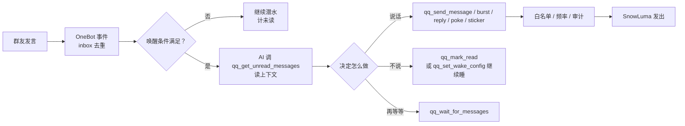
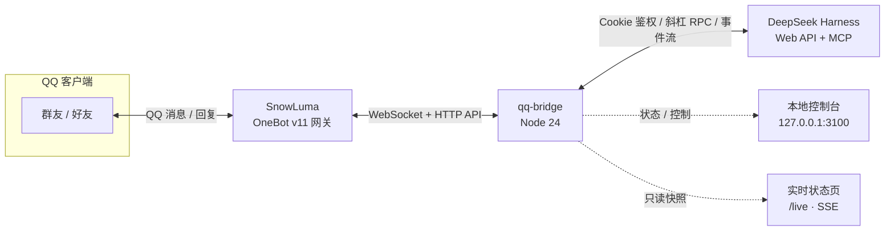
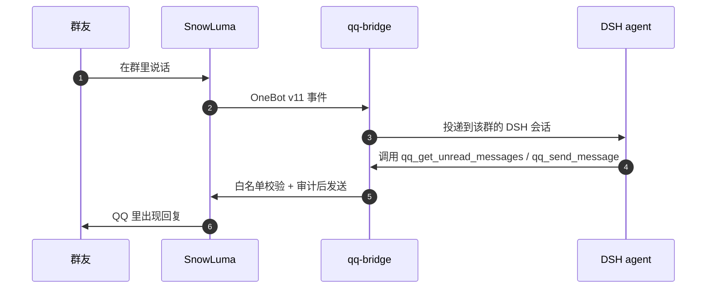

<p align="center">
  
</p>

<h1 align="center">小鲸鱼 · qq-bridge</h1>

<p align="center"><b>把 QQ 变成 DeepSeek Harness 的聊天入口。</b><br>
群友照常聊天，后台是一个会看消息、会等人、会自己决定要不要说话的 AI。</p>

<p align="center">
  
  
  
  
  
</p>

<p align="center">
  <a href="README.en.md">English</a> ·
  <a href="docs/README.md">文档索引</a> ·
  <a href="RULES.md">权限规则</a> ·
  <a href="SECURITY.md">安全</a> ·
  <a href="UPSTREAM.md">上游说明</a>
</p>

> [!NOTE]
> 当前是 `0.0.0` 开发快照，逐项适配 **DSH 0.2.0-rc.2**（`npm run verify:adaptation`）。
> 本仓库**不打 tag、不发 Release**；你看到的 `v0.1.x` / `v0.2.x` 标签都属于上游
> [Derpyu520/qq-bridge](https://github.com/Derpyu520/qq-bridge)。

**目录**：[它是什么](#它是什么) · [能做什么](#能做什么) · [群聊仿真](#群聊仿真) · [实时状态页](#实时状态页-live) · [本地控制台](#本地控制台) · [架构](#架构) · [快速开始](#快速开始) · [运行模式](#运行模式) · [排查手册](#排查手册) · [已知限制](#已知限制) · [安全与隐私](#安全与隐私) · [文档](#文档) · [许可与致谢](#许可与致谢)

## 它是什么

一个跑在你本机的 QQ 桥接：QQ 好友和群聊的消息会变成 **DeepSeek Harness（DSH）** 会话里的消息，
agent 的回复、提问和工具审批再回到 QQ。它不改变 QQ 的用法，也不接管你的账号——
只是在「QQ ↔ SnowLuma」和「DSH」之间，补上那条一直缺的神经。

在群聊仿真模式（`simulation`，默认）里，消息**不会**被逐条转给模型看：AI 自己调
`qq_get_unread_messages` 翻未读、用 `qq_send_message` 决定说什么、用 `qq_wait_for_messages`
决定等一会儿还是潜水。像群友一样在场，而不是一个自动回复机器人。

**它刻意不做的事：**

- 不注入 QQ、不部署 SnowLuma——原生 hook 完全由 SnowLuma 负责，桥接只连它的 OneBot 接口；
- 不向白名单之外发消息，也没有禁言、踢人、上传下载这类群管理动作；
- 不把 DSH / SnowLuma 的原始报错直接丢进群，只给一句人话；
- 不默认发送语音（AI 发语音需要手动打开开关）。

## 能做什么

| 能力 | 具体功能 |
| --- | --- |
| **群聊仿真** | AI 自己看未读、决定发不发、等下一波、继续潜水；35 个 MCP 工具开关；@ / 名字 / 关键词 / 提问 / 拍一拍 / 概率等唤醒条件；睡眠、频率、夜间静默、黏人追发等硬限制；每个群独立初始提示词与群画像。 |
| **实时状态页** | `/live` 单页 SSE 实时刷新：像素小鲸鱼与心情气泡、羁绊、心情 / 精力与 7 天曲线、兴趣成长、内心生活、动向、会话、最近活动、服务健康、累计 token、长期记忆、资源库。只读，适合挂在副屏。 |
| **本地控制台** | 13 个任务页：模式切换、会话与审批、人格编辑、工具开关、黑话、资源库、花费、安全、运维、可靠性、工具参考；顶部实时状态带（DSH / SnowLuma / 模式 / 会话 / 待批）、图标导航轨、浅色 / 深色主题、响应式布局、跨页搜索。 |
| **人格两层** | 「仿真提示词」管工具协议与行为边界，「人格提示词」管人设与语气；角色卡可新建 / 编辑 / 重命名 / 复制 / 删除，支持按模式筛选与注入字数上限。 |
| **记忆与关系** | 话题、pending thoughts、群友印象、跨会话个人记忆；群友关系数值、群日报预览、心情 / 精力 / 兴趣与内心生活时间线。 |
| **黑话学习** | 从群聊历史自动抽取候选，人工确认含义 / 用法 / 例句 / 风险 / 来源后写入词库；确认词条注入提示词，并提供查询与提交工具；抽取阈值和注入量可调。 |
| **多模态表达** | 图片、表情、动图进入上下文；贴纸库备注、标签与看图理解；引用回复、拍一拍、分条发送；语音库 + TTS 情绪音色；入站语音 ASR 转写（默认关闭）。 |
| **群聊洞察** | 群友关系表与可编辑数值、群日报预览、活跃成员、群画像；日报默认关闭，打开后才生成。 |
| **可靠内核** | SQLite/WAL；outbox 幂等与重放、inbox 去重、任务队列；DSH 掉线时按会话排队，恢复后补投；`npm run doctor` 一键体检。 |
| **成本看板** | 按 DeepSeek 官方峰谷价目折算，支持按群 / 好友 / 轮次下钻、缓存命中与未命中拆分、24 小时 / 3 天 / 7 天 / 30 天走势。 |
| **安全默认值** | 白名单为空就不响应；仿真会话没有本地执行工具；发送强制白名单 + 敏感信息审计；跨会话指令要确认码；内部报错不进群；`state/` 可收紧 ACL。 |
| **DSH 适配** | 用 `~/.dsh` 持久签名密钥离线铸造会话 Cookie；slash RPC + `/api/remote.mux` 事件流；preset bundle patch；三个受限 MCP server；`install-dsh.mjs` 一键安装。 |

## 群聊仿真

`simulation` 模式里，消息**不会**逐条触发一次自动回复。桥接只负责把 QQ 事件可靠地送进 DSH，
之后由 AI 自己决定：这次要不要看、看完要不要说、说几条、还是继续潜水。



### 她手里的工具

- **读**：未读、最近消息、单条详情、消息图片、合并转发、活跃成员、自己最近发过什么，避免重复接话；
- **说**：统一发送、分条发送、引用回复、拍一拍、收藏表情、语音条；间隔会按真人节奏打散；
- **等**：`qq_wait_for_messages` 短暂等待新消息，有新消息立即返回，超时则回来继续判断；
- **节奏**：`qq_set_wake_config` 设置下次唤醒方式（无限期 / 指定时间 / @ / 名字 / 关键词 / 提问 / 拍一拍 / 概率），
  `qq_mark_read` 表示「看过但决定不回」，`qq_social_state` 查看当前未读与唤醒状态；
- **记忆**：`qq_memory_append` / `qq_memory_query` 记录话题、想说的话、群友印象与跨会话个人记忆；
- **黑话**：`qq_slang_query` 查已确认词条，`qq_slang_submit` 把陌生表达交给管理员筛选；
- **生活技能**：天气、猜拳 / 骰子 / 今日鲸鱼运势、定时提醒（主人私聊与家人群）。

控制台「群聊仿真」页把每个工具做成独立开关。关掉后 AI 的 DSH 工具清单里就不再出现它；
语音、贴纸、收集、发送类工具都可以单独关闭。

<p align="center">
  
  <br>
  <sub>群聊仿真页：工具开关、唤醒推荐值与硬限制、发送限制（离线演示数据）</sub>
</p>

### 节奏与边界

- **唤醒硬限制**：最小 / 最大潜水时长、每分钟 / 每小时最多唤醒、合并窗口、无行动兜底次数、
  唤醒收尾提醒次数、沉睡前强制等待；
- **夜间静默**：可配置时间窗，窗口内不主动发言；
- **黏人追发**：主人在私聊里没回时，按配置的间隔与次数补一句，不会无限刷屏；
- **主动检查**：长时间空闲后按概率决定要不要找话题，而不是固定频率推送；
- **群独立配置**：每个群可设初始提示词、群画像、风格备注与是否允许主动发言；
- **发送边界**：所有发送命中白名单；敏感路径、令牌、Cookie 等会被审计层拦截；
  QQ / SnowLuma / DSH 的内部错误只进日志，不进群。

## 实时状态页 `/live`

<p align="center">
  
  <br>
  <sub>只读实时状态页（离线演示数据），不含真实账号</sub>
</p>

`/live` 是给「想一直看着她在干什么」的人准备的只读页面。它通过 SSE 自动刷新，
不需要手动点刷新，也不提供任何会改变状态的操作：

- **小鲸鱼本体**：像素立绘会随心情切换（wave / idle / excited / tired / pout），旁边是当前心情气泡；
- **羁绊**：与主人、群友的关系温度与最近互动；
- **心情 / 精力**：二维心情罗盘、7 天心情曲线、精力条与本次情绪的来源；
- **兴趣 / 成长**：长期兴趣权重、最近学到的东西、口癖与小习惯；
- **内心生活**：接下来想做的事、pending thoughts 与今日计数；
- **动向**：当前在潜水、活跃、等待还是被唤醒，以及原因；
- **会话与活动**：每个群 / 私聊的阶段、未读、最近事件流；
- **服务健康**：桥接、DSH、SnowLuma 上游的实时状态；
- **累计用量**：token 与花费摘要；
- **长期记忆与资源库**：记忆条数、表情 / 图片 / 语音库规模。

页面使用独立访问令牌，默认只监听 `127.0.0.1`；SSE 断线会自动重连。适合放在副屏、
直播叠加层或另一台同局域网的设备上查看。

## 本地控制台

<p align="center">
  
  <br>
  <sub>运行总览 · 浅色主题（离线演示数据；深色主题见 <a href="assets/screenshots/console-dark.png">console-dark.png</a>）</sub>
</p>

控制台默认在 `http://127.0.0.1:3100`，需要令牌（未配置时自动生成到 `state/console-token`）。
13 个页面各自负责一类任务：

| 页面 | 可以做什么 |
| --- | --- |
| **运行总览** | DSH / SnowLuma 双健康卡片、当前模式与角色、待处理提问与审批、静默开关、DSH 思考强度、最近 100 条活动。 |
| **功能总览** | 按人格、媒体、内心生活、生活技能与运行方式列出当前能力；显示当前群、会话数与边界。 |
| **会话与审批** | QQ ↔ DSH 会话映射、每个会话的阶段与未读、等待主人回复的提问和工具审批。 |
| **人格与角色** | 角色卡增删改查、两层提示词分别查看 / 编辑 / 还原、注入上限、仿真提示词同步状态。 |
| **群聊仿真** | 35 个工具开关、唤醒推荐值与硬限制、初始提示词、群画像、记忆与状态查看器、工具调用日志、反馈、语音与贴纸参数。 |
| **群聊洞察** | 群友关系表（内部数值可编辑）、群日报预览、活跃成员与群画像。 |
| **资源库** | QQ 收藏表情与图片库的名称、描述、备注、标签；支持筛选与查看。 |
| **黑话词库** | 候选 / 已确认 / 已排除三栏；确认弹窗填写含义、用法、例句、风险与来源；抽取阈值与注入量。 |
| **令牌与花费** | 总花费、累计 token、缓存命中率、平均每轮；按会话与逐轮下钻；24 小时 / 3 天 / 7 天 / 30 天走势。 |
| **访问与安全** | 白名单 / 黑名单、管理员 QQ、控制台令牌、`state/` ACL 告警与一键重新检测。 |
| **调试与运维** | 测试消息、通知 AI、维护桥接进程、会话工作区、清理与诊断入口。 |
| **可靠性与配置** | outbox / jobs / inbox 队列状态、失败重试、按 schema 直接编辑配置。 |
| **工具参考** | 桥接提供给 DSH 的 MCP 工具清单、参数与用途，按命名空间分组。 |

界面细节：

- **浅色 / 深色双主题**：首次跟随系统偏好，手动切换后记住选择；
- **响应式**：桌面侧栏、平板与手机自动改为顶部横向导航，表格横向滚动，不产生页面级横向溢出；
- **草稿保护**：切换页面或 3 秒轮询刷新不会丢掉未保存的表单内容；
- **跨页搜索**：输入功能名或参数名，直接跳到对应页面与控件；
- **无障碍**：键盘焦点环、跳到主要内容、`prefers-reduced-motion` 下关闭装饰动画；
- **完全离线**：不引用外部字体、CDN 或统计脚本；`npm run preview:console` 可在不连接 DSH / QQ
  的情况下用虚构数据浏览全部页面。

## 架构



一次对话大致是这样走完的：



几个关键取舍：

- **每 QQ 会话 = 一个 DSH 会话**，统一归组到「QQ 聊天」工作区，映射持久化在 `state/sessions.json`；
- **三个 MCP server 都只给安全子集**：`snowluma`（QQ 动作）、`snowluma-host`（只读探活）、
  `web-search-safe`（带 SSRF 防护的搜索 / 抓取）；
- **鉴权不碰进程内存**：用 `~/.dsh` 里持久化的签名密钥离线铸造会话 Cookie，
  不依赖 DSH 启动 token（DSH 0.1.7 起它只在内存里）。

## 快速开始

共 6 步。其中**第 3、4 步最容易漏**——漏了不会崩，但 QQ 上会「毫无反应」。

### 0. 前置条件

| 组件 | 要求 |
| --- | --- |
| **DeepSeek Harness** | 已安装并运行，默认 `http://127.0.0.1:3080` |
| **SnowLuma** | Windows x64 版，能正常登录 QQ 并开启 OneBot WebSocket + HTTP API |
| **Node.js** | ≥ 22.13（CI 主任务跑 Node 24） |
| **系统** | Windows 10 / 11（QQ 与 SnowLuma 都在 Windows 上） |

### 1. 拿到代码并装依赖

```bash
git clone https://github.com/Frostyume/xiaojingyu.git
cd xiaojingyu
npm install
```

`postinstall` 会自动修补 `@snowluma/sdk` 发布版的 ESM 打包 bug，不需要手动处理。

### 2. 写配置

```bash
cp config.example.json config.json     # Windows CMD 用：copy config.example.json config.json
```

> [!IMPORTANT]
> 示例里的 `allow.private` / `allow.groups` 是空数组。空白名单 + `allowAllWhenEmpty: false`
> 时桥接**不响应任何消息**——这是刻意的 fail-closed 默认值。白名单在第 5 步填。

<details>
<summary>常用配置字段</summary>

| 字段 | 说明 |
| --- | --- |
| `dsh.baseUrl` | DSH Web 地址，默认 `http://127.0.0.1:3080` |
| `dsh.provider` / `dsh.model` / `dsh.reasoningEffort` | 会话使用的模型与推理强度；模型名填 DSH 里实际可用的 |
| `dsh.authToken` | **通常留空**：留空时用 `~/.dsh` 的签名密钥离线铸造 Cookie；填了才优先走 token 交换 |
| `snowluma.wsUrl` | OneBot **WebSocket** 地址，如 `ws://127.0.0.1:3001` |
| `snowluma.httpUrl` | OneBot **HTTP API** 地址，如 `http://127.0.0.1:3000`（不要填 WS 端口，否则报 HTTP 426） |
| `snowluma.accessToken` | OneBot 的 token，没配置就留空 |
| `snowluma.followDiscoveredEndpoint` | 默认 `true`：换账号后自动发现并跟随新端口 / token，并写回 `config.json` |
| `snowluma.launcherPath` / `homeDir` | SnowLuma 安装目录，用于 token 与端点自发现（桥接不会启动它） |
| `agentPreset` | 旧版 `chat` / `reserved` 模式使用的 preset，默认 `qq-chat-legacy`（未随仓库发布） |
| `simulation.agentPreset` | 群聊仿真 preset，默认 `qq-chat` |
| `allow.private` / `allow.groups` | 白名单（QQ 号 / 群号数组） |
| `deny.*` | 黑名单，优先于白名单 |
| `consolePort` / `consoleToken` | 控制台端口（默认 `3100`）与令牌（留空自动生成到 `state/console-token`） |
| `simulation.initialPromptMaxChars` | 会话初始提示词字数上限，默认 2000 |
| `simulation.media` | 图片上限：`maxBytes` 8MB / `maxPixels` 64MP / `maxCount` 5 张 |
| `webSearch.provider` | `auto`（默认，DeepSeek 优先）/ `deepseek` / `bing` |
| `workspaceTitle` | QQ 会话在 DSH 里的归组名，默认「QQ 聊天」 |

</details>

### 3. 装 DSH 端（preset + MCP），然后重启 DSH

```bash
node tools/install-dsh.mjs
```

脚本会把 `qq-chat` preset 与三个 MCP server 写进 DSH 配置，并把全新环境的默认模式设为
`simulation`。**装完必须重启 DSH**——preset 与 MCP 只在 DSH 启动时加载。

> 跳过这一步桥接不会崩，但会话拿不到 preset，桥接会 **fail-closed 拒绝建会话**
> （绝不回退到带 bash / 文件工具的默认 preset），表现同样是 QQ 上没反应。

详细步骤与排错见 [docs/guides/DSH_SETUP.md](docs/guides/DSH_SETUP.md)。

### 4. 准备 SnowLuma

1. 从 <https://github.com/SnowLuma/SnowLuma/releases/latest> 下载 `SnowLuma-v<版本>-win-x64.zip`
   （完整版自带 Node 运行时；Lite 版需要本机 Node 22.13+）；
2. 解压到任意目录，双击 `launcher.bat`；
3. 打开启动日志里的 WebUI 地址，用初始密码登录：同意条款 → 设置密码 → 扫码登录 QQ；
4. 在 WebUI 里开启 **WebSocket 服务端** 与 **HTTP API**，记下端口（默认 WS `3001`、HTTP `3000`）
   和 accessToken（如果设置了）。

### 5. 填 `snowluma` 段与白名单

```json
"snowluma": {
  "wsUrl": "ws://127.0.0.1:3001",
  "httpUrl": "http://127.0.0.1:3000",
  "accessToken": "你在 WebUI 里配置的 token（没配置就留空）"
},
"allow": {
  "private": [12345678],
  "groups": [87654321]
}
```

### 6. 启动

```bash
npm start          # 前台运行，崩溃不自动重启
```

Windows 想要「崩溃自动重启」，改用 `bin/boot.cmd`（守护窗口，关窗即停）。
看到 `SnowLuma 已连接` 就成功了；接着在 QQ 上给机器人账号发条消息试试。

```bash
npm run doctor     # 一条命令体检：配置、SQLite、DSH、SnowLuma、preset、端口
```

## 运行模式

| 模式 | 谁在使用 | preset | 开箱可用 |
| --- | --- | --- | --- |
| `simulation` | 白名单群 / 私聊：AI 自主看消息、发言、等待、潜水 | `qq-chat` | 是（默认） |
| `closed-agent` | 仅 owner 私聊，完整本地工具 | DSH 默认 preset | 是 |

`simulation` 是规范名。`chat` / `reserved` 是更早的历史模式，依赖的 `qq-chat-legacy`
preset 不随仓库发布；要使用它们需自备该 preset，否则桥接会 fail-closed 拒绝建会话。

`closed-agent` 只放行 owner 私聊，agent 拥有完整本地工具（DSH 默认 preset）——这是为
「在 QQ 上远程操控 DSH」有意保留的能力。切换模式、改预设都在控制台完成，即时生效。

## 排查手册

<details>
<summary><b>发消息完全没反应</b></summary>

按顺序检查：

1. `npm run doctor` 有没有红灯；
2. 第 3 步是否执行过，以及**DSH 是否重启过**（preset 未加载时桥接会拒绝建会话）；
3. `config.json` 的白名单是否填了你的号，`allowAllWhenEmpty` 是否为 `false`；
4. 当前模式是否是 `simulation` / `closed-agent`；
5. 桥接日志里有没有「缺 preset」「白名单拒绝」「SnowLuma 未连接」。
</details>

<details>
<summary><b>连上了，但群里一条消息都不来</b></summary>

大概率是 SnowLuma 的 `[Hook]` 退化了：它的进程和 OneBot WebSocket 都活着，但收不到 QQ 侧的数据。
桥接会把这事讲清楚：控制台「运行总览」的 **SnowLuma 上游** 卡片会变成「已连接 · 未接收」，
`GET /api/status` 的 `snowluma` 字段给出 `degraded` / `good` / `hint`。

排查顺序：控制台看卡片 → 看 SnowLuma 的 `logs/snowluma-*.log` 里有没有
`receive path stale` / `process enumeration timed out` → 再考虑升级 SnowLuma。
注意**升级不会更换注入用的原生组件**，它修不了「原生 hook 挂不上 QQ」这类问题。
</details>

<details>
<summary><b>每次启动第一次连接都报 1006</b></summary>

正常现象。SnowLuma 同一账号的 **HTTP token（3000）与 WebSocket token（3001）是两个不同的值**，
而 `snowluma.accessToken` 通常只能存一个（HTTP 那个）。桥接首次 WS 连接会失败一次，
随后自愈发现 WS token、重连成功。

如果日志里出现 `token 自愈失败`，检查 `snowluma.homeDir` 是否指向真正的 SnowLuma 安装目录。
</details>

<details>
<summary><b>端点自愈把我的 wsUrl 改掉了</b></summary>

换 QQ 账号后端口和 token 都会变，所以桥接默认会跟随发现的新端点并写回配置。
想跑第二个实例 / 指向另一份 SnowLuma 安装时：

```json
"snowluma": { "followDiscoveredEndpoint": false }
```

关掉后**只自愈 token**（换账号仍能恢复），绝不动 URL、也不写回 URL。
</details>

<details>
<summary><b>重启 DSH 后要重启桥接吗</b></summary>

通常不需要。桥接每 5 秒探活，DSH 不可用期间收到的 QQ 消息会在进程内排队
（每会话最多 50 条，满后丢最旧项），恢复后补投。但桥接进程退出会丢失内存队列，
断线期间已经结束的回复不保证补发。
</details>

## 已知限制

- agent 回复在回合结束时一次性发送，不做流式逐字转发；超长回复按句读 / URL 边界自动分段；
- 图片、表情和合并转发可以进入多模态上下文；入站语音需在 `simulation.speech.asr.enabled`
  打开后才会转写成文字（默认关闭，未开启时显示占位），视频消息目前只显示占位文本；
- **AI 发语音默认关闭**（`simulation.voice.enabled` 与 `tools.sendVoice` 均为 `false`），
  先把音频放进 `audio/`，再到控制台打开开关。示例语音在 [`assets/voice/`](assets/voice/)；
- agent 的 Markdown 回复会转成纯文本再发出（链接保留 `文字 (url)` 形式）；
- 仅支持 Windows 10 / 11：QQ 与 SnowLuma 都是 Windows 程序；
- 只提供 `simulation` / `closed-agent` 两种模式；更早的 `chat` / `reserved` 需自备 `qq-chat-legacy` preset。

## 安全与隐私

- **群友没有本地权限**：`qq-chat` 不挂载 bash / 文件读写 / 子代理 / 工作流，
  群友怎么诱导都无法操作本机；
- **QQ 动作是安全子集**：只允许三个 MCP 命名空间 + `ask_user_question` / `todo_write`，
  发送类工具强制命中白名单；语音只能发语音库里的文件；
- **高风险动作要确认**：跨会话指令、敏感操作会在 owner 私聊里要求 `/确认 <6 位码>`；
- **人格由桥接注入**：角色来自 `personas/` 与控制台，群友口头要求改角色无效；
- **不把内部错误发进群**：DSH / SnowLuma / QQ 的原始报错只留在日志和 `GET /api/status`；
- **仓库不含密钥**：真实 `config.json`、`state/`、`audio/` 都不会进入仓库，只提供脱敏模板。

隐私相关的数据出机清单（例如黑话学习会把词条交给搜索后端，可关闭）见
[docs/guides/PRIVACY.md](docs/guides/PRIVACY.md)；权限边界见 [RULES.md](RULES.md)。
发现安全问题请按 [SECURITY.md](SECURITY.md) 私密报告，不要开公开 issue。

## 文档

| 文档 | 内容 |
| --- | --- |
| [docs/README.md](docs/README.md) | 文档索引（每篇一句话） |
| [docs/guides/DSH_SETUP.md](docs/guides/DSH_SETUP.md) | DSH 端安装：preset、MCP、重启 |
| [docs/guides/DSH_ADAPTATION.md](docs/guides/DSH_ADAPTATION.md) | DSH 0.2.0-rc.2 适配与版本说明 |
| [docs/guides/SECURITY_BASELINE.md](docs/guides/SECURITY_BASELINE.md) | 安全基线与 Windows ACL |
| [docs/guides/RELIABILITY.md](docs/guides/RELIABILITY.md) | outbox / 队列 / 重试机制 |
| [docs/guides/TOKEN_USAGE_CONSOLE.md](docs/guides/TOKEN_USAGE_CONSOLE.md) | 花费看板的口径与价目表 |
| [docs/guides/CONSOLE-UI-TESTING.md](docs/guides/CONSOLE-UI-TESTING.md) | 控制台离线回归与预览 |
| [docs/guides/PRIVACY.md](docs/guides/PRIVACY.md) | 数据出机清单与隐私开关 |
| [RULES.md](RULES.md) | QQ 会话的权限边界与安全承诺 |
| [SECURITY.md](SECURITY.md) | 漏洞报告流程 |
| [UPSTREAM.md](UPSTREAM.md) | 与上游的关系、跟进规则 |
| [docs/FOLDER_MAP.md](docs/FOLDER_MAP.md) | 目录结构与脚本命名约定 |
| [NOTICE](NOTICE) | 第三方组件与许可说明 |

## 自检与测试

离线回归使用临时目录和模拟服务，不读真实配置、不发 QQ 消息：

```bash
npm run test:audit      # 47 个脚本的离线回归（CI 主任务）
npm run test:console-ui # 控制台离线浏览器回归
npm run self-test       # DSH 侧链路验证（会创建一个独立测试会话）
npm run verify          # schema + 控制台契约 + 全部 core / stage / audit
```

## 目录结构

<details>
<summary>展开仓库目录</summary>

```
xiaojingyu/
  config.example.json   # 配置模板（脱敏占位符；真实 config.json 不入库）
  config.schema.json    # 由 config.example.json 生成（verify 会 --check）
  README.md / README.en.md / RULES.md / SECURITY.md / UPSTREAM.md
  app/                  # 进程入口（whale.js 主程序、self-check.js）
  runtime/              # 内核 / 人格 / 分享 / 控制 / 编排
  services/             # 人格、媒体、社交能力
  channels/             # QQ（SnowLuma OneBot）与 DSH 适配
  mcp/                  # 三个 MCP server
  console/              # 控制台服务端（鉴权、/live、策略）
  features/             # 可插拔功能（日报、卡片）
  web/                  # deck.html 控制台、live.html 状态页、assets/ 鲸鱼像素图
  personas/             # 人格卡（小鲸鱼）
  integrations/dsh/     # preset 权威源、agent-presets bundle、mode-console 插件
  docs/                 # 文档索引、目录地图与 guides/
  tools/                # 运维 / 构建 / 测试辅助脚本
  tests/                # 自动化测试与基线夹具
  bin/                  # Windows 启动器（boot.cmd / reboot.cmd）
  assets/
    banner.png          # README 横幅
    screenshots/        # 控制台截图（离线示例数据）
    voice/              # 两条示例语音，复制到 audio/ 即可
  audio/                # 语音库（不入库）
  state/                # 运行时数据（不入库）
```

</details>

> **「发语音」独立工具（`voice-tool/`，入口 `voice-cli.mjs` / `voice-gui.mjs`）不随本仓库发布。** 它复用本仓库的
> `services/media/voice-core.js` / `channels/qq/gateway.js`，只依赖 SnowLuma；
> 仓库内的语音能力（`qq_speak`、`/api/simulation/send-voice` 等）不依赖它。

## 与上游的关系

本项目的起点是 MIT 许可的 [Derpyu520/qq-bridge](https://github.com/Derpyu520/qq-bridge)（基线 `v0.2.0-r4`），
感谢原作者与贡献者打下的桥接骨架。在此基础上，本项目按自己的需求做了大幅改写与扩展，主要包括：

- **群聊仿真引擎**：未读队列、唤醒条件（@ / 名字 / 关键词 / 提问 / 拍一拍 / 概率）、
  `qq_wait_for_messages` 短等待、分条发送、夜间静默、黏人追发、每群独立初始提示词与群画像、
  35 个 MCP 工具开关；
- **实时状态页**：`/live` 用 SSE 单页展示小鲸鱼心情与精力、羁绊、兴趣成长、内心生活、
  会话、活动、健康、token 与记忆，只读，适合常驻副屏；
- **本地 Web 控制台**：13 个任务页、浅色 / 深色主题、响应式布局、草稿保护、跨页搜索；
- **可靠性内核**：SQLite/WAL、outbox 幂等与重放、inbox 去重、任务队列、doctor 诊断；
- **成本看板**：按 DeepSeek 官方峰谷价目折算，按群 / 好友 / 轮次下钻，带 24 小时到 30 天走势；
- **DSH 0.2.0 适配**：slash RPC、`/api/remote.mux` 事件流、preset bundle patch、离线 Cookie 铸造；
- **安全边界**：preset 工具守卫、发送白名单、回复审计、语音库限制。

上游的名称、版权行与 MIT 许可完整保留；具体分叉点与跟进规则见 [UPSTREAM.md](UPSTREAM.md)。
版本号停留在 `0.0.0` 开发快照，**不打 tag、不发 Release**；上游新增的 0.2.1 适配尚未合并。

## 许可与致谢

- 本仓库与上游均以 **MIT** 许可发布；[LICENSE](LICENSE) 保留上游版权行，不替换、不删除；
- 感谢 [Derpyu520/qq-bridge](https://github.com/Derpyu520/qq-bridge) —— 桥接骨架、OneBot/DSH 接入思路与大量基础代码来自上游；
- 感谢 [SnowLuma](https://github.com/SnowLuma/SnowLuma) 提供 QQ ↔ OneBot 网关；
- 感谢 DeepSeek Harness 提供的 agent 运行时；第三方组件与许可说明见 [NOTICE](NOTICE)。

SnowLuma 是独立第三方项目，与腾讯 / QQ 无隶属关系；本项目仅供学习与技术研究，
使用前请阅读 SnowLuma 的 EULA 与《QQ 用户协议》。