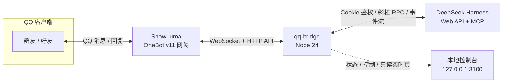
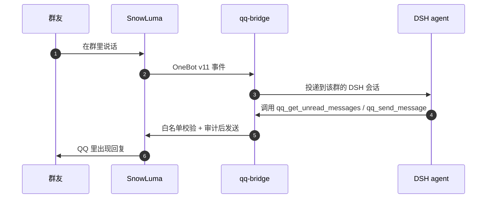

<p align="center">
  
</p>

<h1 align="center">小鲸鱼 · qq-bridge</h1>

<p align="center"><b>把 QQ 变成 DeepSeek Harness 的聊天入口。</b><br>
群友照常聊天，后台是一个会看消息、会等人、会自己决定要不要说话的 AI。</p>

<p align="center">
  
  
  
  
  
</p>

<p align="center">
  <a href="README.en.md">English</a> ·
  <a href="docs/README.md">文档索引</a> ·
  <a href="RULES.md">权限规则</a> ·
  <a href="SECURITY.md">安全</a> ·
  <a href="UPSTREAM.md">上游说明</a>
</p>

> [!NOTE]
> 当前是 `0.0.0` 开发快照，逐项适配 **DSH 0.2.0-rc.2**（`npm run verify:adaptation`）。
> 本仓库**不打 tag、不发 Release**；你看到的 `v0.1.x` / `v0.2.x` 标签都属于上游
> [Derpyu520/qq-bridge](https://github.com/Derpyu520/qq-bridge)。

**目录**：[它是什么](#它是什么) · [特性](#特性) · [架构](#架构) · [控制台](#控制台) · [快速开始](#快速开始) · [运行模式](#运行模式) · [排查手册](#排查手册) · [已知限制](#已知限制) · [安全与隐私](#安全与隐私) · [文档](#文档) · [许可与致谢](#许可与致谢)

## 它是什么

一个跑在你本机的 QQ 桥接：QQ 好友和群聊的消息会变成 **DeepSeek Harness（DSH）** 会话里的消息，
agent 的回复、提问和工具审批再回到 QQ。它不改变 QQ 的用法，也不接管你的账号——
只是在「QQ ↔ SnowLuma」和「DSH」之间，补上那条一直缺的神经。

在二代仿真模式（`reserved2`，默认）里，消息**不会**被逐条转给模型看：AI 自己调
`qq_get_unread_messages` 翻未读、用 `qq_send_message` 决定说什么、用 `qq_wait_for_messages`
决定等一会儿还是潜水。像群友一样在场，而不是一个自动回复机器人。

**它刻意不做的事：**

- 不注入 QQ、不部署 SnowLuma——原生 hook 完全由 SnowLuma 负责，桥接只连它的 OneBot 接口；
- 不向白名单之外发消息，也没有禁言、踢人、上传下载这类群管理动作；
- 不把 DSH / SnowLuma 的原始报错直接丢进群，只给一句人话；
- 不默认发送语音（AI 发语音需要手动打开开关）。

## 特性

| | |
| --- | --- |
| **双向对话**<br>群聊 / 私聊消息进入 DSH 会话；引用回复会解析成「被引用人 + 原文」，AI 知道这句话在接谁的话。 | **自主收发**<br>二代仿真里 AI 通过 MCP 工具自己看未读、发言、引用、等人、潜水；分条发送由它自己决定。 |
| **人格两层**<br>「仿真提示词」管行为与协议，「人格提示词」管人设与语气；控制台可分别查看、修改、还原。 | **本地控制台**<br>13 个页面覆盖运行状态、会话审批、人格、群聊仿真、黑话、花费、安全与运维；浅色 / 深色双主题。 |
| **多模态**<br>图片、表情、动图走 CDN 与安全下载进入上下文；IPv4 优先 + 逐地址切换，不再为 IPv6 白等。 | **可靠内核**<br>SQLite outbox / jobs / inbox，DSH 掉线时消息在内存排队，恢复后补投；每会话独立映射。 |
| **安全默认值**<br>白名单空 = 不响应（fail-closed）；QQ 动作只暴露安全子集，发送强制白名单。 | **纯 JS 链路**<br>桥接没有任何原生 / 注入面，也不启动或控制 SnowLuma；出问题能一眼分清是谁的锅。 |

## 架构



一次对话大致是这样走完的：



几个关键取舍：

- **每 QQ 会话 = 一个 DSH 会话**，统一归组到「QQ 聊天」工作区，映射持久化在 `state/sessions.json`；
- **三个 MCP server 都只给安全子集**：`snowluma`（QQ 动作）、`snowluma-host`（只读探活）、
  `web-search-safe`（带 SSRF 防护的搜索 / 抓取）；
- **鉴权不碰进程内存**：用 `~/.dsh` 里持久化的签名密钥离线铸造会话 Cookie，
  不依赖 DSH 启动 token（DSH 0.1.7 起它只在内存里）。

## 控制台

<p align="center">
  
  <br>
  <sub>离线演示数据（<code>npm run preview:console</code>），不含真实账号</sub>
</p>

控制台默认在 `http://127.0.0.1:3100`，需要令牌（未配置时自动生成并打印在启动日志）。
除了启停和模式切换，几个比较常用的地方：

- **运行总览**：DSH / SnowLuma 双健康卡片、当前模式与角色、待处理提问与审批；
- **令牌与花费**：实时 token 与折合金额，可下钻到每个群、每个好友、每一轮对话；
  按 DeepSeek 官方峰谷价目表计算（高峰单价为空闲 2 倍），带 24 小时 / 3 天 / 7 天 / 30 天走势；
- **人格与角色**：编辑角色卡、查看和修改两层提示词、切换 DSH 思考强度；
- **群聊仿真**：初始提示词、唤醒策略、夜间静默、黏人追发等仿真参数；
- **访问与安全**：白名单、管理员、控制台令牌与安全告警条；
- **实时状态页** `/live`：只读，适合挂在副屏看当前在聊什么。

<details>
<summary>13 个页面一览</summary>

运行总览 · 功能总览 · 会话与审批 · 人格与角色 · 群聊仿真 · 群聊洞察 · 资源库 ·
黑话词库 · 令牌与花费 · 访问与安全 · 调试与运维 · 可靠性与配置 · 工具参考

</details>

## 快速开始

共 6 步。其中**第 3、4 步最容易漏**——漏了不会崩，但 QQ 上会「毫无反应」。

### 0. 前置条件

| 组件 | 要求 |
| --- | --- |
| **DeepSeek Harness** | 已安装并运行，默认 `http://127.0.0.1:3080` |
| **SnowLuma** | Windows x64 版，能正常登录 QQ 并开启 OneBot WebSocket + HTTP API |
| **Node.js** | ≥ 22.13（CI 主任务跑 Node 24） |
| **系统** | Windows 10 / 11（QQ 与 SnowLuma 都在 Windows 上） |

### 1. 拿到代码并装依赖

```bash
git clone https://github.com/Frostyume/xiaojingyu.git
cd xiaojingyu
npm install
```

`postinstall` 会自动修补 `@snowluma/sdk` 发布版的 ESM 打包 bug，不需要手动处理。

### 2. 写配置

```bash
cp config.example.json config.json     # Windows CMD 用：copy config.example.json config.json
```

> [!IMPORTANT]
> 示例里的 `allow.private` / `allow.groups` 是空数组。空白名单 + `allowAllWhenEmpty: false`
> 时桥接**不响应任何消息**——这是刻意的 fail-closed 默认值。白名单在第 5 步填。

<details>
<summary>常用配置字段</summary>

| 字段 | 说明 |
| --- | --- |
| `dsh.baseUrl` | DSH Web 地址，默认 `http://127.0.0.1:3080` |
| `dsh.provider` / `dsh.model` / `dsh.reasoningEffort` | 会话使用的模型与推理强度；模型名填 DSH 里实际可用的 |
| `dsh.authToken` | **通常留空**：留空时用 `~/.dsh` 的签名密钥离线铸造 Cookie；填了才优先走 token 交换 |
| `snowluma.wsUrl` | OneBot **WebSocket** 地址，如 `ws://127.0.0.1:3001` |
| `snowluma.httpUrl` | OneBot **HTTP API** 地址，如 `http://127.0.0.1:3000`（不要填 WS 端口，否则报 HTTP 426） |
| `snowluma.accessToken` | OneBot 的 token，没配置就留空 |
| `snowluma.followDiscoveredEndpoint` | 默认 `true`：换账号后自动发现并跟随新端口 / token，并写回 `config.json` |
| `snowluma.launcherPath` / `homeDir` | SnowLuma 安装目录，用于 token 与端点自发现（桥接不会启动它） |
| `agentPreset` | `chat` / `reserved` 模式使用的 preset，默认 `qq-chat` |
| `socialV2.agentPreset` | 二代仿真 preset，默认 `qq-chat-v2` |
| `allow.private` / `allow.groups` | 白名单（QQ 号 / 群号数组） |
| `deny.*` | 黑名单，优先于白名单 |
| `consolePort` / `consoleToken` | 控制台端口（默认 `3100`）与令牌（留空自动生成到 `state/console-token`） |
| `socialV2.initialPromptMaxChars` | 会话初始提示词字数上限，默认 2000 |
| `socialV2.media` | 图片上限：`maxBytes` 8MB / `maxPixels` 64MP / `maxCount` 5 张 |
| `webSearch.provider` | `auto`（默认，DeepSeek 优先）/ `deepseek` / `bing` |
| `workspaceTitle` | QQ 会话在 DSH 里的归组名，默认「QQ 聊天」 |

</details>

### 3. 装 DSH 端（preset + MCP），然后重启 DSH

```bash
node scripts/setup-dsh.mjs
```

脚本会把 `qq-chat-v2` preset 与三个 MCP server 写进 DSH 配置，并把全新环境的默认模式设为
`reserved2`。**装完必须重启 DSH**——preset 与 MCP 只在 DSH 启动时加载。

> 跳过这一步桥接不会崩，但会话拿不到 preset，桥接会 **fail-closed 拒绝建会话**
> （绝不回退到带 bash / 文件工具的默认 preset），表现同样是 QQ 上没反应。

详细步骤与排错见 [docs/guides/DSH_SETUP.md](docs/guides/DSH_SETUP.md)。

### 4. 准备 SnowLuma

1. 从 <https://github.com/SnowLuma/SnowLuma/releases/latest> 下载 `SnowLuma-v<版本>-win-x64.zip`
   （完整版自带 Node 运行时；Lite 版需要本机 Node 22.13+）；
2. 解压到任意目录，双击 `launcher.bat`；
3. 打开启动日志里的 WebUI 地址，用初始密码登录：同意条款 → 设置密码 → 扫码登录 QQ；
4. 在 WebUI 里开启 **WebSocket 服务端** 与 **HTTP API**，记下端口（默认 WS `3001`、HTTP `3000`）
   和 accessToken（如果设置了）。

### 5. 填 `snowluma` 段与白名单

```json
"snowluma": {
  "wsUrl": "ws://127.0.0.1:3001",
  "httpUrl": "http://127.0.0.1:3000",
  "accessToken": "你在 WebUI 里配置的 token（没配置就留空）"
},
"allow": {
  "private": [12345678],
  "groups": [87654321]
}
```

### 6. 启动

```bash
npm start          # 前台运行，崩溃不自动重启
```

Windows 想要「崩溃自动重启」，改用 `start.bat`（守护窗口，关窗即停）。
看到 `SnowLuma 已连接` 就成功了；接着在 QQ 上给机器人账号发条消息试试。

```bash
npm run doctor     # 一条命令体检：配置、SQLite、DSH、SnowLuma、preset、端口
```

## 运行模式

| 模式 | 谁在使用 | preset | 开箱可用 |
| --- | --- | --- | --- |
| `chat` | 白名单群 / 私聊日常对话 | `qq-chat`（一代） | 需自备 preset |
| `closed-agent` | 仅 owner 私聊，完整本地工具 | DSH 默认 preset | 是 |
| `reserved` | 一代仿真（观望 / 活跃 / 试探 / 退场） | `qq-chat`（一代） | 需自备 preset |
| `reserved2` | 二代仿真：AI 自主收发 | `qq-chat-v2` | 是（推荐） |

> [!IMPORTANT]
> 本仓库只带二代预设 `qq-chat-v2`。`chat` / `reserved` 依赖的一代 `qq-chat` preset
> **不随仓库发布**，缺它时桥接会 fail-closed 拒绝建会话。

`closed-agent` 只放行 owner 私聊，agent 拥有完整本地工具（DSH 默认 preset）——这是为
「在 QQ 上远程操控 DSH」有意保留的能力。切换模式、改预设都在控制台完成，即时生效。

## 排查手册

<details>
<summary><b>发消息完全没反应</b></summary>

按顺序检查：

1. `npm run doctor` 有没有红灯；
2. 第 3 步是否执行过，以及**DSH 是否重启过**（preset 未加载时桥接会拒绝建会话）；
3. `config.json` 的白名单是否填了你的号，`allowAllWhenEmpty` 是否为 `false`；
4. 当前模式是否是 `reserved2` / `closed-agent`（`chat` / `reserved` 需要一代 preset）；
5. 桥接日志里有没有「缺 preset」「白名单拒绝」「SnowLuma 未连接」。
</details>

<details>
<summary><b>连上了，但群里一条消息都不来</b></summary>

大概率是 SnowLuma 的 `[Hook]` 退化了：它的进程和 OneBot WebSocket 都活着，但收不到 QQ 侧的数据。
桥接会把这事讲清楚：控制台「运行总览」的 **SnowLuma 上游** 卡片会变成「已连接 · 未接收」，
`GET /api/status` 的 `snowluma` 字段给出 `degraded` / `good` / `hint`。

排查顺序：控制台看卡片 → 看 SnowLuma 的 `logs/snowluma-*.log` 里有没有
`receive path stale` / `process enumeration timed out` → 再考虑升级 SnowLuma。
注意**升级不会更换注入用的原生组件**，它修不了「原生 hook 挂不上 QQ」这类问题。
</details>

<details>
<summary><b>每次启动第一次连接都报 1006</b></summary>

正常现象。SnowLuma 同一账号的 **HTTP token（3000）与 WebSocket token（3001）是两个不同的值**，
而 `snowluma.accessToken` 通常只能存一个（HTTP 那个）。桥接首次 WS 连接会失败一次，
随后自愈发现 WS token、重连成功。

如果日志里出现 `token 自愈失败`，检查 `snowluma.homeDir` 是否指向真正的 SnowLuma 安装目录。
</details>

<details>
<summary><b>端点自愈把我的 wsUrl 改掉了</b></summary>

换 QQ 账号后端口和 token 都会变，所以桥接默认会跟随发现的新端点并写回配置。
想跑第二个实例 / 指向另一份 SnowLuma 安装时：

```json
"snowluma": { "followDiscoveredEndpoint": false }
```

关掉后**只自愈 token**（换账号仍能恢复），绝不动 URL、也不写回 URL。
</details>

<details>
<summary><b>重启 DSH 后要重启桥接吗</b></summary>

通常不需要。桥接每 5 秒探活，DSH 不可用期间收到的 QQ 消息会在进程内排队
（每会话最多 50 条，满后丢最旧项），恢复后补投。但桥接进程退出会丢失内存队列，
断线期间已经结束的回复不保证补发。
</details>

## 已知限制

- agent 回复在回合结束时一次性发送，不做流式逐字转发；超长回复按句读 / URL 边界自动分段；
- 图片和部分表情可以进入多模态上下文；**收到**的语音 / 视频目前只显示占位文本；
- **AI 发语音默认关闭**（`socialV2.voice.enabled` 与 `tools.sendVoice` 均为 `false`），
  先把音频放进 `audio/`，再到控制台打开开关。示例语音在 [`assets/voice/`](assets/voice/)；
- agent 的 Markdown 回复会转成纯文本再发出（链接保留 `文字 (url)` 形式）；
- 仅支持 Windows 10 / 11：QQ 与 SnowLuma 都是 Windows 程序；
- 本仓库只带二代 preset，`chat` / `reserved` 模式需要自备一代 `qq-chat`。

## 安全与隐私

- **群友没有本地权限**：`qq-chat-v2` 不挂载 bash / 文件读写 / 子代理 / 工作流，
  群友怎么诱导都无法操作本机；
- **QQ 动作是安全子集**：只允许三个 MCP 命名空间 + `ask_user_question` / `todo_write`，
  发送类工具强制命中白名单；语音只能发语音库里的文件；
- **高风险动作要确认**：跨会话指令、敏感操作会在 owner 私聊里要求 `/确认 <6 位码>`；
- **人格由桥接注入**：角色来自 `roles/` 与控制台，群友口头要求改角色无效；
- **不把内部错误发进群**：DSH / SnowLuma / QQ 的原始报错只留在日志和 `GET /api/status`；
- **仓库不含密钥**：真实 `config.json`、`state/`、`audio/` 都不会进入仓库，只提供脱敏模板。

隐私相关的数据出机清单（例如黑话学习会把词条交给搜索后端，可关闭）见
[docs/guides/PRIVACY.md](docs/guides/PRIVACY.md)；权限边界见 [RULES.md](RULES.md)。
发现安全问题请按 [SECURITY.md](SECURITY.md) 私密报告，不要开公开 issue。

## 文档

| 文档 | 内容 |
| --- | --- |
| [docs/README.md](docs/README.md) | 文档索引（每篇一句话） |
| [docs/guides/DSH_SETUP.md](docs/guides/DSH_SETUP.md) | DSH 端安装：preset、MCP、重启 |
| [docs/guides/DSH_020_ADAPTATION.md](docs/guides/DSH_020_ADAPTATION.md) | DSH 0.2.0-rc.2 适配与版本说明 |
| [docs/guides/SECURITY_BASELINE.md](docs/guides/SECURITY_BASELINE.md) | 安全基线与 Windows ACL |
| [docs/guides/RELIABILITY.md](docs/guides/RELIABILITY.md) | outbox / 队列 / 重试机制 |
| [docs/guides/TOKEN_USAGE_CONSOLE.md](docs/guides/TOKEN_USAGE_CONSOLE.md) | 花费看板的口径与价目表 |
| [docs/guides/CONSOLE-UI-TESTING.md](docs/guides/CONSOLE-UI-TESTING.md) | 控制台离线回归与预览 |
| [docs/guides/PRIVACY.md](docs/guides/PRIVACY.md) | 数据出机清单与隐私开关 |
| [RULES.md](RULES.md) | QQ 会话的权限边界与安全承诺 |
| [SECURITY.md](SECURITY.md) | 漏洞报告流程 |
| [UPSTREAM.md](UPSTREAM.md) | 与上游的关系、跟进规则 |
| [docs/FOLDER_MAP.md](docs/FOLDER_MAP.md) | 目录结构与脚本命名约定 |
| [NOTICE](NOTICE) | 第三方组件与许可说明 |

## 自检与测试

离线回归使用临时目录和模拟服务，不读真实配置、不发 QQ 消息：

```bash
npm run test:audit      # 47 个脚本的离线回归（CI 主任务）
npm run test:console-ui # 控制台离线浏览器回归
npm run self-test       # DSH 侧链路验证（会创建一个独立测试会话）
npm run verify          # schema + 控制台契约 + 全部 core / stage / audit
```

## 目录结构

<details>
<summary>展开仓库目录</summary>

```
qq-bridge/
  config.example.json   # 配置模板（脱敏占位符；真实 config.json 不入库）
  config.schema.json    # 由 config.example.json 生成（verify 会 --check）
  README.md / README.en.md / RULES.md / SECURITY.md / UPSTREAM.md
  docs/                 # 文档索引、目录地图与 guides/
  dsh/agent-presets/qq-chat-v2/  # 二代 preset 的权威源（本仓库只带 v2）
  plugins/qq-agent-presets       # DSH bundle：生成 preset patch + 共享工具守卫
  plugins/qq-mode-console        # DSH 插件：qq-mode 设置命名空间（host 半）
  public/
    console.html        # 本地 Web 控制台
    live.html           # 只读实时状态页
    assets/             # 鲸鱼像素图
  roles/                # 人格卡（小鲸鱼）
  assets/
    banner.png          # README 横幅
    screenshots/        # 控制台截图（离线示例数据）
    voice/              # 两条示例语音，复制到 audio/ 即可
  src/                  # 桥接内核、DSH 客户端、三个 MCP server
  scripts/              # 测试 / 运维脚本（含 postinstall 补丁）
  audio/                # 语音库（不入库）
  state/                # 运行时数据（不入库）
```

</details>

> **「发语音」独立工具（`voice-tool/`，入口 `voice-cli.mjs` / `voice-gui.mjs`）不随本仓库发布。** 它复用本仓库的
> `src/voice-core.js` / `src/snowluma-conn.js`，只依赖 SnowLuma；
> 仓库内的语音能力（`qq_speak`、`/api/socialV2/send-voice` 等）不依赖它。

## 版本与上游

本仓库是上游 [Derpyu520/qq-bridge](https://github.com/Derpyu520/qq-bridge) 的二次开发分支，
当前基于上游 `v0.2.0-r4`，在此基础上做了人格、控制台、仿真与可靠性定制。
版本号停留在 `0.0.0` 开发快照，**不打 tag、不发 Release**；上游新增的 0.2.1 适配尚未合并。
跟进上游的规则、许可证边界与禁止入库清单见 [UPSTREAM.md](UPSTREAM.md)。

## 许可与致谢

- 本项目以 **MIT** 许可发布，保留上游版权行；第三方组件与 SnowLuma 合规说明见 [NOTICE](NOTICE)；
- 感谢 [Derpyu520/qq-bridge](https://github.com/Derpyu520/qq-bridge) 提供的上游基础；
- 感谢 [SnowLuma](https://github.com/SnowLuma/SnowLuma) 提供 QQ ↔ OneBot 网关；
- 感谢 DeepSeek Harness 提供的 agent 运行时。

SnowLuma 是独立第三方项目，与腾讯 / QQ 无隶属关系；本项目仅供学习与技术研究，
使用前请阅读 SnowLuma 的 EULA 与《QQ 用户协议》。