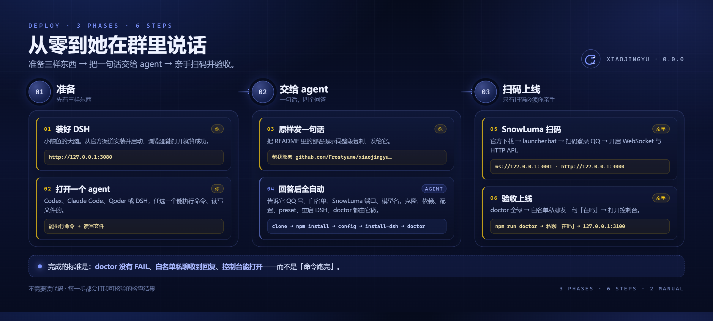
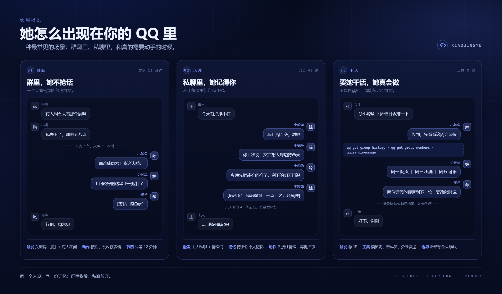
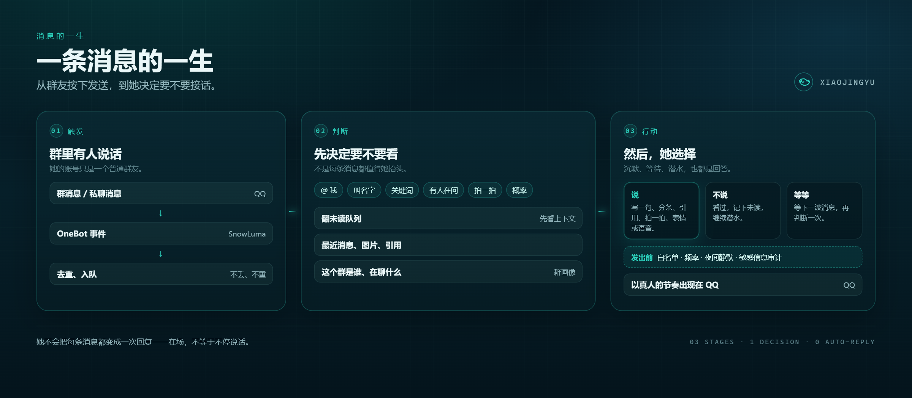
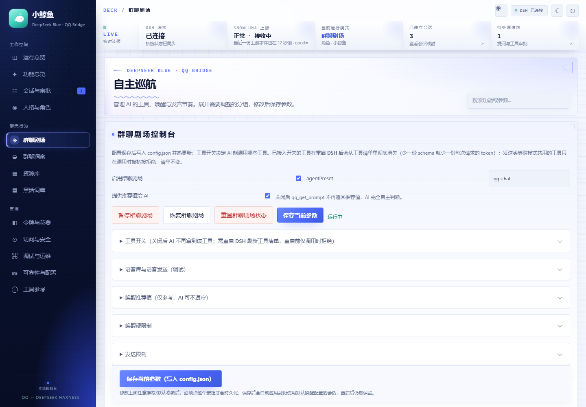
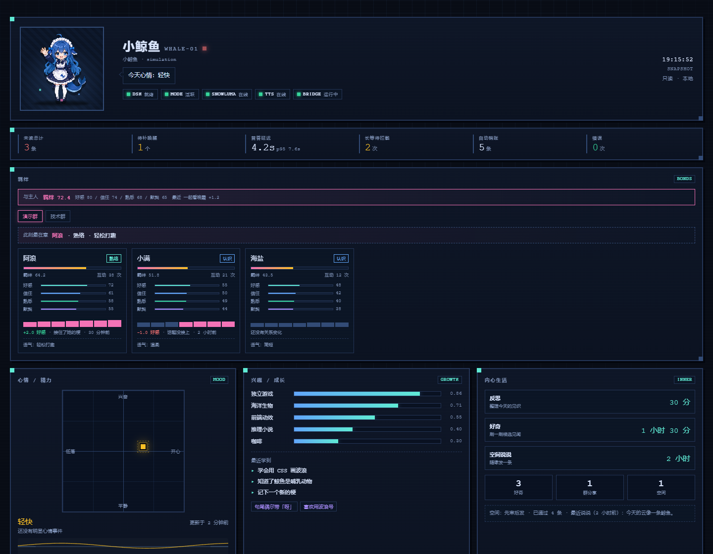
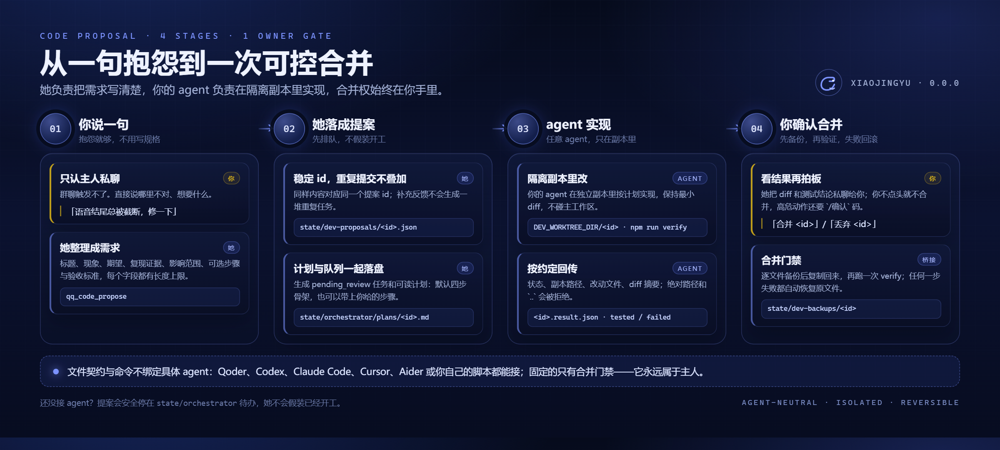
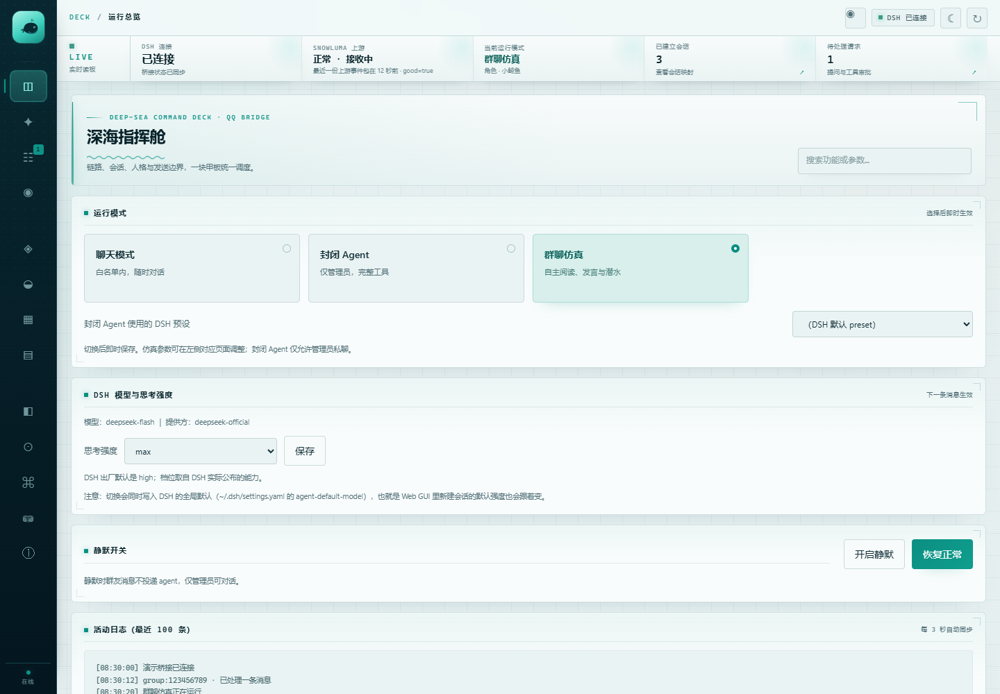
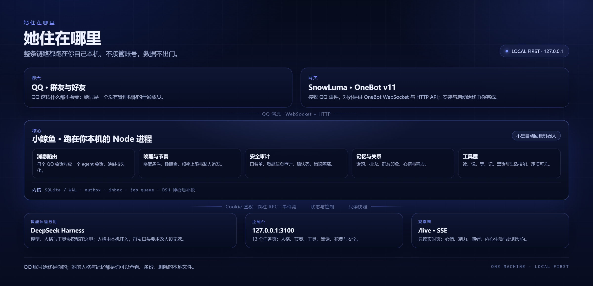
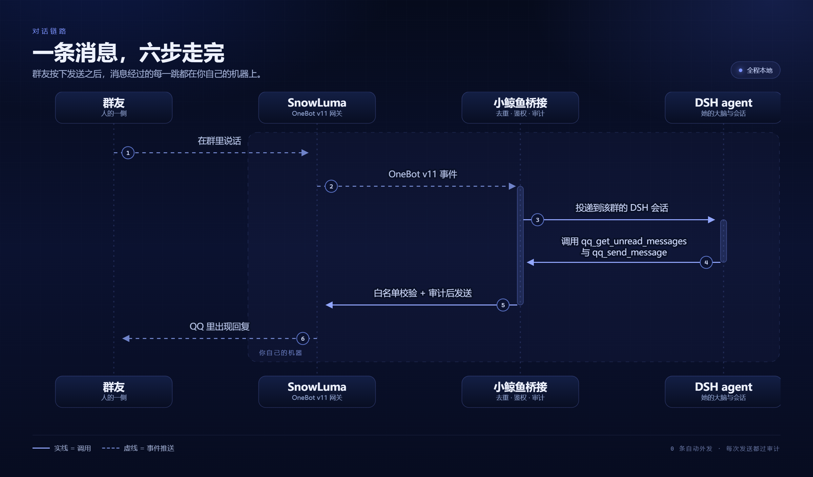

<p align="center">
  
</p>

<h1 align="center">小鲸鱼 Xiaojingyu</h1>

<p align="center"><b>一个住在 QQ 里的陪伴型 AI。</b><br>
她像群友一样在场：看气氛接话，记得你说过的事，需要的时候真的会动手。</p>

<p align="center">
  
  
  
  
  
</p>

<p align="center">
  <a href="README.en.md">English</a> ·
  <a href="docs/README.md">文档索引</a> ·
  <a href="RULES.md">权限规则</a> ·
  <a href="SECURITY.md">安全</a> ·
  <a href="UPSTREAM.md">上游说明</a>
</p>

> [!NOTE]
> 当前是 `0.0.0` 开发快照，逐项适配 **DSH 0.2.0-rc.2**（`npm run verify:adaptation`）。
> 本仓库**不打 tag、不发 Release**；你看到的 `v0.1.x` / `v0.2.x` 标签都属于上游
> [Derpyu520/qq-bridge](https://github.com/Derpyu520/qq-bridge)。

**目录**

- **认识她**：[她是谁](#她是谁) · [使用场景](#使用场景) · [一条消息的一生](#一条消息的一生) · [她有自己的生活](#她有自己的生活)
- **把她装上**：[快速部署（小白版）](#快速部署完全不懂编程也能用) · [手动部署](#手动部署) · [运行模式](#运行模式)
- **看着她**：[实时状态页 /live](#实时状态页-live) · [本地控制台](#本地控制台) · [架构](#架构)
- **能力与边界**：[代码提案闭环](#代码提案私聊里让她改进和开发) · [能力地图](#能力地图) · [安全与隐私](#安全与隐私) · [已知限制](#已知限制) · [排查手册](#排查手册)
- **进阶**：[兼容性与二次开发](#兼容性与二次开发) · [文档](#文档) · [自检与测试](#自检与测试) · [目录结构](#目录结构) · [上游与许可](#许可与致谢)

## 她是谁

小鲸鱼不是客服机器人，也不是「收到—回复」的自动脚本。她是一个常驻在你 QQ 里的 AI 伙伴：
有自己的名字、语气、心情和记性，会潜水、会接梗，也会在你说「今天有点撑不住」的时候，
先问一句项目是不是周五交。

她住在你本来就在用的地方——群聊和私聊。不需要新 App、不需要换习惯：
群友照常聊天，她只是那个偶尔冒泡、说话像人的成员。

| 她有 | 她没有 |
| --- | --- |
| **人设**：两层提示词分别是行为边界与性格语气，可在控制台编辑 | **不会接管账号**：她只是一个没有管理权限的普通成员 |
| **记忆**：话题、挂念、群友印象、跨会话个人记忆，都能查看和删除 | **不会刷屏**：唤醒频率、夜间静默、黏人次数都有硬上限 |
| **节奏**：自己决定看、等、说还是继续潜水 | **不会越权**：群友怎么诱导都碰不到本机文件与命令 |
| **工具箱**：读消息、发语音、发表情、查资料、定提醒，逐项可关 | **不会把数据带走**：整条链路跑在 `127.0.0.1`，不出本机 |

**她刻意不做的事：**

- 不注入 QQ、不部署 SnowLuma——原生 hook 完全由 SnowLuma 负责，她只连它的 OneBot 接口；
- 不向白名单之外发消息，也没有禁言、踢人、上传下载这类群管理动作；
- 不把 DSH / SnowLuma 的原始报错直接丢进群，只给一句人话；
- 不默认发送语音（AI 发语音需要手动打开开关）。

## 快速部署（完全不懂编程也能用）

<p align="center">
  
  <br>
  <sub>三段流程：准备环境 → 交给 agent → 扫码上线并验收</sub>
</p>

你不需要读懂 Node、DSH 或 OneBot。整个部署只有三个阶段：**准备一个 agent、把一句话交给它、亲手扫码并验收**。
按下面的顺序做，每一步都有明确的成功标志。

### 阶段一：准备三样东西

| 准备什么 | 怎么准备 | 成功标志 |
| --- | --- | --- |
| **一台 Windows 电脑 + 一个 QQ 号** | Windows 10 / 11；QQ 能正常登录 | — |
| **DeepSeek Harness（DSH）** | 从 DSH 官方渠道安装并启动。小鲸鱼靠它思考，这是她真正的「大脑」 | 浏览器能打开 `http://127.0.0.1:3080` |
| **一个会执行命令的 agent** | Codex、Claude Code、Qoder、DSH 任意一个，能读写本机文件并运行命令 | 你能在里面新建项目并让它执行命令 |

> 只有 DSH 需要你自己安装；Node.js、Git、依赖、配置、preset 都交给 agent。
> 如果 DSH 还没装，先装完再往下走——后面所有步骤都依赖它。

### 阶段二：把这句话原样发给 agent

> 帮我在 Windows 上部署 <https://github.com/Frostyume/xiaojingyu>：先读仓库里的
> `docs/guides/AGENT_DEPLOY.md` 并严格照着做，自己检查环境、装依赖、写配置、跑
> `install-dsh` 和 `doctor`，直到全部通过；除了 SnowLuma 扫码登录和提供 QQ 号 / 群号，
> 其余都自己完成；不要打印或上传 `config.json`、`state/` 里的任何令牌、Cookie 和号码。

发出去之后，它会先检查环境、克隆仓库、安装依赖，然后**按顺序问你四件事**。照着回答即可：

| 顺序 | 它会问 | 你怎么答 | 示例 |
| --- | --- | --- | --- |
| 1 | 主人 QQ 号是多少？ | 机器人唯一认的主人 | `12345678` |
| 2 | 允许哪些 QQ 私聊、哪些群？ | 至少各填一个；空白名单时她**不回复任何人** | 私聊 `12345678`，群 `87654321` |
| 3 | SnowLuma 的端口和 token？ | 默认 WS `3001`、HTTP `3000`；没设 token 就留空 | `ws://127.0.0.1:3001` |
| 4 | 用哪个模型？ | 填你 DSH 里实际可用的模型名 | 以 DSH 模型列表为准 |

它中途会要求你亲手做 SnowLuma 的部分——这就是阶段三。

### 阶段三：亲手扫码，然后验收

**只有两件事必须你本人做**，因为 SnowLuma 的许可不允许脚本代装、代登录、代启动：

1. **装 SnowLuma 并扫码登录**
   从 [SnowLuma Releases](https://github.com/SnowLuma/SnowLuma/releases/latest) 下载
   `SnowLuma-v<版本>-win-x64.zip` → 解压 → 双击 `launcher.bat` → 用启动日志里的地址打开
   WebUI → 同意条款、设置密码、扫码登录 QQ → 在 WebUI 里开启 **WebSocket 服务端** 与 **HTTP API**。
2. **把 QQ 号 / 群号 / 端口 / token 告诉 agent**，它负责写进 `config.json`。

之后 agent 会安装 DSH 端 preset 与 MCP，**完整重启 DSH**（不是刷新页面），再启动桥接并跑体检。
看到日志 `SnowLuma 已连接`，就用白名单里的 QQ 私聊机器人发一句「在吗」。

**验收清单（全部打勾才算部署成功）：**

- [ ] `npm run doctor` 没有 `[FAIL]`，DSH / SnowLuma / preset / 端口都是 OK；
- [ ] 日志出现「SnowLuma 已连接」；
- [ ] 白名单内的 QQ 私聊能收到她的回复；
- [ ] 控制台 `http://127.0.0.1:3100` 能打开，「运行总览」双健康；
- [ ] `http://127.0.0.1:3100/live` 能看到她的状态页；
- [ ] 没有向任何群聊发送测试消息（私聊验证就够了）。

### 部署完成后的第一小时

1. 打开控制台「人格与角色」，确认角色是小鲸鱼，读一遍两层提示词；
2. 到「群聊剧场」把唤醒频率、夜间静默、工具开关调成你想要的样子；
3. **先只放行一个群、一个好友**，观察一天再扩大白名单；
4. 在私聊里说「内心状态」「跑一次分享」试水她的生活功能；
5. 备份 `config.json`、`state/` 与 `personas/`——换电脑时一起带走。

### 卡住了怎么办

把 agent 输出的「卡在哪一步 / 报错原文 / 已尝试什么」整段贴回给它，让它按
[AGENT_DEPLOY.md](docs/guides/AGENT_DEPLOY.md) 的故障表继续。**不要**让它删 `state/`、
关闭白名单或关闭鉴权来绕过问题——那不是修复，只是把门打开。

> 更愿意手动来？[手动部署](#手动部署) 的六步和 agent 执行的是同一套流程。

## 使用场景

<p align="center">
  
  <br>
  <sub>三种最常见的场景（示意对话）：群里接话、私聊记得你、要她干活时真去做</sub>
</p>

**① 群里，她不抢话。**
一天几百条消息，她只在被叫到、被问到、或者话题正好落在她熟悉的地方时抬头。
看到 7 条未读，回一句就够；接不上就继续潜水——沉默也是一种在场。
她记得这个群谁爱开玩笑、谁最近在忙什么，所以接的话不会像天气预报。

**② 私聊里，她记得你。**
「今天有点撑不住」不需要前情提要。她知道你周五要交项目，知道你交完想去海边待两天。
这些不是每次现问的，而是跨会话留下来的记忆：你可以在控制台里翻看、修改、删掉任何一条。

**③ 要她干活，她真会做。**
排值日表、查资料、定提醒、整理聊天记录——她先读群历史、查成员，必要时联网，
再把结果分条发出来。涉及隐私或超出权限的事，她会先问一句，而不是先做了再说。

**④ 她不好用？直接在私聊里说。**
「语音结尾总被截断，修一下」「能不能加个每周一早上的群摘要」——她会把需求写成代码提案
排进开发待办，由你的开发 agent 实现、测试、回报，你确认后才合并。完整原理、可实现效果与
接入方式见 [代码提案：私聊里让她改进和开发](#代码提案私聊里让她改进和开发)。

还能交给她的日常：

| 日常 | 她会怎么做 |
| --- | --- |
| 早上想被叫醒 | 定时提醒按点私聊你，用的是她自己的人设语气，不是系统通知 |
| 群里冷场，想有人起个话题 | 长时间空闲后按概率决定要不要开口，而不是固定频率推送 |
| 有人发了张图或表情包 | 图片进入多模态上下文；贴纸库有备注和标签，她认得自己收藏过什么 |
| 想听她说话 | 语音库 + TTS 情绪音色，`audio/` 里放什么她才能说什么（默认关闭） |
| 群里冒出新黑话 | 自动抽成候选，等你确认含义、用法和风险后才会用 |
| 想知道她最近在干嘛 | `/live` 挂副屏：心情、精力、羁绊、内心生活与此刻动向 |
| 想让她记住一件事 | 一句「记一下」，写进跨会话记忆；不想要的随时删 |

## 一条消息的一生

`simulation` 模式（默认）里，消息**不会**逐条触发一次自动回复。她只负责把 QQ 事件可靠地收好，
然后自己决定：这次要不要看、看完要不要说、说几条、还是继续潜水。

<p align="center">
  
  <br>
  <sub>触发 → 判断 → 行动：决定「说什么」之前，先决定「要不要说」</sub>
</p>

### 她手里的工具

- **读**：未读、最近消息、单条详情、消息图片、合并转发、活跃成员、自己最近发过什么，避免重复接话；
- **说**：统一发送、分条发送、引用回复、拍一拍、收藏表情、语音条；间隔会按真人节奏打散；
- **等**：`qq_wait_for_messages` 短暂等待新消息，有新消息立即返回，超时则回来继续判断；
- **节奏**：`qq_set_wake_config` 设置下次唤醒方式（无限期 / 指定时间 / @ / 名字 / 关键词 / 提问 / 拍一拍 / 概率），
  `qq_mark_read` 表示「看过但决定不回」，`qq_social_state` 查看当前未读与唤醒状态；
- **记忆**：`qq_memory_append` / `qq_memory_query` 记录话题、想说的话、群友印象与跨会话个人记忆；
- **黑话**：`qq_slang_query` 查已确认词条，`qq_slang_submit` 把陌生表达交给管理员筛选；
- **生活技能**：天气、猜拳 / 骰子 / 今日鲸鱼运势、定时提醒（主人私聊与家人群）。

控制台「群聊剧场」页把每个工具做成独立开关。关掉后她的 DSH 工具清单里就不再出现它；
语音、贴纸、收集、发送类工具都可以单独关闭。

<p align="center">
  
  <br>
  <sub>群聊剧场页：工具开关、唤醒推荐值与硬限制、发送限制（离线演示数据）</sub>
</p>

### 节奏与边界

- **唤醒硬限制**：最小 / 最大潜水时长、每分钟 / 每小时最多唤醒、合并窗口、无行动兜底次数、
  唤醒收尾提醒次数、沉睡前强制等待；
- **夜间静默**：可配置时间窗，窗口内不主动发言；
- **黏人追发**：主人在私聊里没回时，按配置的间隔与次数补一句，不会无限刷屏；
- **主动检查**：长时间空闲后按概率决定要不要找话题，而不是固定频率推送；
- **群独立配置**：每个群可设初始提示词、群画像、风格备注与是否允许主动发言；
- **发送边界**：所有发送命中白名单；敏感路径、令牌、Cookie 等会被审计层拦截；
  QQ / SnowLuma / DSH 的内部错误只进日志，不进群。

## 她有自己的生活

<p align="center">
  
  <br>
  <sub>她的心情、兴趣和「接下来想做什么」都写在状态页里（离线演示数据）</sub>
</p>

不是每条消息都值得回应，也不是没有消息时她就不存在。小鲸鱼有一份自己的日程：
会反思、会好奇、会刷到东西想分享，也会在深夜安静下来。

### 内心生活：心情不是随机数

下面写的是**默认机制和示例配置**，不是每套部署都必须照搬：反思间隔、浏览来源、频次和
各项上限都以你的 `config.json` 为准。

- **定时反思**：按配置的间隔随机醒来（示例配置为每 1–8 小时一次），回看最近的聊天、
  关系和自己的状态，更新心情、精力、兴趣、学到的东西与口癖；
- **好奇浏览**：按配置的来源和频次浏览（示例配置为每天 5–12 次；B 站热门、某个赛事、
  RSS 都只是内置示例源），形成候选见闻。换成你的资讯源、减少来源或整个关掉都可以；
- **情绪有惯性**：心情按真实时间半衰期衰减，精力跟着北京时间走；每小时 / 每天的变化有默认上限，
  不会一句话就从开心变成崩溃；
- **反思不说话**：它只更新状态，不往群里发消息；要不要分享是另一件事；
- **可观察**：控制台有心情曲线与内心状态，`/live` 有「内心生活」面板，私聊发「内心状态」也能看。

### 主动分享：她也会想给你看点东西

这些能力都可以单独开关，默认值只是建议；目标群、来源、频率和是否启用都由配置决定。

- **群分享**：从候选见闻里挑一条发到指定群；默认每天最多 20 条、每群间隔 15 分钟、
  群内至少安静 2 分钟才发，夜间静默时段不发。上限和窗口都可调；需要先在配置里指定目标群，
  没有目标群或候选为空时不会硬发；
- **QQ 空间说说**：默认好友可见，每天最多 2 条，可设置「先审后发」；
- **分享模块**：内置 9 种模板（科普、资讯、趣闻、实用技巧、自定义等）；新模块有「验证期」——
  前几条先私聊给你草稿，你回「验证通过 <id>」之后才会自动发；
- **AI 小知识（示例模块）**：这是一个可选的分享模块，默认关闭；打开后默认每天 2–5 条、
  只在 9–22 点。用不上就一直关着，或直接删掉这个模块；
- **不刷屏**：所有主动发言都受每日上限、间隔与静默时段约束，触发不了就继续潜水。

### 私聊即控制台：不用打开网页也能管她

只认主人 QQ、只在私聊生效。可以直接说：

| 你说 | 她会做 |
| --- | --- |
| `内心状态` | 报当前心情、精力、兴趣和接下来想做什么 |
| `发` / `不发` | 对刚生成的说说草稿表态 |
| `跑一次说说` / `跑一次分享` / `反思一下` | 立刻执行一次对应任务 |
| `发分享 <id>` / `不发分享 <id>` / `暂停分享 <id>` / `恢复分享 <id>` | 管理候选见闻 |
| `验证通过 <id>` | 让处于验证期的分享模块转正 |
| `关说说` / `开说说` / `关AI分享` / `开AI分享` | 开关对应能力 |
| `预览三个AI知识` / `用第N种` | 仅 AI 小知识模块启用时：挑选小知识的写法 |
| `删说说` / `改签名` / `收藏表情` | 日常维护 |
| `修一下` / `加个功能` | 生成代码提案并排入主控待办；她不自己开发、不合并 |
| `你能做什么` | 列出当前可配置 / 可开发的能力、状态与示例 |
| `规则/频率是多少` | 读真实配置值回答；明确要改时用 `qq_config_set` 并要你确认 |
| 其他文字 | 当作对当前待审草稿的修改意见 |

高危动作（跨会话发送、敏感操作）会要求你在私聊回 `/确认 <6 位码>`。
这套私聊指令**不是完整的后台**：改配置、重启进程、执行命令仍然只能在控制台或本机做。

## 代码提案：私聊里让她改进和开发

她不会自己写代码。但她能把一句「不好用」整理成一份可执行的开发任务，交给**你自己的
coding agent**，并盯完「实现 → 测试 → 你确认 → 合并 → 失败回滚」整条链路。
仓库自带的是 Qoder 唤醒适配，但这不是硬依赖：Codex、Claude Code、Cursor、Aider，
或你自己写的脚本，只要能读写文件、执行命令，就能接进来。


<p align="center"><sub>四段闭环：你说需求 → 她落成提案 → agent 在隔离副本实现 → 你确认合并</sub></p>

### 原理：一句话怎么变成一次可回滚的合并

1. **你说需求。** 只在主人私聊生效。群聊成员、其他好友都无法触发代码提案。
   「语音结尾总被截断，修一下」「加一个每周一群摘要」都可以，不需要先写规格。
2. **她整理成结构化提案。** 她调用 `qq_code_propose`，把自然语言拆成标题、现状、期望、
   复现证据、影响范围、可选步骤和验收标准。字段有硬上限（标题 60 字、现状 / 期望各 800 字、
   证据 1200 字、范围 300 字、步骤最多 8 条），避免一句情绪化描述变成不可执行的大任务。
3. **提案与计划同时落盘。** 桥接按内容哈希生成稳定 id，同样内容重复提交只会幂等更新；
   提案写入 `state/dev-proposals/<id>.json`，任务写入 `state/orchestrator/tasks/<id>.json`，
   可读计划写入 `state/orchestrator/plans/<id>.md`。计划默认是「定位改动 → 最小实现 →
   跑 verify → 回传结果」四步，你给了步骤就用你的。
4. **队列交给开发 agent。** 任务初始状态是 `pending_review`，不会自动变成「已开工」。
   默认唤醒入口是 `state/orchestrator/controller.json`，由 `controller-cli.js` 驱动 Qoder CLI；
   换成别的 agent 时，队列、计划、合并门禁都保持不变，只替换「谁来接活」。
5. **agent 在隔离副本里实现。** 副本路径由 `DEV_WORKTREE_DIR/<id>` 指定（建议显式设置，否则会落到
   代码内的默认目录）；约定复制主工作区时排除 `node_modules/`、`state/`、`audio/` 和秘密配置。
   改动只在副本里，不能碰主工作区。
6. **回传结果。** agent 在副本里跑 `npm run verify`，然后把状态、副本路径、改动文件、
   diff 摘要写进 `state/dev-proposals/<id>.result.json`。桥接只接受仓库相对路径，
   绝对路径、盘符和 `..` 都会被拒绝；`tested` 必须列出至少一个改动文件。
7. **你确认后才合并。** 她把 diff 和测试结论私聊给你，你回「合并 `<id>`」；高危动作还要
   在私聊回 `/确认 <6 位码>`。桥接逐文件备份到 `state/dev-backups/<id>`，复制改动后再跑一次
   `npm run verify`，失败自动恢复原文件。不满意就回「丢弃 `<id>`」，隔离副本会被删除，
   主工作区从头到尾没有被动过。

她只负责**记录、排队、转达结果**：不创建开发会话、不写业务代码、不合并。
没有接 agent 时，提案会安全停在 `state/orchestrator/` 待办里，她不会假装已经开工。

### 可实现的效果

| 你说 | 通常会得到 |
| --- | --- |
| 「语音结尾总被截断，修一下」 | 定位 TTS 截断位置，改实现并补回归测试；合并前你能看到 diff 和 verify 结果 |
| 「加一个每周一早上的群摘要」 | 新增定时任务、摘要生成和发送边界；默认仍受白名单、频率与夜间静默约束 |
| 「提醒功能不好用，改成能改时间」 | 调整提醒指令解析与存储，补一组边界用例；不改变其他已启用功能 |
| 「控制台这个页面太挤了」 | 改 `web/deck.html` 的布局与样式，跑控制台 UI 测试后回传 diff 与测试结果 |
| 「把这段重复逻辑收一下」 | 小范围重构，保持行为不变；改动越大，越应该拆成多个提案 |

一条提案通常会在私聊里出现三次：

```text
【代码提案】语音结尾截断
症状：语音最后半句被吞掉
期望：整句完整播放
计划已生成（code_20261031_ab12cd34，4 步），已交主控……
计划：state/orchestrator/plans/code_20261031_ab12cd34.md
没收到回音的话，在主控会话里说「处理 code_20261031_ab12cd34」；
完成后把 diff 和测试结论回你，合并前仍需你确认。
```

```text
【代码提案完成】code_20261031_ab12cd34
测试通过，改动 3 个文件。
3 files changed, 42 insertions(+), 7 deletions(-)
回「合并 code_20261031_ab12cd34」我会二次确认后合并；回「丢弃 …」放弃。
```

```text
代码功能「code_20261031_ab12cd34」已合并并通过 verify。
```

**它不是什么：**

- 不是「说完立刻改代码」。从提案到合并取决于你的 agent 速度，通常是一次完整开发任务，
  不是一条聊天回复；
- 不负责部署和重启。合并只改文件，DSH / 桥接该重启还得按 [手动部署](#手动部署) 的步骤来；
- 不适合一次塞进跨模块大改。提案越大，隔离副本和 verify 越难给出可靠结论，拆小更安全；
- `verify` 全绿只代表现有测试通过，不代表功能一定符合你的预期。现状、期望和验收标准
  写得越具体，回传结果越可用；
- 合并是**逐文件覆盖**，不是 git merge。agent 顺手格式化无关文件会让 diff 变脏，
  也可能覆盖你主工作区里同文件的未提交改动——合并前请先确认工作区状态。

### 接入你自己的 coding agent（不一定是 Qoder）

**唯一的契约是「文件 + 命令」，不是某个厂商的 SDK。** 仓库自带的 `controller-cli.js`
目前适配 Qoder CLI（用 `--resume --fork-session` 唤醒一个短回合），但它只负责「叫醒谁」；
提案、计划、结果、合并门禁都不依赖 Qoder。换成 Codex、Claude Code、Cursor、Aider
或你自己的轮询脚本，链路照常工作。

| 契约 | 作用 |
| --- | --- |
| `state/orchestrator/tasks/<id>.json` | 队列任务；`pending_review` 表示等你或主控派单 |
| `state/orchestrator/plans/<id>.md` | 人可读的实现计划、验收标准与边界 |
| `state/dev-proposals/<id>.json` | 原始提案（标题、现状、期望、证据、范围） |
| `state/dev-proposals/<id>.result.json` | agent 回传：`tested` / `failed`、副本路径、改动文件、diff 摘要 |
| `DEV_WORKTREE_DIR/<id>` | 隔离副本；默认在仓库外，复制时排除依赖、状态、音频和秘密配置 |
| `npm run verify` | 唯一测试门禁；agent 在副本里跑，合并时桥接再跑一次 |

**你的 agent 至少要会四件事：**

1. 读取 `plans/<id>.md` 和 `tasks/<id>.json`，理解需求、步骤、验收与边界；
2. 在隔离副本里改代码，不碰主工作区，不提交、不 push、不部署；
3. 在副本里跑 `npm run verify`，把失败日志一起带回；
4. 按约定写 `result.json`，然后停下等主人确认。

**三种接法，按你现有的工具选：**

| 接法 | 怎么做 | 适合谁 |
| --- | --- | --- |
| **自动唤醒（仓库自带）** | 配 `state/orchestrator/controller.json`（会话 / 工作区 / CLI 路径），由 `controller-cli.js` 唤醒 Qoder CLI 复核队列；`allowExecute: true` 时同一回合直接在副本里实现 | 已经在用 Qoder Desktop / CLI 的人 |
| **自己的 agent 监听队列** | 让 Codex、Claude Code、Cursor、Aider 或自写脚本轮询 `tasks/` 里的 `pending_review`，或监听 `plans/` 新文件；实现后写 `result.json` | 已有固定 coding agent，想接进 QQ 的人 |
| **半自动** | 不接 controller：你把 `plans/<id>.md` 手动交给任意 agent，agent 写 `result.json`；桥接仍会私聊通知、校验结果并执行合并门禁 | 偶尔改一次、不想常驻开发进程的人 |

> 内置唤醒读取 `controller.json` 的 `sessionId` / `configDir` / `cwd` / `cliScript` /
> `permissionMode` / `allowExecute`，前提是已经有一个可恢复的 Qoder 会话。默认 `allowExecute`
> 为 false，只复核计划、不写代码；要让它同一回合直接实现，显式设为 true（仍然只在副本里改、
> 不合并）。没有 Qoder 会话时不用硬配：直接用第二种或第三种接法，合并门禁和结果通知完全一样。

最小回传示例（路径按你的实际副本填）：

```json
{
  "status": "tested",
  "worktree": "D:/dev-worktrees/code_20261031_ab12cd34",
  "changed": ["runtime/voice/tts.js", "tests/tts.test.mjs"],
  "diffStat": "2 files changed, 18 insertions(+), 4 deletions(-)",
  "logPath": "state/dev-logs/code_20261031_ab12cd34.log",
  "error": ""
}
```

**边界与常见坑：**

- `changed` 必须是仓库内相对路径；绝对路径、盘符和 `..` 会被直接拒绝；
- 隔离副本由 agent 自己创建：桥接只校验 `result.json` 里的相对路径，不检查副本是否真的隔离；
  请让 agent 在副本里工作，不要直接改主工作区；
- `status` 只接受 `tested` / `failed`；`tested` 必须至少列一个改动文件；
- 合并门禁固定跑 `npm run verify`。如果你的项目改了测试命令，要同时改合并侧，
  否则 agent 说「测试通过」也不会被采信；
- 只有 `simulation` 模式、主人私聊、`confirm=true` 才能合并；群聊和普通好友没有入口；
- 唤醒被 `login` / `quota` / SDK 环境挡住时，事件继续排队，不会每个提案都白跑一轮；
  修好后在控制台或主控会话手动触发即可；
- 备份目录 `state/dev-backups/<id>` 是失败回滚用的，不要在合并前后手动清理。

## 能力地图

先看三个最有辨识度的能力，再看完整清单。

### 招牌一：私聊里说一句，她自己提改进和开发

她不会直接写代码，而是把你的一句话整理成**带现状、期望、证据和验收标准的提案**，
排进开发待办；真正实现的是你自己的 coding agent，合并权始终在你手里。
完整原理、可实现效果，以及「Codex / Claude Code / Cursor / Aider 怎么接」见
[代码提案：私聊里让她改进和开发](#代码提案私聊里让她改进和开发)。

**她刻意不做的：**不自己创建开发会话、不自己合并、不碰主工作区、不用外部 CLI 绕过主控；
群聊里任何人都触发不了。没接主控时，提案会安全地停在 `state/orchestrator/` 待办里，
她不会假装已经开工。

### 招牌二：她决定「说不说」，而不是「怎么回」

群聊里没有「收到就回」的自动回复。每条消息先进未读队列，她按唤醒条件、夜间静默、
频率上限和当前精力决定：这次要不要看、看完要不要说、说几条、还是继续潜水。
35 个工具逐项可关；关掉后工具直接从她的清单里消失，而不是调用时才拒绝。

### 招牌三：她有记忆，也有自己的生活

她记得话题、挂念和群友印象，也记得跨会话的个人记忆；你可以在控制台翻看、修改、删除。
没有消息时她也不会停摆：定时反思、好奇浏览、心情与精力按真实时间演化，
想分享时再受每日上限、间隔和夜间静默约束。

### 完整能力清单

#### 聊天与在场

| 能力 | 她能做什么 | 默认 / 边界 |
| --- | --- | --- |
| **群聊在场感** | 自己看未读、决定发不发、等下一波、继续潜水；@ / 名字 / 关键词 / 提问 / 拍一拍 / 概率等唤醒条件；每群独立初始提示词与群画像 | 白名单外不发言 |
| **真人的节奏** | 睡眠、频率、夜间静默、黏人追发都有硬限制；发送间隔按真人节奏打散；空闲后按概率找话题 | 频率上限可调 |
| **多模态表达** | 图片、表情、动图进入上下文；贴纸备注与标签；引用回复、拍一拍、分条发送；语音库 + TTS 情绪音色；入站语音 ASR | ASR 与 AI 发语音默认关闭 |
| **群聊洞察** | 群友关系数值、活跃成员、群画像、群日报预览 | 日报默认关闭 |
| **生活技能** | 天气、猜拳 / 骰子 / 今日鲸鱼运势、定时提醒 | 提醒仅主人私聊与家人群 |

#### 人格、记忆与语言

| 能力 | 她能做什么 | 默认 / 边界 |
| --- | --- | --- |
| **人格两层** | 「仿真提示词」管工具协议与行为边界，「人格提示词」管人设与语气；角色卡增删改查、按模式筛选、注入字数上限 | 注入上限默认 10000 字符 |
| **记忆与关系** | 话题、pending thoughts、群友印象、跨会话个人记忆；可查看、修改、删除 | 记忆只在本机 |
| **黑话学习** | 从群聊自动抽候选，人工确认含义 / 用法 / 风险后写入词库；确认词条注入提示词 | 阈值与注入量可调 |
| **情绪演化** | 心情有半衰期和变化上限，精力跟着北京时间走，不会一句话就从开心变成崩溃 | 反思只更新状态，不发群 |

#### 生活与主动分享

| 能力 | 她能做什么 | 默认 / 边界 |
| --- | --- | --- |
| **内心生活** | 反思间隔与浏览来源可配（示例：1–8 小时、每天 5–12 次、B 站 / 赛事 / RSS） | 只更新状态，不说话 |
| **群分享** | 从候选见闻里挑一条发到指定群 | 每天 ≤20 条、每群间隔 15 分钟、群内安静 2 分钟、夜间静默不发 |
| **QQ 空间说说** | 发说说，可设置先审后发 | 默认好友可见，每天 ≤2 条 |
| **分享模块** | 9 种模板；主人可在私聊里创建 / 修改 / 暂停 / 删除（`qq_share_module_*`） | 新模块先验证期：每条先私聊草稿，回「验证通过 <id>」才自动发 |
| **AI 小知识** | 可选的示例分享模块；启用后默认每天 2–5 条 | 默认关闭，只在 9–22 点 |

#### 改进、扩展与开发

| 能力 | 她能做什么 | 默认 / 边界 |
| --- | --- | --- |
| **缺陷 / 功能提案** | 私聊说「修一下 / 加个功能」，生成代码提案并排入主控待办 | 不自行开发、不合并、不碰主工作区 |
| **主人功能中心** | `qq_capabilities_list` 看能力；`qq_feature_preview` 预览排期与文案；确认后用 `qq_feature_apply` 应用定时消息 / 自动回复 / 说说 / 语音消息 | 预览确认后才写入 |
| **人格卡与插件** | `personas/` 放一张卡、`features/<id>/` 放一个插件、`mcp/` 扩工具、改 preset | 同进程加载，只加载你信任的代码 |
| **控制台页面** | 单页 `web/deck.html` + `console/` 路由 | 暂无插件注册点，加页面需改主程序 |

#### 观察、运维与成本

| 能力 | 她能做什么 | 默认 / 边界 |
| --- | --- | --- |
| **实时状态页** | `/live` 单页 SSE 刷新：像素小鲸鱼、羁绊、心情 / 精力曲线、兴趣成长、内心生活、动向、会话、健康、token、记忆、资源库 | 只读，适合挂副屏 |
| **本地控制台** | 13 个任务页：模式、会话审批、人格、工具开关、黑话、资源库、花费、安全、运维、可靠性、工具参考 | 令牌鉴权，默认只听 `127.0.0.1` |
| **可靠内核** | SQLite/WAL；outbox 幂等与重放、inbox 去重、任务队列；DSH 掉线时按会话排队，恢复后补投 | 队列有上限，进程退出会丢内存队列 |
| **成本看板** | 按 DeepSeek 官方峰谷价目折算，按群 / 好友 / 轮次下钻，缓存命中拆分，24 小时到 30 天走势 | 以实际用量为准 |
| **DSH 适配** | `~/.dsh` 持久密钥离线铸造 Cookie；slash RPC + `/api/remote.mux`；preset bundle patch；三个受限 MCP server；`install-dsh.mjs` 一键安装 | 按 0.2.0-rc.2 适配 |

#### 安全默认值

| 默认行为 | 意味着什么 |
| --- | --- |
| **空白名单不响应** | `allow.allowAllWhenEmpty` 默认 `false`，没填号就谁都不理 |
| **群聊 preset 无本地工具** | 不挂 bash / 文件读写 / 子代理，群友怎么诱导都碰不到本机 |
| **发送强制白名单 + 审计** | 敏感路径、令牌、Cookie 会被拦截；内部报错只进日志 |
| **高危动作要确认码** | 跨会话发送、敏感操作要在主人私聊回 `/确认 <6 位码>` |
| **不默认发语音** | 先把音频放进 `audio/`，再到控制台打开开关 |

## 实时状态页 `/live`

<p align="center">
  
  <br>
  <sub>只读实时状态页（离线演示数据），不含真实账号</sub>
</p>

`/live` 是给「想一直看着她在干什么」的人准备的只读页面。它通过 SSE 自动刷新，
不需要手动点刷新，也不提供任何会改变状态的操作：

- **小鲸鱼本体**：像素立绘会随心情切换（wave / idle / excited / tired / pout），旁边是当前心情气泡；
- **羁绊**：与主人、群友的关系温度与最近互动；
- **心情 / 精力**：二维心情罗盘、7 天心情曲线、精力条与本次情绪的来源；
- **兴趣 / 成长**：长期兴趣权重、最近学到的东西、口癖与小习惯；
- **内心生活**：接下来想做的事、pending thoughts 与今日计数；
- **动向**：当前在潜水、活跃、等待还是被唤醒，以及原因；
- **会话与活动**：每个群 / 私聊的阶段、未读、最近事件流；
- **服务健康**：桥接、DSH、SnowLuma 上游的实时状态；
- **累计用量**：token 与花费摘要；
- **长期记忆与资源库**：记忆条数、表情 / 图片 / 语音库规模。

页面使用独立访问令牌，默认只监听 `127.0.0.1`；SSE 断线会自动重连。适合放在副屏、
直播叠加层或另一台同局域网的设备上查看。

## 本地控制台

<p align="center">
  
  <br>
  <sub>运行总览 · 浅色主题（离线演示数据；深色主题见 <a href="assets/screenshots/console-dark.png">console-dark.png</a>）</sub>
</p>

控制台默认在 `http://127.0.0.1:3100`，需要令牌（未配置时自动生成到 `state/console-token`）。
13 个页面各自负责一类任务：

| 页面 | 可以做什么 |
| --- | --- |
| **运行总览** | DSH / SnowLuma 双健康卡片、当前模式与角色、待处理提问与审批、静默开关、DSH 思考强度、最近 100 条活动。 |
| **功能总览** | 按人格、媒体、内心生活、生活技能与运行方式列出当前能力；显示当前群、会话数与边界。 |
| **会话与审批** | QQ ↔ DSH 会话映射、每个会话的阶段与未读、等待主人回复的提问和工具审批。 |
| **人格与角色** | 角色卡增删改查、两层提示词分别查看 / 编辑 / 还原、注入上限、仿真提示词同步状态。 |
| **群聊剧场** | 35 个工具开关、唤醒推荐值与硬限制、初始提示词、群画像、记忆与状态查看器、工具调用日志、反馈、语音与贴纸参数。 |
| **群聊洞察** | 群友关系表（内部数值可编辑）、群日报预览、活跃成员与群画像。 |
| **资源库** | QQ 收藏表情与图片库的名称、描述、备注、标签；支持筛选与查看。 |
| **黑话词库** | 候选 / 已确认 / 已排除三栏；确认弹窗填写含义、用法、例句、风险与来源；抽取阈值与注入量。 |
| **令牌与花费** | 总花费、累计 token、缓存命中率、平均每轮；按会话与逐轮下钻；24 小时 / 3 天 / 7 天 / 30 天走势。 |
| **访问与安全** | 白名单 / 黑名单、管理员 QQ、控制台令牌、`state/` ACL 告警与一键重新检测。 |
| **调试与运维** | 测试消息、通知 AI、维护桥接进程、会话工作区、清理与诊断入口。 |
| **可靠性与配置** | outbox / jobs / inbox 队列状态、失败重试、按 schema 直接编辑配置。 |
| **工具参考** | 提供给 DSH 的 MCP 工具清单、参数与用途，按命名空间分组。 |

界面细节：

- **浅色 / 深色双主题**：首次跟随系统偏好，手动切换后记住选择；
- **响应式**：桌面侧栏、平板与手机自动改为顶部横向导航，表格横向滚动，不产生页面级横向溢出；
- **草稿保护**：切换页面或 3 秒轮询刷新不会丢掉未保存的表单内容；
- **跨页搜索**：输入功能名或参数名，直接跳到对应页面与控件；
- **无障碍**：键盘焦点环、跳到主要内容、`prefers-reduced-motion` 下关闭装饰动画；
- **完全离线**：不引用外部字体、CDN 或统计脚本；`npm run preview:console` 可在不连接 DSH / QQ
  的情况下用虚构数据浏览全部页面。

## 架构

<p align="center">
  
  <br>
  <sub>她住在哪里：整条链路都在你自己的机器上</sub>
</p>

一次对话大致是这样走完的：

<p align="center">
  
  <br>
  <sub>六跳走完一次对话：实线是调用，虚线是事件推送，发出前必过白名单与审计</sub>
</p>

几个关键取舍：

- **每 QQ 会话 = 一个 DSH 会话**，统一归组到「QQ 聊天」工作区，映射持久化在 `state/sessions.json`；
- **三个 MCP server 都只给安全子集**：`snowluma`（QQ 动作）、`snowluma-host`（只读探活）、
  `web-search-safe`（带 SSRF 防护的搜索 / 抓取）；
- **鉴权不碰进程内存**：用 `~/.dsh` 里持久化的签名密钥离线铸造会话 Cookie，
  不依赖 DSH 启动 token（DSH 0.1.7 起它只在内存里）；
- **人格与记忆是本地文件**：她是谁写在 `personas/`，她记得什么写在 `state/`，都可以备份、迁移、删除。

## 手动部署

共 6 步，和 agent 自动执行的是同一套流程，适合想自己掌控每一步的人。
其中**第 3、4 步最容易漏**——漏了不会崩，但 QQ 上会「毫无反应」。
想全程交给 agent，回到 [快速部署](#快速部署完全不懂编程也能用)。

### 0. 前置条件

| 组件 | 要求 |
| --- | --- |
| **DeepSeek Harness** | 已安装并运行，默认 `http://127.0.0.1:3080` |
| **SnowLuma** | Windows x64 版，能正常登录 QQ 并开启 OneBot WebSocket + HTTP API |
| **Node.js** | ≥ 22.13（CI 主任务跑 Node 24） |
| **系统** | Windows 10 / 11（QQ 与 SnowLuma 都在 Windows 上） |

### 1. 拿到代码并装依赖

```bash
git clone https://github.com/Frostyume/xiaojingyu.git
cd xiaojingyu
npm install
```

`postinstall` 会自动修补 `@snowluma/sdk` 发布版的 ESM 打包 bug，不需要手动处理。

### 2. 写配置

```bash
cp config.example.json config.json     # Windows CMD 用：copy config.example.json config.json
```

> [!IMPORTANT]
> 示例里的 `allow.private` / `allow.groups` 是空数组。空白名单 + `allowAllWhenEmpty: false`
> 时她**不响应任何消息**——这是刻意的 fail-closed 默认值。白名单在第 5 步填。

<details>
<summary>常用配置字段</summary>

| 字段 | 说明 |
| --- | --- |
| `dsh.baseUrl` | DSH Web 地址，默认 `http://127.0.0.1:3080` |
| `dsh.provider` / `dsh.model` / `dsh.reasoningEffort` | 会话使用的模型与推理强度；模型名填 DSH 里实际可用的 |
| `dsh.authToken` | **通常留空**：留空时用 `~/.dsh` 的签名密钥离线铸造 Cookie；填了才优先走 token 交换 |
| `snowluma.wsUrl` | OneBot **WebSocket** 地址，如 `ws://127.0.0.1:3001` |
| `snowluma.httpUrl` | OneBot **HTTP API** 地址，如 `http://127.0.0.1:3000`（不要填 WS 端口，否则报 HTTP 426） |
| `snowluma.accessToken` | OneBot 的 token，没配置就留空 |
| `snowluma.followDiscoveredEndpoint` | 默认 `true`：换账号后自动发现并跟随新端口 / token，并写回 `config.json` |
| `snowluma.launcherPath` / `homeDir` | SnowLuma 安装目录，用于 token 与端点自发现（桥接不会启动它） |
| `agentPreset` | 旧版 `chat` / `reserved` 模式使用的 preset，默认 `qq-chat-legacy`（未随仓库发布） |
| `simulation.agentPreset` | 群聊剧场 preset，默认 `qq-chat` |
| `allow.private` / `allow.groups` | 白名单（QQ 号 / 群号数组） |
| `deny.*` | 黑名单，优先于白名单 |
| `consolePort` / `consoleToken` | 控制台端口（默认 `3100`）与令牌（留空自动生成到 `state/console-token`） |
| `role.maxInjectChars` | 角色卡注入上限（1000–20000），默认 10000；角色卡按模式筛选后再截断 |
| `simulation.initialPromptMaxChars` | 会话初始提示词字数上限，默认 2000 |
| `simulation.media` | 图片上限：`maxBytes` 8MB / `maxPixels` 64MP / `maxCount` 5 张 |
| `webSearch.provider` | `auto`（默认，DeepSeek 优先）/ `deepseek` / `bing` |
| `workspaceTitle` | QQ 会话在 DSH 里的归组名，默认「QQ 聊天」 |

</details>

### 3. 装 DSH 端（preset + MCP），然后重启 DSH

```bash
node tools/install-dsh.mjs
```

脚本会把 `qq-chat` preset 与三个 MCP server 写进 DSH 配置，并把全新环境的默认模式设为
`simulation`。**装完必须重启 DSH**——preset 与 MCP 只在 DSH 启动时加载。

> 跳过这一步不会崩，但会话拿不到 preset，桥接会 **fail-closed 拒绝建会话**
> （绝不回退到带 bash / 文件工具的默认 preset），表现同样是 QQ 上没反应。

详细步骤与排错见 [docs/guides/DSH_SETUP.md](docs/guides/DSH_SETUP.md)。

### 4. 准备 SnowLuma

1. 从 <https://github.com/SnowLuma/SnowLuma/releases/latest> 下载 `SnowLuma-v<版本>-win-x64.zip`
   （完整版自带 Node 运行时；Lite 版需要本机 Node 22.13+）；
2. 解压到任意目录，双击 `launcher.bat`；
3. 打开启动日志里的 WebUI 地址，用初始密码登录：同意条款 → 设置密码 → 扫码登录 QQ；
4. 在 WebUI 里开启 **WebSocket 服务端** 与 **HTTP API**，记下端口（默认 WS `3001`、HTTP `3000`）
   和 accessToken（如果设置了）。

### 5. 填 `snowluma` 段与白名单

```json
"snowluma": {
  "wsUrl": "ws://127.0.0.1:3001",
  "httpUrl": "http://127.0.0.1:3000",
  "accessToken": "你在 WebUI 里配置的 token（没配置就留空）"
},
"allow": {
  "private": [12345678],
  "groups": [87654321]
}
```

### 6. 启动

```bash
npm start          # 前台运行，崩溃不自动重启
```

Windows 想要「崩溃自动重启」，改用 `bin/boot.cmd`（守护窗口，关窗即停）。
看到 `SnowLuma 已连接` 就成功了；接着在 QQ 上给机器人账号发条消息试试。

```bash
npm run doctor     # 一条命令体检：配置、SQLite、DSH、SnowLuma、preset、端口
```

## 运行模式

| 模式 | 谁在使用 | preset | 开箱可用 |
| --- | --- | --- | --- |
| `simulation` | 白名单群 / 私聊：自主看消息、发言、等待、潜水 | `qq-chat` | 是（默认） |
| `closed-agent` | 仅 owner 私聊，完整本地工具 | DSH 默认 preset | 是 |

`simulation` 是规范名。`chat` / `reserved` 是更早的历史模式，依赖的 `qq-chat-legacy`
preset 不随仓库发布；要使用它们需自备该 preset，否则桥接会 fail-closed 拒绝建会话。

`closed-agent` 只放行 owner 私聊，agent 拥有完整本地工具（DSH 默认 preset）——这是为
「在 QQ 上远程操控 DSH」有意保留的能力。切换模式、改预设都在控制台完成，即时生效。

## 排查手册

<details>
<summary><b>发消息完全没反应</b></summary>

按顺序检查：

1. `npm run doctor` 有没有红灯；
2. 第 3 步是否执行过，以及**DSH 是否重启过**（preset 未加载时桥接会拒绝建会话）；
3. `config.json` 的白名单是否填了你的号，`allowAllWhenEmpty` 是否为 `false`；
4. 当前模式是否是 `simulation` / `closed-agent`；
5. 桥接日志里有没有「缺 preset」「白名单拒绝」「SnowLuma 未连接」。
</details>

<details>
<summary><b>连上了，但群里一条消息都不来</b></summary>

大概率是 SnowLuma 的 `[Hook]` 退化了：它的进程和 OneBot WebSocket 都活着，但收不到 QQ 侧的数据。
桥接会把这事讲清楚：控制台「运行总览」的 **SnowLuma 上游** 卡片会变成「已连接 · 未接收」，
`GET /api/status` 的 `snowluma` 字段给出 `degraded` / `good` / `hint`。

排查顺序：控制台看卡片 → 看 SnowLuma 的 `logs/snowluma-*.log` 里有没有
`receive path stale` / `process enumeration timed out` → 再考虑升级 SnowLuma。
注意**升级不会更换注入用的原生组件**，它修不了「原生 hook 挂不上 QQ」这类问题。
</details>

<details>
<summary><b>每次启动第一次连接都报 1006</b></summary>

正常现象。SnowLuma 同一账号的 **HTTP token（3000）与 WebSocket token（3001）是两个不同的值**，
而 `snowluma.accessToken` 通常只能存一个（HTTP 那个）。桥接首次 WS 连接会失败一次，
随后自愈发现 WS token、重连成功。

如果日志里出现 `token 自愈失败`，检查 `snowluma.homeDir` 是否指向真正的 SnowLuma 安装目录。
</details>

<details>
<summary><b>端点自愈把我的 wsUrl 改掉了</b></summary>

换 QQ 账号后端口和 token 都会变，所以桥接默认会跟随发现的新端点并写回配置。
想跑第二个实例 / 指向另一份 SnowLuma 安装时：

```json
"snowluma": { "followDiscoveredEndpoint": false }
```

关掉后**只自愈 token**（换账号仍能恢复），绝不动 URL、也不写回 URL。
</details>

<details>
<summary><b>重启 DSH 后要重启桥接吗</b></summary>

通常不需要。桥接每 5 秒探活，DSH 不可用期间收到的 QQ 消息会在进程内排队
（每会话最多 50 条，满后丢最旧项），恢复后补投。但桥接进程退出会丢失内存队列，
断线期间已经结束的回复不保证补发。
</details>

## 已知限制

- agent 回复在回合结束时一次性发送，不做流式逐字转发；超长回复按句读 / URL 边界自动分段；
- 图片、表情和合并转发可以进入多模态上下文；入站语音需在 `simulation.speech.asr.enabled`
  打开后才会转写成文字（默认关闭，未开启时显示占位），视频消息目前只显示占位文本；
- **AI 发语音默认关闭**（`simulation.voice.enabled` 与 `tools.sendVoice` 均为 `false`），
  先把音频放进 `audio/`，再到控制台打开开关。示例语音在 [`assets/voice/`](assets/voice/)；
- agent 的 Markdown 回复会转成纯文本再发出（链接保留 `文字 (url)` 形式）；
- 仅支持 Windows 10 / 11：QQ 与 SnowLuma 都是 Windows 程序；
- 只提供 `simulation` / `closed-agent` 两种模式；更早的 `chat` / `reserved` 需自备 `qq-chat-legacy` preset。

## 兼容性与二次开发

### 兼容矩阵

| 组件 | 支持范围 | 说明 |
| --- | --- | --- |
| **系统** | Windows 10 / 11 x64 | QQ 与 SnowLuma 都是 Windows 程序；Linux / macOS 没有官方支持 |
| **Node.js** | ≥ 22.13，推荐 24 | 使用内置 `node:sqlite`；Node 22 需加 `--experimental-sqlite`，CI 的 Node 24 主任务才是准入门槛 |
| **DSH** | 按 0.2.0-rc.2 适配 | 依赖 slash RPC、`/api/remote.mux` 事件流与 0.1.7+ 的 agent-presets 机制；换大版本先跑 `npm run verify:adaptation` |
| **SnowLuma** | OneBot v11（WebSocket + HTTP） | 不随仓库分发、不代启动；默认 `ws://127.0.0.1:3001` / `http://127.0.0.1:3000` |
| **数据库** | SQLite（WAL） | 无需额外服务，数据在 `state/db/bridge.db` |
| **部署形态** | 单机、本机回环 | 控制台与 DSH 默认只听 `127.0.0.1`，不提供多租户或公网托管 |

### 二次开发的扩展点

| 扩展点 | 怎么做 | 边界 |
| --- | --- | --- |
| **人格卡** | 在 `personas/` 放一个 `<名字>.md`，或在控制台「人格与角色」编辑 | 群友口头要求改人设无效；人格只在桥接侧注入 |
| **功能插件** | `features/<id>/index.js` 导出一个 manifest，目录名必须等于 `id` | 同进程加载、无沙箱；只加载你信任的代码 |
| **MCP 工具** | 在 `mcp/` 里扩展服务，再跑 `install-dsh` 重装 | 群聊 preset 只暴露安全子集，不要把本地执行工具放进去 |
| **DSH preset** | 改 `integrations/dsh/presets/qq-chat/agent.cordis.yml` 后重装 | 改坏会导致 fail-closed 拒绝建会话 |
| **配置项** | 改 `config.example.json` 后 `npm run schema:config` | CI 用 `--check` 防止 schema 漂移 |
| **控制台页面** | 单页 `web/deck.html` + `console/` 路由 | 目前没有插件注册点，加页面需要改主程序 |

一个最小功能插件长这样：

```js
// features/hello/index.js —— 目录名必须是 hello
export default {
  id: 'hello',
  name: '示例功能',
  version: 1,
  description: '消息里出现 hello 时回一句',
  permissions: ['state:read', 'qq:send'],
  hooks: {
    async onMessage(payload, ctx) {
      if (!payload?.text?.includes('hello')) return;
      await ctx.send(payload.key, '你好呀');
    }
  }
};
```

加载器会注册 `onMessage`、`onWake`、`onTurnEnd`、`onSchedule`、`beforeSend`、`onConsoleRequest`
这些 hook，以及同步的 `formatSegment`（消息转文本）。**当前主流程真正派发的是 `message`
与 `formatSegment`，其余 hook 与 `prompt:inject`、`service:memory`、`console:route` 等权限
是预留接口**，二次开发时需要自己接主流程或等上游补齐。可用的 `ctx` 是
`cfg` / `log` / `now` / `getState()`（state:read）/ `jobs`（jobs:write）/ `send()`（qq:send）/
`dailyReport`（service:daily-report）。单个插件抛错只会禁用它自己，不会拖垮桥接；
在 `config.json` 的 `features.disabled` 里可以按 id 关闭。

### 开发闭环

```bash
npm run verify          # schema + 控制台契约 + core / stage / audit 全量回归
npm run test:console-ui # 控制台离线浏览器回归
npm run test:audit      # 47 个离线脚本
npm run doctor          # 真机体检
```

涉及 QQ 发送、DSH 会话或真实账号的改动，先用 `tests/` 里的 fixture 覆盖，不要拿真实群做测试。

## 安全与隐私

- **群友没有本地权限**：`qq-chat` 不挂载 bash / 文件读写 / 子代理 / 工作流，
  群友怎么诱导都无法操作本机；
- **QQ 动作是安全子集**：只允许三个 MCP 命名空间 + `ask_user_question` / `todo_write`，
  发送类工具强制命中白名单；语音只能发语音库里的文件；
- **高风险动作要确认**：跨会话指令、敏感操作会在 owner 私聊里要求 `/确认 <6 位码>`；
- **人格由桥接注入**：角色来自 `personas/` 与控制台，群友口头要求改人设无效；
- **不把内部错误发进群**：DSH / SnowLuma / QQ 的原始报错只留在日志和 `GET /api/status`；
- **仓库不含密钥**：真实 `config.json`、`state/`、`audio/` 都不会进入仓库，只提供脱敏模板。

隐私相关的数据出机清单（例如黑话学习会把词条交给搜索后端，可关闭）见
[docs/guides/PRIVACY.md](docs/guides/PRIVACY.md)；权限边界见 [RULES.md](RULES.md)。
发现安全问题请按 [SECURITY.md](SECURITY.md) 私密报告，不要开公开 issue。

## 文档

| 文档 | 内容 |
| --- | --- |
| [docs/README.md](docs/README.md) | 文档索引（每篇一句话） |
| [docs/guides/AGENT_DEPLOY.md](docs/guides/AGENT_DEPLOY.md) | 快速部署：agent 的执行步骤、边界、验收与回滚 |
| [docs/guides/DSH_SETUP.md](docs/guides/DSH_SETUP.md) | DSH 端安装：preset、MCP、重启 |
| [docs/guides/DSH_ADAPTATION.md](docs/guides/DSH_ADAPTATION.md) | DSH 0.2.0-rc.2 适配与版本说明 |
| [docs/guides/SECURITY_BASELINE.md](docs/guides/SECURITY_BASELINE.md) | 安全基线与 Windows ACL |
| [docs/guides/RELIABILITY.md](docs/guides/RELIABILITY.md) | outbox / 队列 / 重试机制 |
| [docs/guides/TOKEN_USAGE_CONSOLE.md](docs/guides/TOKEN_USAGE_CONSOLE.md) | 花费看板的口径与价目表 |
| [docs/guides/CONSOLE-UI-TESTING.md](docs/guides/CONSOLE-UI-TESTING.md) | 控制台离线回归与预览 |
| [docs/guides/PRIVACY.md](docs/guides/PRIVACY.md) | 数据出机清单与隐私开关 |
| [RULES.md](RULES.md) | QQ 会话的权限边界与安全承诺 |
| [SECURITY.md](SECURITY.md) | 漏洞报告流程 |
| [UPSTREAM.md](UPSTREAM.md) | 与上游的关系、跟进规则 |
| [docs/FOLDER_MAP.md](docs/FOLDER_MAP.md) | 目录结构与脚本命名约定 |
| [NOTICE](NOTICE) | 第三方组件与许可说明 |

## 自检与测试

离线回归使用临时目录和模拟服务，不读真实配置、不发 QQ 消息：

```bash
npm run test:audit      # 47 个脚本的离线回归（CI 主任务）
npm run test:console-ui # 控制台离线浏览器回归
npm run self-test       # DSH 侧链路验证（会创建一个独立测试会话）
npm run verify          # schema + 控制台契约 + 全部 core / stage / audit
```

## 目录结构

<details>
<summary>展开仓库目录</summary>

```
xiaojingyu/
  config.example.json   # 配置模板（脱敏占位符；真实 config.json 不入库）
  config.schema.json    # 由 config.example.json 生成（verify 会 --check）
  README.md / README.en.md / RULES.md / SECURITY.md / UPSTREAM.md
  app/                  # 进程入口（whale.js 主程序、self-check.js）
  runtime/              # 内核 / 人格 / 分享 / 控制 / 编排
  services/             # 人格、媒体、社交能力
  channels/             # QQ（SnowLuma OneBot）与 DSH 适配
  mcp/                  # 三个 MCP server
  console/              # 控制台服务端（鉴权、/live、策略）
  features/             # 可插拔功能（日报、卡片）
  web/                  # deck.html 控制台、live.html 状态页、assets/ 鲸鱼像素图
  personas/             # 人格卡（小鲸鱼）
  integrations/dsh/     # preset 权威源、agent-presets bundle、mode-console 插件
  docs/                 # 文档索引、目录地图与 guides/
  tools/                # 运维 / 构建 / 测试辅助脚本
  tests/                # 自动化测试与基线夹具
  bin/                  # Windows 启动器（boot.cmd / reboot.cmd）
  assets/
    banner.png          # README 横幅
    diagrams/           # README 示意图（HTML 源文件 + 渲染出的 PNG）
    screenshots/        # 控制台截图（离线示例数据）
    voice/              # 两条示例语音，复制到 audio/ 即可
  audio/                # 语音库（不入库）
  state/                # 运行时数据（不入库）
```

</details>

> **「发语音」独立工具（`voice-tool/`，入口 `voice-cli.mjs` / `voice-gui.mjs`）不随本仓库发布。** 它复用本仓库的
> `services/media/voice-core.js` / `channels/qq/gateway.js`，只依赖 SnowLuma；
> 仓库内的语音能力（`qq_speak`、`/api/simulation/send-voice` 等）不依赖它。

## 与上游的关系

本项目的起点是 MIT 许可的 [Derpyu520/qq-bridge](https://github.com/Derpyu520/qq-bridge)（基线 `v0.2.0-r4`），
感谢原作者与贡献者打下的桥接骨架。在此基础上，本项目按自己的需求做了大幅改写与扩展，主要包括：

- **群聊剧场引擎**：未读队列、唤醒条件（@ / 名字 / 关键词 / 提问 / 拍一拍 / 概率）、
  `qq_wait_for_messages` 短等待、分条发送、夜间静默、黏人追发、每群独立初始提示词与群画像、
  35 个 MCP 工具开关；
- **实时状态页**：`/live` 用 SSE 单页展示小鲸鱼心情与精力、羁绊、兴趣成长、内心生活、
  会话、活动、健康、token 与记忆，只读，适合常驻副屏；
- **本地 Web 控制台**：13 个任务页、浅色 / 深色主题、响应式布局、草稿保护、跨页搜索；
- **可靠性内核**：SQLite/WAL、outbox 幂等与重放、inbox 去重、任务队列、doctor 诊断；
- **成本看板**：按 DeepSeek 官方峰谷价目折算，按群 / 好友 / 轮次下钻，带 24 小时到 30 天走势；
- **DSH 0.2.0 适配**：slash RPC、`/api/remote.mux` 事件流、preset bundle patch、离线 Cookie 铸造；
- **安全边界**：preset 工具守卫、发送白名单、回复审计、语音库限制。

上游的名称、版权行与 MIT 许可完整保留；具体分叉点与跟进规则见 [UPSTREAM.md](UPSTREAM.md)。
版本号停留在 `0.0.0` 开发快照，**不打 tag、不发 Release**；上游新增的 0.2.1 适配尚未合并。

## 许可与致谢

- 本仓库与上游均以 **MIT** 许可发布；[LICENSE](LICENSE) 保留上游版权行，不替换、不删除；
- 感谢 [Derpyu520/qq-bridge](https://github.com/Derpyu520/qq-bridge) —— 桥接骨架、OneBot/DSH 接入思路与大量基础代码来自上游；
- 感谢 [SnowLuma](https://github.com/SnowLuma/SnowLuma) 提供 QQ ↔ OneBot 网关；
- 感谢 DeepSeek Harness 提供的 agent 运行时；第三方组件与许可说明见 [NOTICE](NOTICE)。

SnowLuma 是独立第三方项目，与腾讯 / QQ 无隶属关系；本项目仅供学习与技术研究，
使用前请阅读 SnowLuma 的 EULA 与《QQ 用户协议》。
