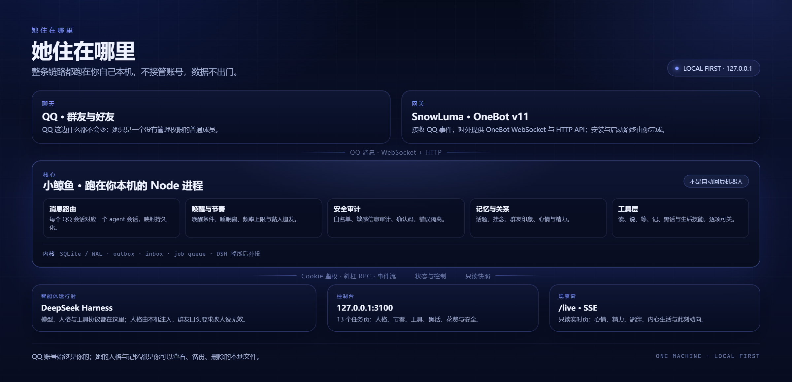
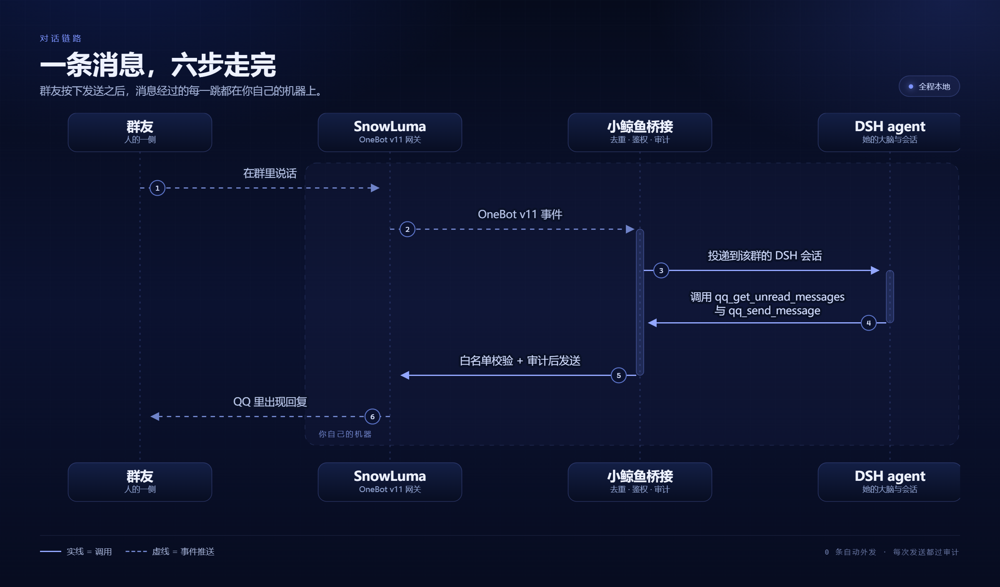

# 架构与设计取舍（ARCHITECTURE）

> 想知道小鲸鱼内部怎么分工、为什么这样拆、上下文怎么花，看这份。
> 部署看 [README](../README.md)，目录细节看 [FOLDER_MAP.md](FOLDER_MAP.md)。

  
   
  她住在哪里：整条链路都在你自己的机器上

## 两种角色

整条链路只有两种角色，分工很清楚。

**接线层**是她和外界之间的常驻前台。它很轻，尽量用确定性代码工作：收下 QQ 事件，做白名单与唤醒准入，把短时间内的消息合并成一次，维护会话映射、记忆与作息，并统一负责对外发送。它不做重推理——大多数消息根本不值得叫醒模型。

**思考层**是真正会思考、会调工具的部分。每次被唤醒，它在一个隔离的上下文里读消息、查记忆、决定说什么或做什么；它不直接对群说话，结果都回到接线层，由同一个出口发出去。

所以：**会话是内部实现，不是你要管理的东西。** 你面对的是「一个群里的她」，不是一堆需要整理的会话列表。这样分工有三个原因：

- 大多数消息不值得唤醒模型——规则先挡掉，成本花在真正需要判断的地方；
- 所有对外的话都走同一个出口，不会几个会话各说各话、重复回复；
- 每个群、每个私聊的上下文彼此隔离，一个群的玩笑不会漏到另一个群。

一次对话大致是这样走完的：

  
   
  六跳走完一次对话：实线是调用，虚线是事件推送，发出前必过白名单与审计

## 设计取舍

| 议题 | 我们的选择 | 为什么 |
| --- | --- | --- |
| 会话 | 每个 QQ 群 / 私聊固定一条执行会话；同一会话串行，不并发回复 | 顺序可预期，避免两句话抢同一个群；不同会话各排各的队 |
| 路由 | 规则先筛，语义后判；命中唤醒条件才进入模型 | 大部分消息不需要推理，规则快且不花钱 |
| 并发 | 同会话串行 + 8 秒合并窗口；繁忙时把唤醒原因排队 | 一批消息一次 prompt，比逐条唤醒省 token，也更像人在看聊天 |
| 上下文 | 索引常驻、全文按需；长内容只留摘要与引用 | 窗口是预算，不是仓库 |
| 部署 | 全部本机：QQ ↔ SnowLuma ↔ 桥接 ↔ DSH 都在 `127.0.0.1` | 数据不出门，故障边界清楚 |
| 失败恢复 | 外部重启 + 持久队列重放 + 会话重建 | 长期运行时，进程退出和 DSH 重启是常态，不是例外 |

几个实现细节：

- **每 QQ 会话 = 一个 DSH 会话**，统一归组到「QQ 聊天」工作区，映射持久化在 `state/sessions.json`；
- **三个 MCP server 都只给安全子集**：`snowluma`（QQ 动作）、`snowluma-host`（只读探活）、
  `web-search-safe`（带 SSRF 防护的搜索 / 抓取）；
- **鉴权不碰进程内存**：用 `~/.dsh` 里持久化的签名密钥离线铸造会话 Cookie，
  不依赖 DSH 启动 token（DSH 0.1.7 起它只在内存里）；
- **人格与记忆是本地文件**：她是谁写在 `personas/`，她记得什么写在 `state/`，都可以备份、迁移、删除。

## 上下文也是预算

唤醒模型时，不是把整个群的历史和全部家当塞进去。上下文按「常驻索引 + 按需取全文」组织：

- 人格内核、工具协议、当前触发这几段每次都在，因为它们决定「她是谁、能做什么、这次为什么醒来」；
- 表情和图片只给 id、名称与一句备注，完整资源由工具按需取；
- 记忆先按相关度给一小段摘要，需要细节再查；
- 长手册只注入当前最相关的 1–2 篇；
- 未读消息是一次快照；如果没读完，快照会标记未完成，她按位点接着读，而不是重发整段；
- 达到阈值先压缩；仍超限时归档旧内容，并生成一段衔接摘要带进下一次会话——这是设计上的兜底路径，
  不是每一轮都会发生。

原则只有一句：**窗口是预算，不是仓库。** 她记得的东西可以很多，但每次只取这次用得到的部分。

## 相关文档

- [FOLDER_MAP.md](FOLDER_MAP.md)：目录职责与命名约定
- [guides/SECURITY_BASELINE.md](guides/SECURITY_BASELINE.md)：威胁模型与安全边界
- [guides/RELIABILITY.md](guides/RELIABILITY.md)：SQLite/WAL、outbox、重试与诊断
- [guides/DSH_ADAPTATION.md](guides/DSH_ADAPTATION.md)：DSH 版本适配记录
