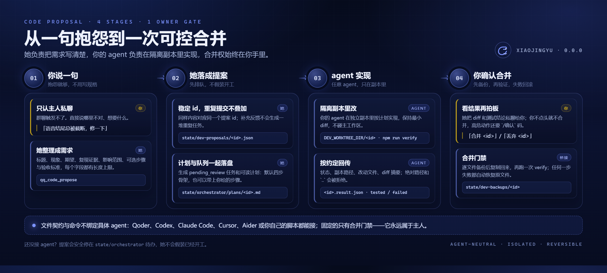

# 代码提案闭环（CODE_PROPOSAL）

> 在私聊里说一句「修一下」，她怎么把它变成一次可回滚的合并。
> 快速了解看 [README 的能力地图](../../README.md#能力地图)，这里是完整流程与接入细节。

她不会自己写代码。但她能把一句「不好用」整理成一份可执行的开发任务，交给**你自己的
coding agent**，并盯完「实现 → 测试 → 你确认 → 合并 → 失败回滚」整条链路。
仓库自带的是 Qoder 唤醒适配，但这不是硬依赖：Codex、Claude Code、Cursor、Aider，
或你自己写的脚本，只要能读写文件、执行命令，就能接进来。


<p align="center"><sub>四段闭环：你说需求 → 她落成提案 → agent 在隔离副本实现 → 你确认合并</sub></p>

## 原理：一句话怎么变成一次可回滚的合并

1. **你说需求。** 只在主人私聊生效。群聊成员、其他好友都无法触发代码提案。
   「语音结尾总被截断，修一下」「加一个每周一群摘要」都可以，不需要先写规格。
2. **她整理成结构化提案。** 她调用 `qq_code_propose`，把自然语言拆成标题、现状、期望、
   复现证据、影响范围、可选步骤和验收标准。字段有硬上限（标题 60 字、现状 / 期望各 800 字、
   证据 1200 字、范围 300 字、步骤最多 8 条），避免一句情绪化描述变成不可执行的大任务。
3. **提案与计划同时落盘。** 桥接按内容哈希生成稳定 id，同样内容重复提交只会幂等更新；
   提案写入 `state/dev-proposals/<id>.json`，任务写入 `state/orchestrator/tasks/<id>.json`，
   可读计划写入 `state/orchestrator/plans/<id>.md`。计划默认是「定位改动 → 最小实现 →
   跑 verify → 回传结果」四步，你给了步骤就用你的。
4. **队列交给开发 agent。** 任务初始状态是 `pending_review`，不会自动变成「已开工」。
   默认唤醒入口是 `state/orchestrator/controller.json`，由 `controller-cli.js` 驱动 Qoder CLI；
   换成别的 agent 时，队列、计划、合并门禁都保持不变，只替换「谁来接活」。
5. **agent 在隔离副本里实现。** 副本路径由 `DEV_WORKTREE_DIR/<id>` 指定（建议显式设置，否则会落到
   代码内的默认目录）；约定复制主工作区时排除 `node_modules/`、`state/`、`audio/` 和秘密配置。
   改动只在副本里，不能碰主工作区。
6. **回传结果。** agent 在副本里跑 `npm run verify`，然后把状态、副本路径、改动文件、
   diff 摘要写进 `state/dev-proposals/<id>.result.json`。桥接只接受仓库相对路径，
   绝对路径、盘符和 `..` 都会被拒绝；`tested` 必须列出至少一个改动文件。
7. **你确认后才合并。** 她把 diff 和测试结论私聊给你，你回「合并 `<id>`」；高危动作还要
   在私聊回 `/确认 <6 位码>`。桥接逐文件备份到 `state/dev-backups/<id>`，复制改动后再跑一次
   `npm run verify`，失败自动恢复原文件。不满意就回「丢弃 `<id>`」，隔离副本会被删除，
   主工作区从头到尾没有被动过。

她只负责**记录、排队、转达结果**：不创建开发会话、不写业务代码、不合并。
没有接 agent 时，提案会安全停在 `state/orchestrator/` 待办里，她不会假装已经开工。

## 可实现的效果

| 你说 | 通常会得到 |
| --- | --- |
| 「语音结尾总被截断，修一下」 | 定位 TTS 截断位置，改实现并补回归测试；合并前你能看到 diff 和 verify 结果 |
| 「加一个每周一早上的群摘要」 | 新增定时任务、摘要生成和发送边界；默认仍受白名单、频率与夜间静默约束 |
| 「提醒功能不好用，改成能改时间」 | 调整提醒指令解析与存储，补一组边界用例；不改变其他已启用功能 |
| 「控制台这个页面太挤了」 | 改 `web/deck.html` 的布局与样式，跑控制台 UI 测试后回传 diff 与测试结果 |
| 「把这段重复逻辑收一下」 | 小范围重构，保持行为不变；改动越大，越应该拆成多个提案 |

一条提案通常会在私聊里出现三次：

```text
【代码提案】语音结尾截断
症状：语音最后半句被吞掉
期望：整句完整播放
计划已生成（code_20261031_ab12cd34，4 步），已交主控……
计划：state/orchestrator/plans/code_20261031_ab12cd34.md
没收到回音的话，在主控会话里说「处理 code_20261031_ab12cd34」；
完成后把 diff 和测试结论回你，合并前仍需你确认。
```

```text
【代码提案完成】code_20261031_ab12cd34
测试通过，改动 3 个文件。
3 files changed, 42 insertions(+), 7 deletions(-)
回「合并 code_20261031_ab12cd34」我会二次确认后合并；回「丢弃 …」放弃。
```

```text
代码功能「code_20261031_ab12cd34」已合并并通过 verify。
```

## 它不是什么

- 不是「说完立刻改代码」。从提案到合并取决于你的 agent 速度，通常是一次完整开发任务，
  不是一条聊天回复；
- 不负责部署和重启。合并只改文件，DSH / 桥接该重启还得按
  [MANUAL_DEPLOY.md](MANUAL_DEPLOY.md) 的步骤来；
- 不适合一次塞进跨模块大改。提案越大，隔离副本和 verify 越难给出可靠结论，拆小更安全；
- `verify` 全绿只代表现有测试通过，不代表功能一定符合你的预期。现状、期望和验收标准
  写得越具体，回传结果越可用；
- 合并是**逐文件覆盖**，不是 git merge。agent 顺手格式化无关文件会让 diff 变脏，
  也可能覆盖你主工作区里同文件的未提交改动——合并前请先确认工作区状态。

## 接入你自己的 coding agent

**唯一的契约是「文件 + 命令」，不是某个厂商的 SDK。** 仓库自带的 `controller-cli.js`
目前适配 Qoder CLI（用 `--resume --fork-session` 唤醒一个短回合），但它只负责「叫醒谁」；
提案、计划、结果、合并门禁都不依赖 Qoder。换成 Codex、Claude Code、Cursor、Aider
或你自己的轮询脚本，链路照常工作。

| 契约 | 作用 |
| --- | --- |
| `state/orchestrator/tasks/<id>.json` | 队列任务；`pending_review` 表示等你或主控派单 |
| `state/orchestrator/plans/<id>.md` | 人可读的实现计划、验收标准与边界 |
| `state/dev-proposals/<id>.json` | 原始提案（标题、现状、期望、证据、范围） |
| `state/dev-proposals/<id>.result.json` | agent 回传：`tested` / `failed`、副本路径、改动文件、diff 摘要 |
| `DEV_WORKTREE_DIR/<id>` | 隔离副本；默认在仓库外，复制时排除依赖、状态、音频和秘密配置 |
| `npm run verify` | 唯一测试门禁；agent 在副本里跑，合并时桥接再跑一次 |

**你的 agent 至少要会四件事：**

1. 读取 `plans/<id>.md` 和 `tasks/<id>.json`，理解需求、步骤、验收与边界；
2. 在隔离副本里改代码，不碰主工作区，不提交、不 push、不部署；
3. 在副本里跑 `npm run verify`，把失败日志一起带回；
4. 按约定写 `result.json`，然后停下等主人确认。

**三种接法，按你现有的工具选：**

| 接法 | 怎么做 | 适合谁 |
| --- | --- | --- |
| **自动唤醒（仓库自带）** | 配 `state/orchestrator/controller.json`（会话 / 工作区 / CLI 路径），由 `controller-cli.js` 唤醒 Qoder CLI 复核队列；`allowExecute: true` 时同一回合直接在副本里实现 | 已经在用 Qoder Desktop / CLI 的人 |
| **自己的 agent 监听队列** | 让 Codex、Claude Code、Cursor、Aider 或自写脚本轮询 `tasks/` 里的 `pending_review`，或监听 `plans/` 新文件；实现后写 `result.json` | 已有固定 coding agent，想接进 QQ 的人 |
| **半自动** | 不接 controller：你把 `plans/<id>.md` 手动交给任意 agent，agent 写 `result.json`；桥接仍会私聊通知、校验结果并执行合并门禁 | 偶尔改一次、不想常驻开发进程的人 |

> 内置唤醒读取 `controller.json` 的 `sessionId` / `configDir` / `cwd` / `cliScript` /
> `permissionMode` / `allowExecute`，前提是已经有一个可恢复的 Qoder 会话。默认 `allowExecute`
> 为 false，只复核计划、不写代码；要让它同一回合直接实现，显式设为 true（仍然只在副本里改、
> 不合并）。没有 Qoder 会话时不用硬配：直接用第二种或第三种接法，合并门禁和结果通知完全一样。

最小回传示例（路径按你的实际副本填）：

```json
{
  "status": "tested",
  "worktree": "D:/dev-worktrees/code_20261031_ab12cd34",
  "changed": ["runtime/voice/tts.js", "tests/tts.test.mjs"],
  "diffStat": "2 files changed, 18 insertions(+), 4 deletions(-)",
  "logPath": "state/dev-logs/code_20261031_ab12cd34.log",
  "error": ""
}
```

**边界与常见坑：**

- `changed` 必须是仓库内相对路径；绝对路径、盘符和 `..` 会被直接拒绝；
- 隔离副本由 agent 自己创建：桥接只校验 `result.json` 里的相对路径，不检查副本是否真的隔离；
  请让 agent 在副本里工作，不要直接改主工作区；
- `status` 只接受 `tested` / `failed`；`tested` 必须至少列一个改动文件；
- 合并门禁固定跑 `npm run verify`。如果你的项目改了测试命令，要同时改合并侧，
  否则 agent 说「测试通过」也不会被采信；
- 只有 `simulation` 模式、主人私聊、`confirm=true` 才能合并；群聊和普通好友没有入口；
- 唤醒被 `login` / `quota` / SDK 环境挡住时，事件继续排队，不会每个提案都白跑一轮；
  修好后在控制台或主控会话手动触发即可；
- 备份目录 `state/dev-backups/<id>` 是失败回滚用的，不要在合并前后手动清理。
