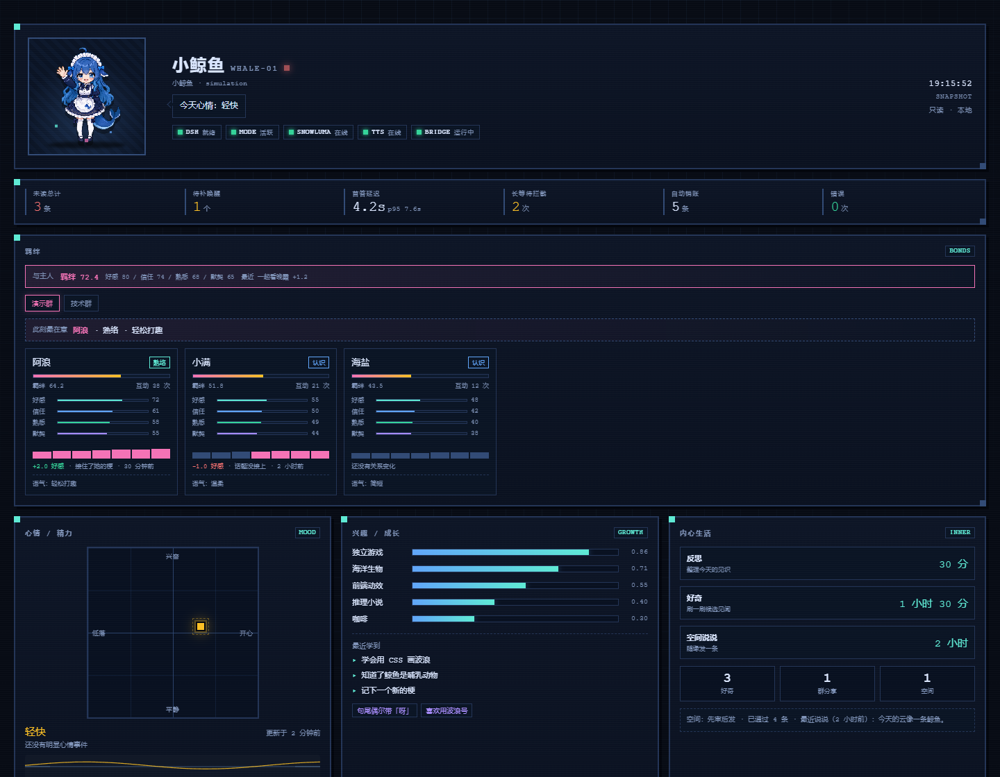
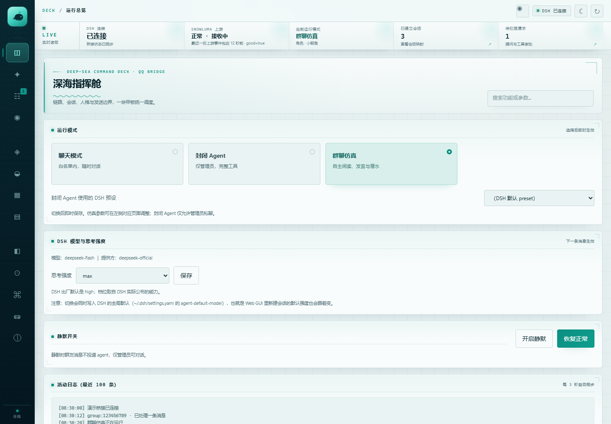

# 状态页与控制台（CONSOLE）

> `/live` 用来看，控制台用来管。两者都只监听本机，默认都要令牌。
> [← 返回 README](../../README.md)

## 实时状态页 `/live`

  
   
  只读实时状态页（离线演示数据），不含真实账号

`/live` 是给「想一直看着她在干什么」的人准备的只读页面。它通过 SSE 自动刷新，
不需要手动点刷新，也不提供任何会改变状态的操作：

- **小鲸鱼本体**：像素立绘会随心情切换（wave / idle / excited / tired / pout），旁边是当前心情气泡；
- **羁绊**：与主人、群友的关系温度与最近互动；
- **心情 / 精力**：二维心情罗盘、7 天心情曲线、精力条与本次情绪的来源；
- **兴趣 / 成长**：长期兴趣权重、最近学到的东西、口癖与小习惯；
- **内心生活**：接下来想做的事、pending thoughts 与今日计数；
- **她在读**：出门见闻读过/正在读的书与字幕进度（章节或已读字数、进度条、最后阅读时间、今日见闻与字数）；没有进度时整卡隐藏；
- **动向**：当前在潜水、活跃、等待还是被唤醒，以及原因；
- **会话与活动**：每个群 / 私聊的阶段、未读、最近事件流；
- **服务健康**：桥接、DSH、SnowLuma 上游的实时状态；
- **累计用量**：token 与花费摘要；
- **长期记忆与资源库**：记忆条数、表情 / 图片 / 语音库规模。

页面使用独立访问令牌，默认只监听 `127.0.0.1`；SSE 断线会自动重连。适合放在副屏、
直播叠加层或另一台同局域网的设备上查看。

## 本地控制台

  
   
  运行总览 · 浅色主题（离线演示数据；深色主题见 <a href="../../assets/screenshots/console-dark.png">console-dark.png</a>）

控制台默认在 `http://127.0.0.1:3100`，需要令牌（未配置时自动生成到 `state/console-token`）。
13 个页面各自负责一类任务：

| 页面 | 可以做什么 |
| --- | --- |
| **运行总览** | DSH / SnowLuma 双健康卡片、当前模式与角色、待处理提问与审批、静默开关、DSH 思考强度、最近 100 条活动。 |
| **功能总览** | 按人格、媒体、内心生活、生活技能与运行方式列出当前能力；显示当前群、会话数与边界。 |
| **会话与审批** | QQ ↔ DSH 会话映射、每个会话的阶段与未读、等待主人回复的提问和工具审批。 |
| **人格与角色** | 角色卡增删改查、两层提示词分别查看 / 编辑 / 还原、注入上限、仿真提示词同步状态。 |
| **群聊剧场** | 35 个工具开关、唤醒推荐值与硬限制、初始提示词、群画像、记忆与状态查看器、工具调用日志、反馈、语音与贴纸参数。 |
| **群聊洞察** | 群友关系表（内部数值可编辑）、群日报预览、活跃成员与群画像。 |
| **资源库** | QQ 收藏表情与图片库的名称、描述、备注、标签；支持筛选与查看。 |
| **黑话词库** | 候选 / 已确认 / 已排除三栏；确认弹窗填写含义、用法、例句、风险与来源；抽取阈值与注入量。 |
| **令牌与花费** | 总花费、累计 token、缓存命中率、平均每轮；按会话与逐轮下钻；24 小时 / 3 天 / 7 天 / 30 天走势。 |
| **访问与安全** | 白名单 / 黑名单、管理员 QQ、控制台令牌、`state/` ACL 告警与一键重新检测。 |
| **调试与运维** | 测试消息、通知 AI、维护桥接进程、会话工作区、清理与诊断入口。 |
| **可靠性与配置** | outbox / jobs / inbox 队列状态、失败重试、按 schema 直接编辑配置。 |
| **工具参考** | 提供给 DSH 的 MCP 工具清单、参数与用途，按命名空间分组。 |

界面细节：

- **浅色 / 深色双主题**：首次跟随系统偏好，手动切换后记住选择；
- **响应式**：桌面侧栏、平板与手机自动改为顶部横向导航，表格横向滚动，不产生页面级横向溢出；
- **草稿保护**：切换页面或 3 秒轮询刷新不会丢掉未保存的表单内容；
- **跨页搜索**：输入功能名或参数名，直接跳到对应页面与控件；
- **无障碍**：键盘焦点环、跳到主要内容、`prefers-reduced-motion` 下关闭装饰动画；
- **完全离线**：不引用外部字体、CDN 或统计脚本；`npm run preview:console` 可在不连接 DSH / QQ
  的情况下用虚构数据浏览全部页面。

控制台的离线预览与回归方法见 [CONSOLE-UI-TESTING.md](CONSOLE-UI-TESTING.md)；
花费口径见 [TOKEN_USAGE_CONSOLE.md](TOKEN_USAGE_CONSOLE.md)。
